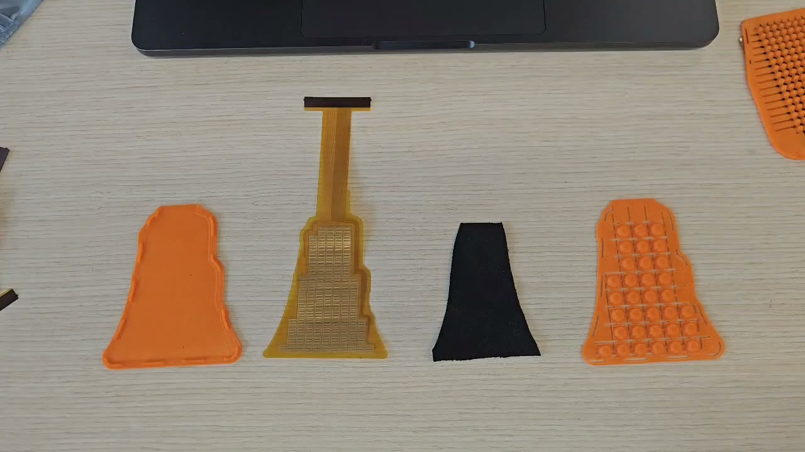
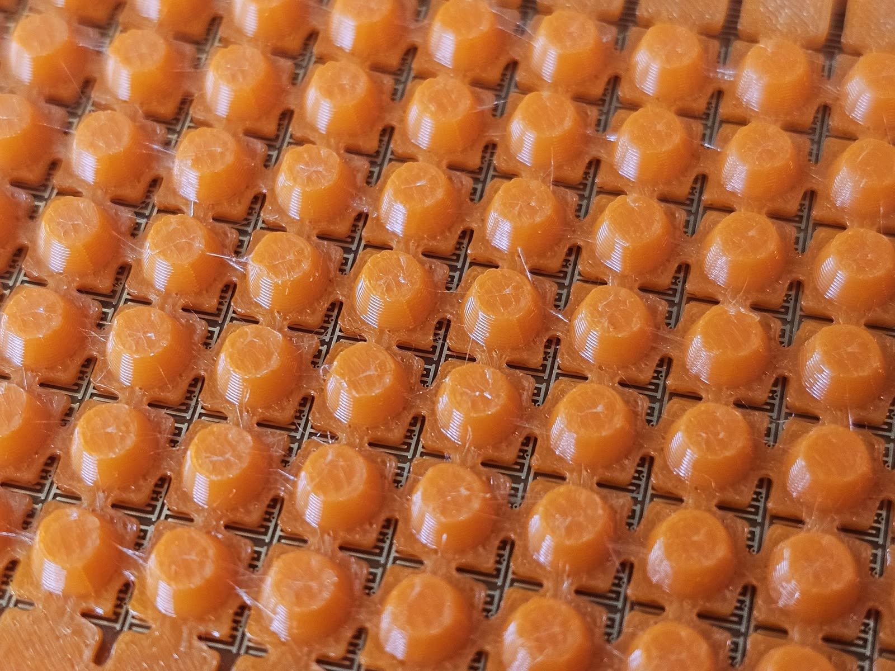

# Build a sensor

A sensor is four layers and a cable: a printed tray, the flex PCB, a piezoresistive sheet, and a printed lid (flat, hatched, or with shear bumps), with the flex tail plugged into a readout board. OpenTac-CAD generates the tray, the lid and the piezoresistive cut from the same design as the flex PCB, so the parts fit each other without measuring.

<figure class="ot-fig ot-fig--clear" markdown="span" style="max-width: 34rem">
  { loading=lazy width="1280" height="720" }
  <figcaption>The four layers of one sensor, from left: printed tray, flex PCB, piezoresistive textile, bump sheet (the lid).</figcaption>
</figure>

The [assembly guide](assembly.md) covers the whole build on one page, with photos and a video: the paper fit check, printing the case, cutting the piezoresistive layer, assembly, and plugging the sensor in to see live readings. The other pages in this section cover ordering, materials and the [readout boards](../hardware.md).

[Assembly guide](assembly.md){ .md-button .md-button--primary }

## The printed case { #the-printed-case }

OpenTac-CAD generates the case from the same design as the flex PCB: a bottom tray whose pocket is the board's outline, and a lid with one bump over each 2&times;2 group of taxels (the bump sheet). Because both come from one design, each bump lands over its group when the lid is pressed on, with no jig and nothing to line up by hand.

That alignment is what makes the shear reading accurate. A sideways push tilts a bump and shifts its load toward two of its four taxels, and the sensor reads shear from that imbalance ([How it works](../learn/index.md#2-how-do-four-taxels-under-one-bump-separate-normal-load-from-shear)); a bump that sat off-centre would split even a straight press unequally and report shear that is not there.

<figure class="ot-fig ot-fig--clear" markdown="span">
  { loading=lazy }
  <figcaption>The bumped lid on its board. The cross-shaped base of each bump seats in the gaps between taxels, which centres the bump over its 2&times;2 group.</figcaption>
</figure>

**Download ZIP** in OpenTac-CAD puts the case in the ZIP's `case/` folder: the bottom, the bumped lid as the primary one, the flat and hatched lids, and a README with the settings used ([What the export contains](../design/export.md)). The case panel in OpenTac-CAD (**Add a printed case**) previews the parts and changes their settings. The ZIPs of the [ready-to-order designs](../design/examples.md) include it too. Printing and fitting are in the assembly guide: [Print the case](assembly.md#print-the-case) and [Assemble](assembly.md#assemble).

## Steps

| | Step | Time | Page |
|---|---|---|---|
| 1 | Design the sensor and download the ZIP: board files and the printed case | minutes | [Design](../design/index.md), [What the export contains](../design/export.md) |
| 2 | Print the 1:1 PDF and check the fit on the part | 10 min | [Assembly](assembly.md#check-the-fit-on-paper) |
| 3 | Order the flex PCB | days to weeks, shipping | [Order the sensor](order-sensor.md) |
| 4 | Order a readout board, if you don't have one | days to weeks, shipping | [Order the readout board](order-readout.md); files in the repository's [`hardware/`](https://github.com/opentac/opentac/tree/main/hardware) folder |
| 5 | Get the piezoresistive layer, TPU and tape | | [Materials and accessories](materials.md) |
| 6 | Print the case from the ZIP's `case/` folder: the tray and the bumped lid, in TPU | a few hours | [The printed case](#the-printed-case), [Assembly](assembly.md#print-the-case) |
| 7 | Cut the piezoresistive layer | 10 min | [Assembly](assembly.md#cut-the-piezoresistive-layer) |
| 8 | Assemble and plug in | 5 min | [Assembly](assembly.md#assemble) |
| 9 | Flash the readout board and read the sensor | 10 min | [Assembly](assembly.md#read-the-sensor), [Flash](../use/flash.md) |

Steps 3 and 4 are the long ones. Order both at once, and print the case while you wait.
