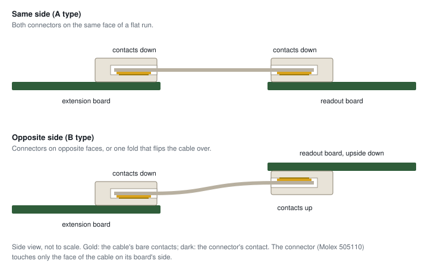

# Materials and accessories

In addition to the flex PCB and readout board, assembly requires a piezoresistive layer and a compliant printed case. An FFC extension is needed only when the readout board cannot be mounted close enough to accept the sensor tail directly.

!!! info "As of October 2026"
    The links below were checked in October 2026. For substitutes, match the relevant material properties, connector dimensions and contact arrangement.

## Piezoresistive layer

The piezoresistive layer converts local pressure into a resistance change between the taxel electrodes. Material choice therefore affects the response and saturation range. In the paper's load-cell measurements at 2.0&nbsp;mm pitch and 1&nbsp;k&Omega; feedback resistance, LINQSTAT did not saturate through 60&nbsp;N, whereas Chibitronics Velostat saturated earlier ([Results](../results.md#material-and-spatial-response)). These measurements apply to the tested stack and readout settings.

| Material | What it is | Notes | Where |
|---|---|---|---|
| **LINQSTAT** | Velostat-like carbon-loaded polyethylene film | did not saturate through 60&nbsp;N in the paper's tests, read at 1&nbsp;k&Omega; feedback; used for the transfer experiments | [LINQSTAT films at Krayden](https://www.krayden.com/s/conductive-plastic-films) |
| **Yunjia textile** | piezoresistive conductive fabric, 0.15&nbsp;mm | one of the three materials in the paper's comparison; used in the build-guide sensor | [Faraday Fiber (Yunjia Textile)](https://faradayfiber.com/en-us/products/pressure-sensor-piezoresistive-fabric) |
| **Chibitronics Velostat** | pressure-sensitive conductive plastic sheet | saturated early in the paper's tests | [Chibitronics shop](https://shop.chibitronics.com/products/conductive-plastic-sheets-velostat-linqstat) |

Cut the layer using the fold template or DXF supplied in the export ([Cut the piezoresistive layer](assembly.md#cut-the-piezoresistive-layer)). One sheet covers many sensors.

## Printed parts

- **TPU filament, Shore 85&ndash;95A**, for the case and the bump sheet. The bumps must deform under tangential load to produce the differential taxel response used for shear estimation. Use a TPU formulation compatible with your printer.
- **Foam**, optional, as a compliant backing between the case and a rigid mount.
- **Double-sided tape**, thin, to hold the flex PCB in the tray.

<figure class="ot-fig ot-fig--clear" markdown="span" style="max-width: 18rem">
  { loading=lazy width="750" height="1000" }
  <figcaption>A case printed in TPU: the lid with bumps (left) and the tray.</figcaption>
</figure>

## Cables and extension boards

The sensor's tail plugs straight into the readout board. When the board has to sit further away, put an extension board and a flat flexible cable (FFC) in between: *sensor tail &rarr; extension board &rarr; cable &rarr; readout board*. Everything is 0.5&nbsp;mm pitch; use 60-pin parts with the 60-pin readout board and 30-pin parts with the 30-pin one. These are the parts we use:

| | 60-pin readout board | 30-pin readout board |
|---|---|---|
| Extension board | [uxcell 60-to-60 pin extension adapter](https://www.amazon.com/uxcell-Extension-Connector-Aapter-Extend/dp/B07SSG7JTG) | [MECCANIXITY 30-pin extension board, single side, pack of 4](https://www.amazon.com/MECCANIXITY-Extension-Extend-Connector-Printer/dp/B0CLH5VVMM) |
| Cable | [uxcell 60-pin FFC, 150&nbsp;mm, A type, 5 pieces](https://www.amazon.com/uxcell-Flexible-Ribbon-Player-Laptop/dp/B07S1BFNCF) | [uxcell 30-pin FFC, 250&nbsp;mm, A type, 20 pieces](https://www.amazon.com/uxcell-Flexible-Ribbon-Player-Laptop/dp/B0FXB5DV3Z) |

Both cables are **A type**: contacts on the same face at both ends, facing down into both connectors. Other lengths and sellers work if the pitch, the pin count and the contact type match.

**Contact type.** A flat cable has bare contacts at both ends, either on the same face (A type, "same side") or on opposite faces (B type, "opposite side"). The readout boards' connector (Molex 505110) touches only the bottom face of whatever is plugged into it, so at each end the contacts must face that connector:

- both connectors on the same face of a flat run: same side (A type);
- connectors on opposite faces, or one fold that flips the cable over: opposite side (B type);
- every 180&deg; fold flips which face is down, so count folds.

<figure class="ot-fig" markdown="span" style="max-width: 36rem">
  [{ loading=lazy }](../assets/diagrams/ffc_types.svg)
  <figcaption>FFC contact orientation: exposed contacts at each cable end must face the contacts inside the corresponding connector.</figcaption>
</figure>

**Verify the pin order** after adding an extension: press near one corner of the sensor and confirm that the response appears at the same corner in the viewer. A mirrored image means pin 1 arrives at the wrong end somewhere in the chain; check the cable type and which way round each end is inserted.

For other lengths from a distributor, Molex's [Premo-Flex 15018 jumpers](https://www.digikey.com/en/products/result?keywords=Premo-Flex%2015018%200.5mm) come in 51 to 305&nbsp;mm, same side ("Type A") or opposite side ("Type D").
