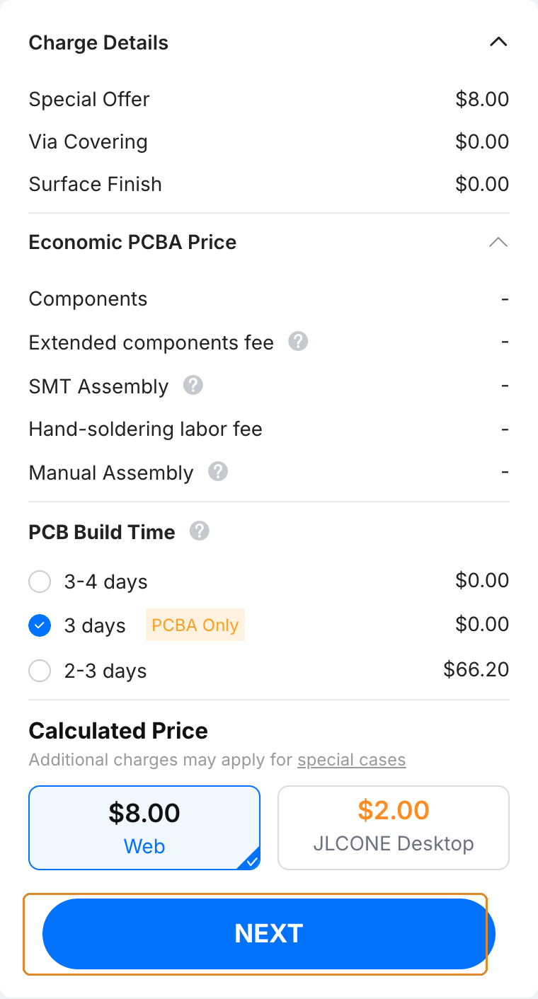

# Order the readout board

The readout boards are ordered assembled (PCBA): the board house makes the PCB and solders the parts. Each board's `production/` folder in the repository has the three files JLCPCB needs. Which board to order: [Readout boards](../hardware.md).

!!! info "As of October 2026"
    Option names, prices and file names below are from October 2026; the screenshots were taken on 16 October 2026, logged out, with the files in this repository. Check the [PCB assembly capabilities](https://jlcpcb.com/capabilities/pcb-assembly-capabilities) and [assembly price](https://jlcpcb.com/help/article/pcb-assembly-price) pages for current terms.

## The files

| Board | Folder | Gerber ZIP | BOM | Placement (CPL) |
|---|---|---|---|---|
| 60-pin | [`hardware/readout_60pin/production/`](https://github.com/opentac/opentac.github.io/tree/main/hardware/readout_60pin/production) | `stm-i2c-60-switch.zip` | `stm-i2c-60-switch_bom.csv` | `stm-i2c-60-switch_positions.csv` |
| 30-pin, top | [`hardware/readout_30pin/top/production/`](https://github.com/opentac/opentac.github.io/tree/main/hardware/readout_30pin/top/production) | `stm-i2c.zip` | `stm-i2c_bom.csv` | `stm-i2c_positions.csv` |
| 30-pin, bottom | [`hardware/readout_30pin/bottom/production/`](https://github.com/opentac/opentac.github.io/tree/main/hardware/readout_30pin/bottom/production) | `sensor_30.zip` | `sensor_30_bom.csv` | `sensor_30_positions.csv` |

<!-- CHECK: production file names after the assets port; update this table if they are renamed -->

The 30-pin version is two boards, so it is two PCBA orders (they can go in the same cart). Both orders include the 1.27&nbsp;mm headers that stack them.

The BOM lists every part with its LCSC number (the `LCSC Part #` column), which is how JLCPCB matches parts. The CPL gives each part's position, rotation and side.

## The order

### Gerbers

1. On jlcpcb.com, start a quote and **Add gerber file** with the board's Gerber ZIP. Layers and size are read from the files: the 60-pin board and the 30-pin top board are 4-layer, the 30-pin bottom board is 2-layer, all 1.6&nbsp;mm FR-4.
2. Leave the PCB options at their defaults unless you have a reason to change them.

<figure class="ot-fig" markdown="span">
  [{ loading=lazy }](../assets/photos/jlcpcb/readout-60pin-upload.png)
  <figcaption>The 60-pin board uploaded: 4 layers, 34.28 &times; 37&nbsp;mm. The 30-pin boards read as 22.79 &times; 16.01&nbsp;mm, 4 layers (top) and 22.7 &times; 16.01&nbsp;mm, 2 layers (bottom).</figcaption>
</figure>

### Assembly options

Turn on **PCB Assembly** with the switch on its bar, below the PCB options. Then:

- **PCBA Type.** The 60-pin board has parts on one side only, so **Economic** works (cheaper, quicker; 2&ndash;50 boards). Both 30-pin boards have parts on both sides: choose **Standard** and set **Assembly Side** to **Both Sides**.
- **Tooling holes:** leave the default, **Added by JLCPCB**. Don't pick "Added by Customer"; the boards have no tooling holes of their own. With Standard the row is called **Edge Rails/Fiducials**; leave it at **Added by JLCPCB** too. Standard assembly needs boards at least 70&nbsp;mm on a side, so JLCPCB adds edge rails to the 30-pin boards and prices them at about 70 &times; 71&nbsp;mm. The boards come on the rails unless you choose **Depanel boards & edge rail before delivery** under Advanced Options.
- **Parts Selection:** leave **By Customer (Self-Service)**, the free option. The steps below are for that option.

<figure class="ot-fig" markdown="span">
  [{ loading=lazy }](../assets/photos/jlcpcb/readout-60pin-assembly.png)
  <figcaption>The 60-pin board: Economic, top side, tooling holes added by JLCPCB.</figcaption>
</figure>

<figure class="ot-fig" markdown="span">
  [{ loading=lazy }](../assets/photos/jlcpcb/readout-30pin-assembly-standard.png)
  <figcaption>A 30-pin board (here the bottom one): Standard, both sides, edge rails added by JLCPCB. Economic is greyed out once both sides are selected.</figcaption>
</figure>

### BOM and placement

The assembly price appears only after the BOM and CPL are processed; until then the price panel shows the PCB alone.

<figure class="ot-fig" markdown="span" style="max-width: 18rem">
  [{ loading=lazy }](../assets/photos/jlcpcb/readout-60pin-next.png)
  <figcaption>The price panel before the BOM step (example quote, 16 October 2026, 5 boards); NEXT leads on.</figcaption>
</figure>

<!-- CHECK: screenshots of the BOM/CPL upload, the parts list and the placement preview need a signed-in JLCPCB account; add them here -->

1. Press **NEXT** in the price panel. JLCPCB asks you to sign in at this point. Then upload the **BOM** and the **CPL** file (the `_positions.csv`) and press **Process BOM & CPL**.
2. **Check every line.** Each BOM line should show a matched part. A line marked as having no part selected needs a part: search by the LCSC number from the BOM. For a resistor or capacitor out of stock, a part of the same value, rating and package is fine. For a chip or connector, don't substitute; wait for stock or ask on the repository's issue tracker.
3. **Check the placement preview.** Look at the chips (pin-1 marks), the USB connector, the sensor connector and the LED. If a part sits rotated or off its pads, note it in the order or choose **Confirm Parts Placement** (also a row in the assembly options above; an engineer checks placement before soldering; $0.45 in October 2026).
4. Add to cart.

## When the boards arrive

Plug the board into USB and [flash the firmware](../use/flash.md). A new board has no firmware, so the first flash needs the BOOT0 button held while plugging in; after that, the firmware can restart itself into the bootloader.
<!-- CHECK: first-flash procedure wording matches use/flash.md -->
