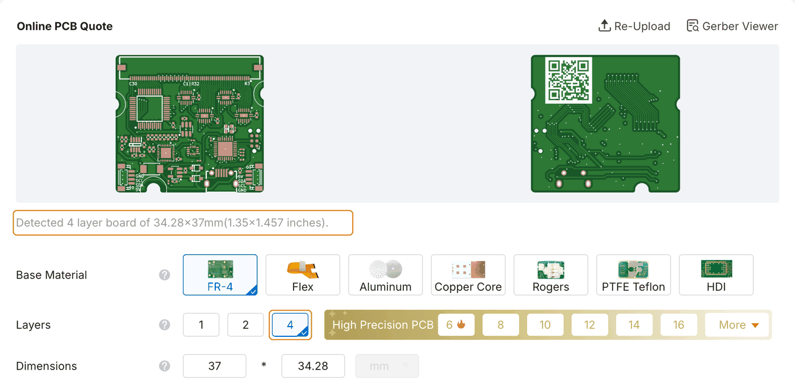
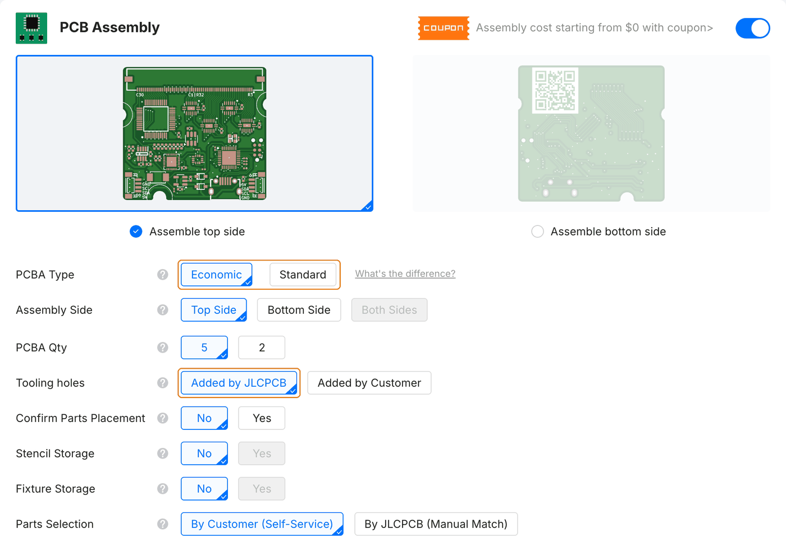
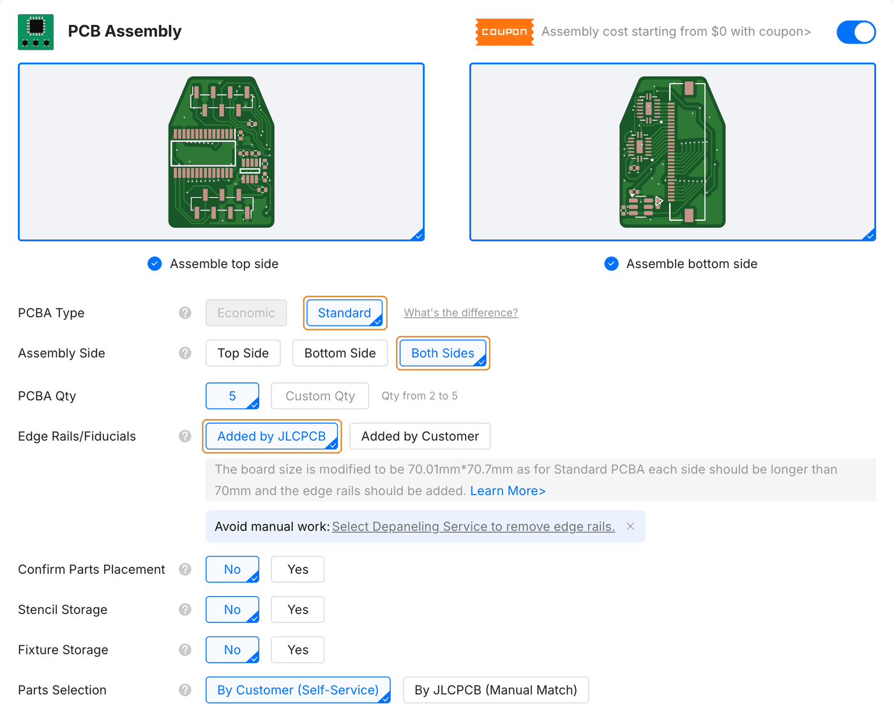
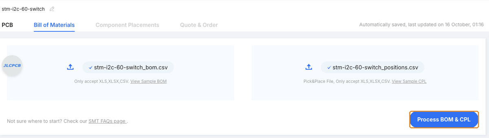
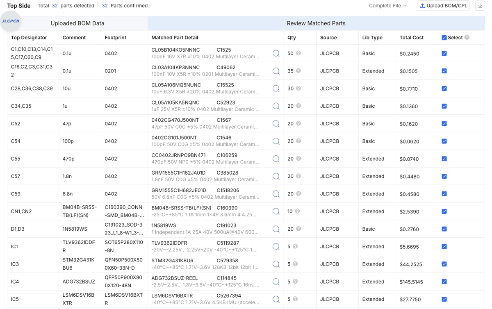
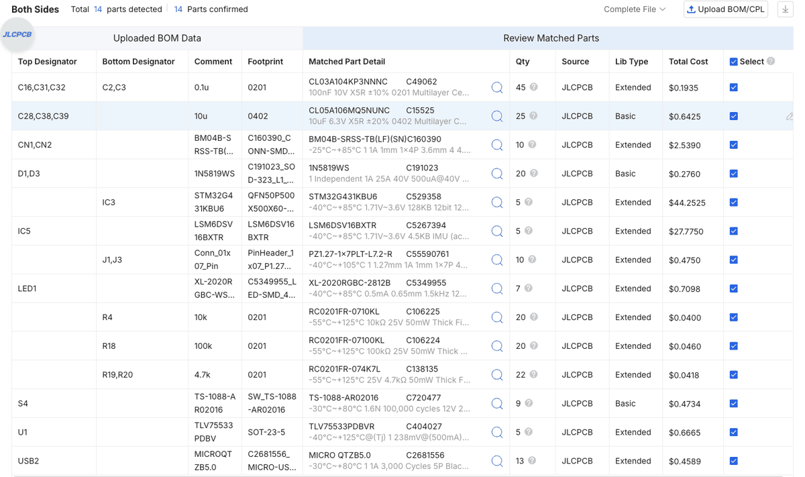
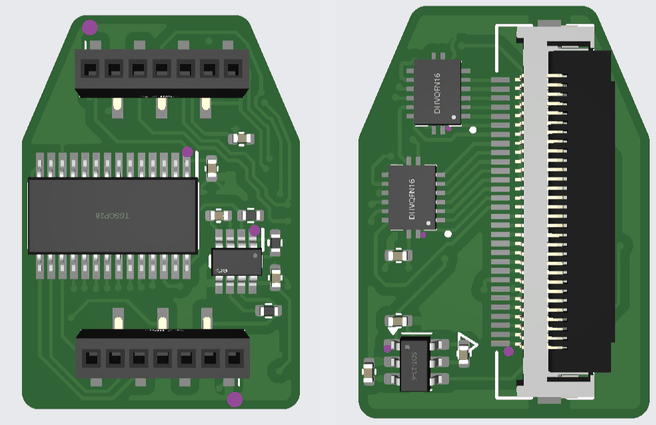

# Order the readout board

We order the readout boards with PCB assembly (PCBA): the manufacturer fabricates the board and mounts its components. Each board's `production/` directory in the [code repository](https://github.com/opentac/opentac/tree/main/hardware) contains the Gerber archive, bill of materials (BOM) and component-placement file (CPL) required for this process. Choose the appropriate hardware using [Readout boards](../hardware.md), then download the corresponding files below.

!!! info "As of October 2026"
    Option names, prices and file names below are from October 2026; the screenshots were taken on 16 October 2026 with the files in the [code repository](https://github.com/opentac/opentac/tree/main/hardware). Check the [PCB assembly capabilities](https://jlcpcb.com/capabilities/pcb-assembly-capabilities) and [assembly price](https://jlcpcb.com/help/article/pcb-assembly-price) pages for current terms.

## Fabrication and assembly files { #the-files }

| Board | Folder | Gerber ZIP | BOM | Placement (CPL) |
|---|---|---|---|---|
| 60-pin | [`hardware/readout_60pin/production/`](https://github.com/opentac/opentac/tree/main/hardware/readout_60pin/production) | [`stm-i2c-60-switch.zip`](https://github.com/opentac/opentac/raw/main/hardware/readout_60pin/production/stm-i2c-60-switch.zip) | [`stm-i2c-60-switch_bom.csv`](https://github.com/opentac/opentac/raw/main/hardware/readout_60pin/production/stm-i2c-60-switch_bom.csv) | [`stm-i2c-60-switch_positions.csv`](https://github.com/opentac/opentac/raw/main/hardware/readout_60pin/production/stm-i2c-60-switch_positions.csv) |
| 30-pin, top | [`hardware/readout_30pin/top/production/`](https://github.com/opentac/opentac/tree/main/hardware/readout_30pin/top/production) | [`stm-i2c.zip`](https://github.com/opentac/opentac/raw/main/hardware/readout_30pin/top/production/stm-i2c.zip) | [`stm-i2c_bom.csv`](https://github.com/opentac/opentac/raw/main/hardware/readout_30pin/top/production/stm-i2c_bom.csv) | [`stm-i2c_positions.csv`](https://github.com/opentac/opentac/raw/main/hardware/readout_30pin/top/production/stm-i2c_positions.csv) |
| 30-pin, bottom | [`hardware/readout_30pin/bottom/production/`](https://github.com/opentac/opentac/tree/main/hardware/readout_30pin/bottom/production) | [`sensor_30.zip`](https://github.com/opentac/opentac/raw/main/hardware/readout_30pin/bottom/production/sensor_30.zip) | [`sensor_30_bom.csv`](https://github.com/opentac/opentac/raw/main/hardware/readout_30pin/bottom/production/sensor_30_bom.csv) | [`sensor_30_positions.csv`](https://github.com/opentac/opentac/raw/main/hardware/readout_30pin/bottom/production/sensor_30_positions.csv) |

The 30-pin version is two boards, so it is two PCBA orders (they can go in the same cart). Both orders include the 1.27&nbsp;mm headers that stack them.

The BOM lists every part with its LCSC number (the `LCSC Part #` column), which is how JLCPCB matches parts. The CPL gives each part's position, rotation and side.

## Configure the assembly order { #the-order }

### Upload the Gerbers { #gerbers }

1. On jlcpcb.com, start a quote and **Add gerber file** with the board's Gerber ZIP. Layers and size are read from the files: the 60-pin board and the 30-pin top board are 4-layer, the 30-pin bottom board is 2-layer, all 1.6&nbsp;mm FR-4.
2. Leave the PCB options at their defaults unless you have a reason to change them.

<figure class="ot-fig" markdown="span">
  [{ loading=lazy }](../assets/photos/jlcpcb/readout-60pin-upload.png)
  <figcaption>The 60-pin board uploaded: 4 layers, 34.28 &times; 37&nbsp;mm. The 30-pin boards read as 22.79 &times; 16.01&nbsp;mm, 4 layers (top) and 22.7 &times; 16.01&nbsp;mm, 2 layers (bottom).</figcaption>
</figure>

### Assembly options

Turn on **PCB Assembly** with the switch on its bar, below the PCB options. Then:

- **PCBA Type: Standard, for all three boards.** The 60-pin board has parts on one side only, but several of them are 0201 passives, the IMU and the LED, which JLCPCB places only in Standard assembly. In Economic those lines are left unselected and the board comes back without them. Both 30-pin boards have parts on both sides, which needs Standard anyway: set **Assembly Side** to **Both Sides** for them; the 60-pin board stays on **Top Side**.
- **Edge Rails/Fiducials:** leave **Added by JLCPCB**. Standard assembly needs boards at least 70&nbsp;mm on a side, so JLCPCB adds edge rails and prices the 60-pin board at 71 &times; 70.28&nbsp;mm (the 30-pin boards at about 70 &times; 71&nbsp;mm). The boards come on the rails unless you choose the depaneling service JLCPCB offers under that row or under Advanced Options.
- **Parts Selection:** leave **By Customer (Self-Service)**, the free option. The steps below are for that option.

<figure class="ot-fig" markdown="span">
  [{ loading=lazy }](../assets/photos/jlcpcb/readout-60pin-assembly.png)
  <figcaption>The 60-pin board: Standard, top side, edge rails added by JLCPCB, parts chosen by you.</figcaption>
</figure>

<figure class="ot-fig" markdown="span">
  [{ loading=lazy }](../assets/photos/jlcpcb/readout-30pin-assembly-standard.png)
  <figcaption>A 30-pin board (here the bottom one): Standard, both sides. Economic is greyed out once both sides are selected.</figcaption>
</figure>

### BOM and placement

Press **NEXT** in the price panel. JLCPCB asks you to sign in here, then walks through four tabs: PCB, Bill of Materials, Component Placements, Quote & Order.

**1. PCB.** A render of the board and the assembly options you chose. Press **NEXT**.

**2. Bill of Materials.** Upload the **BOM** (`*_bom.csv`) and the **CPL** (`*_positions.csv`) from the board's `production/` folder, then press **Process BOM & CPL**.

<figure class="ot-fig" markdown="span">
  [{ loading=lazy }](../assets/photos/jlcpcb/readout-60pin-bom-upload.png)
  <figcaption>BOM and CPL attached for the 60-pin board.</figcaption>
</figure>

**3. Verify component selection.** Every BOM entry must be matched to an LCSC part and selected for assembly. The counts to expect: **32** parts on the 60-pin board, **14** on the 30-pin top board and **10** on the 30-pin bottom board, each shown as *parts detected* and *parts confirmed*. A line with no part selected needs one: search by the LCSC number from the BOM. If a resistor or capacitor is out of stock, a part with the same value, rating and package may be substituted. Do not substitute ICs or connectors; wait for stock or open an issue on the repository's issue tracker.

<figure class="ot-fig" markdown="span">
  [{ loading=lazy }](../assets/photos/jlcpcb/readout-60pin-bom-parts.png)
  <figcaption>Component selection for the 60-pin board: each BOM entry is matched to an LCSC part and selected for assembly.</figcaption>
</figure>

<figure class="ot-fig" markdown="span">
  [{ loading=lazy }](../assets/photos/jlcpcb/readout-30pin-top-bom-parts.png)
  <figcaption>A two-sided board (the 30-pin top board): the list has a column per side. The microcontroller and the 1.27&nbsp;mm stacking headers J1 and J3 are on the bottom.</figcaption>
</figure>

**4. Component Placements.** Look over the 3D preview of each side (**Top** / **Bottom** above the view): the chips' pin-1 dots against the board's marks, the connectors and the LED. If a part sits rotated or off its pads, correct it here, or set **Confirm Parts Placement** to Yes in the assembly options and an engineer checks placement before soldering.

<figure class="ot-fig" markdown="span">
  [{ loading=lazy }](../assets/photos/jlcpcb/readout-60pin-placement.png)
  <figcaption>The 60-pin board (parts on the top side only).</figcaption>
</figure>

<figure class="ot-fig" markdown="span">
  [{ loading=lazy }](../assets/photos/jlcpcb/readout-30pin-top-placement.png)
  <figcaption>The 30-pin top board, top side (left) and bottom side (right). JLCPCB's viewer has no 3D model for the stacking headers J1 and J3, so only their pads show; they are in the parts list above and are placed.</figcaption>
</figure>

<figure class="ot-fig" markdown="span">
  [{ loading=lazy }](../assets/photos/jlcpcb/readout-30pin-bottom-placement.png)
  <figcaption>The 30-pin bottom board, top side (left) and bottom side (right), with the sensor connector.</figcaption>
</figure>

**5. Quote & Order.** Review the itemised fabrication and assembly charges before selecting **SAVE TO CART**.

<figure class="ot-fig" markdown="span">
  [{ loading=lazy }](../assets/photos/jlcpcb/readout-60pin-quote.png)
  <figcaption>Example quote, 16 October 2026, five 60-pin boards: $378.26 before shipping. Components account for most of the total; the multiplexer and microcontroller together cost about $38 per board in this quote. Five of each 30-pin board came to $205.85 (top) and $165.98 (bottom); each is its own order, with a setup fee per side.</figcaption>
</figure>

## Flash the assembled boards { #when-the-boards-arrive }

Plug the board into USB and [flash the firmware](../use/flash.md). A new board has no firmware, so the first flash needs the BOOT0 button held while plugging in; after that, the firmware can restart itself into the bootloader.
