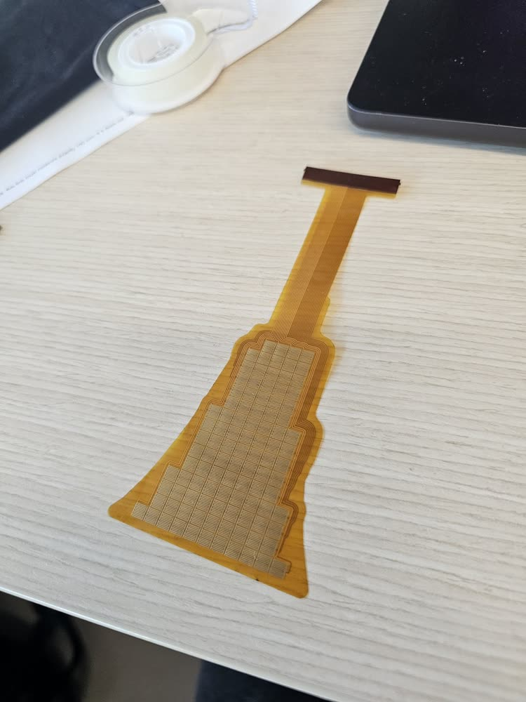
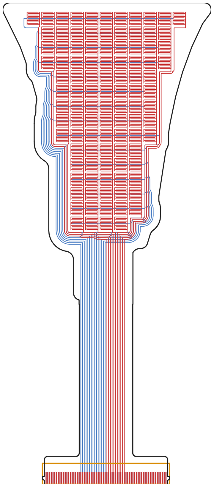
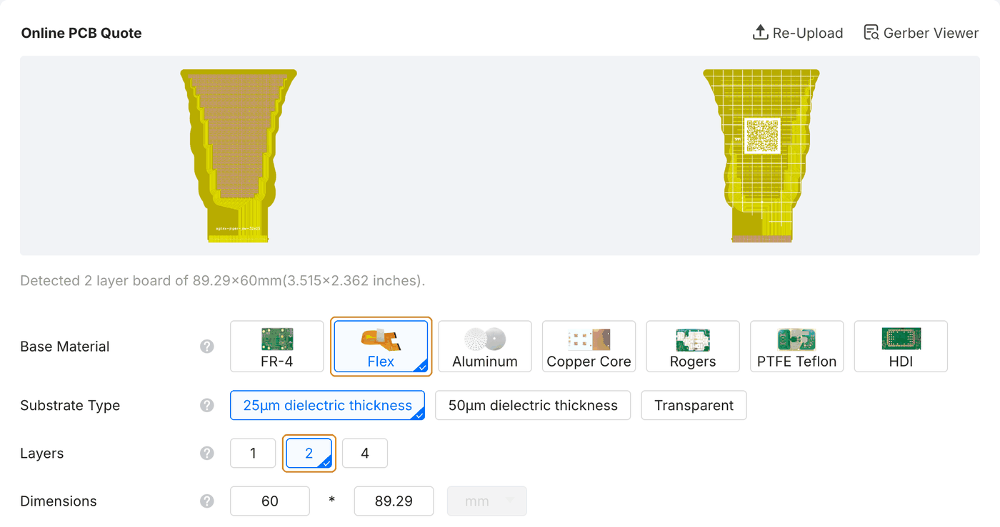
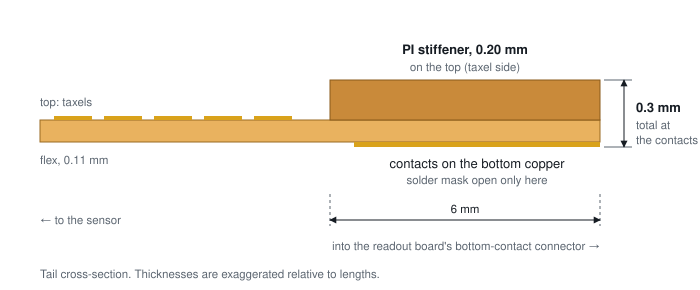
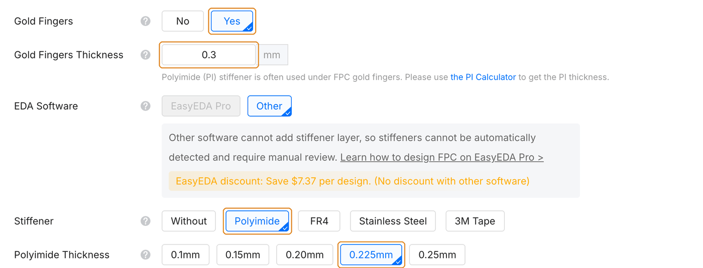
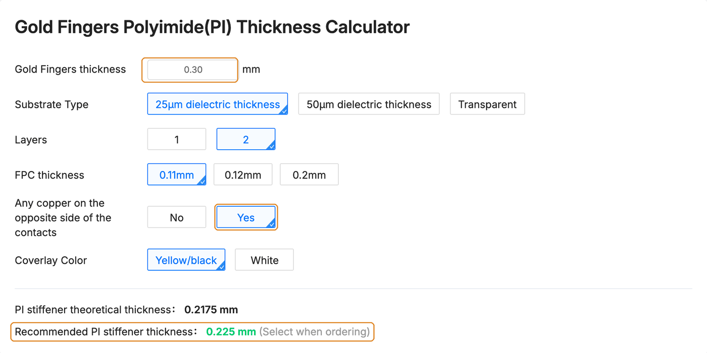
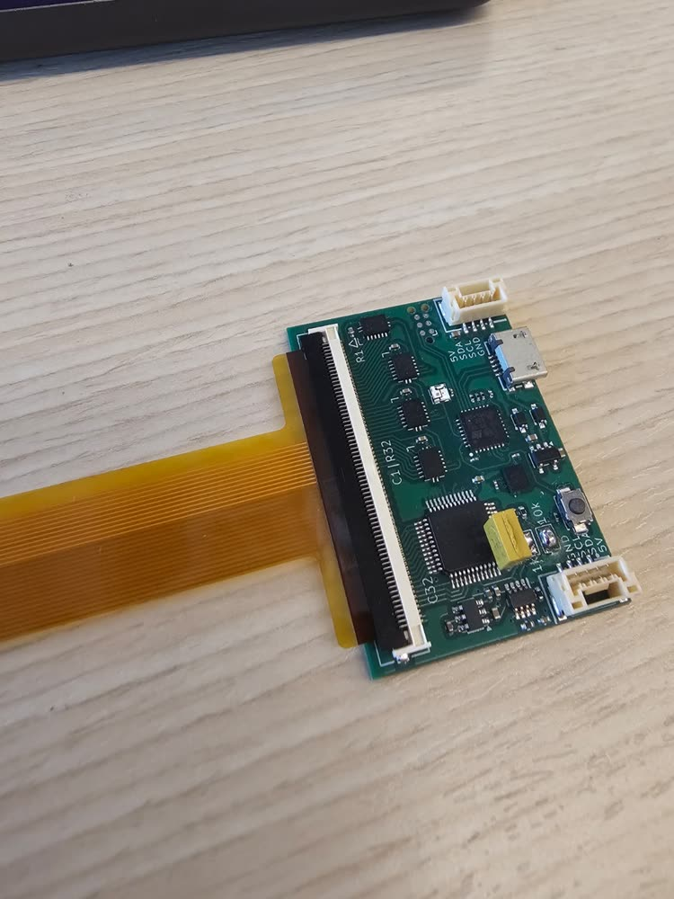

# Order the sensor (flex PCB)

The sensing electrodes and wiring are fabricated as a flexible PCB on a polyimide substrate, approximately 0.1&nbsp;mm thick. The generated Gerbers can be supplied to a manufacturer that supports flex-PCB fabrication. The procedure below uses [JLCPCB](https://jlcpcb.com/), which manufactured the sensors evaluated in the paper.

!!! info "As of October 2026"
    Option names, values and screenshots below are from JLCPCB's quote form and capability pages in October 2026; the screenshots were taken on 16 October 2026 with the dense AgileX Piper jaw (`agilex-piper-jaw-32x25`, 2 layers, 60-pin) from [Ready-to-order designs](../design/examples.md). Board houses change their forms; if something looks different, the [flex PCB capabilities page](https://jlcpcb.com/capabilities/flex-pcb-capabilities) is the reference.

## Prepare the fabrication files { #before-you-upload }

1. **Check the fit on paper first.** Print `printable_1to1.pdf` from the export at 100% and hold it against the part ([how](assembly.md#check-the-fit-on-paper)).
2. **Zip the `gerber/` folder** from the export on its own. That ZIP is what you upload.
3. **Look at the Gerbers** in a viewer (JLCPCB's own viewer after upload, or [KiCad's Gerber viewer](https://www.kicad.org/)). Check the outline, the tail, and the connector end with its stiffener outline.

<figure markdown="span">
  { loading=lazy }
  <figcaption>Fabricated flex PCB with a polyimide stiffener at the connector end.</figcaption>
</figure>
<figure markdown="span">
  { loading=lazy }
  <figcaption>Gerber layers: top copper in red, bottom copper in blue, board outline in black, and stiffener outline in amber.</figcaption>
</figure>

## Configure the PCB order { #the-order-form }

On jlcpcb.com, start a quote and **Add gerber file** with your ZIP. The board size and the number of layers are read from the files. Leave every option at JLC's default except these:

| Option | Choose | Why |
|---|---|---|
| Base Material | **Flex** | the sensor is a flex PCB |
| Layers | **2**, or **4** for a design made with 4 copper layers | must match the design; set from the files, so check it |
| Gold Fingers | **Yes** | the connector end of the tail |
| Gold Fingers Thickness | **0.3** mm | total thickness of the connector end; see [Stiffener](#stiffener) |
| Stiffener | **Polyimide** | selected by itself when Gold Fingers is Yes |
| Polyimide Thickness | **0.20mm** for a 2-layer sensor | what our sensors use; see below |
| PCB Remark | the remark below | the form has no option for the stiffener's side |

For the two-layer boards shown here, we retain the quoted defaults for substrate, board thickness (0.11&nbsp;mm), coverlay, surface finish and copper.

<figure class="ot-fig" markdown="span">
  [{ loading=lazy }](../assets/photos/jlcpcb/sensor-upload-flex.png)
  <figcaption>The ZIP uploaded: JLC renders both sides and reads 2 layers, 89.29 &times; 60&nbsp;mm. Base Material set to Flex; Layers as read from the files.</figcaption>
</figure>

### Stiffener { #stiffener }

The readout boards use a Molex 505110 ZIF connector: a bottom-contact connector that takes a flex end **0.30&nbsp;mm** thick (&plusmn;0.05&nbsp;mm). The sensor tail's contacts are on its **bottom** copper; the export opens the solder mask there, at the connector fingers only, and leaves the top covered. A bare 2-layer flex is much thinner than 0.3&nbsp;mm, so the connector end gets a polyimide (PI) stiffener on the **top** of the tail (the taxel side), opposite the contacts.

<figure class="ot-fig" markdown="span" style="max-width: 36rem">
  [{ loading=lazy }](../assets/diagrams/stiffener_section.svg)
  <figcaption>The connector end in section: stiffener on top, contacts underneath. Thicknesses not to scale.</figcaption>
</figure>

The exported drawing layers specify the stiffener geometry and placement:

- `board-User_Drawings.gbr` draws the stiffener outline: 6&nbsp;mm deep and as wide as the connector end (31.6&nbsp;mm for the 60-pin connector, 16.6&nbsp;mm for the 30-pin).
- `board-User_Comments.gbr` carries the note, for example `31.6x6 PI stiffener on TOP (taxel side), T = 0.3 total, contacts on BOTTOM`.

Specify these requirements in the order form as well; the drawing layers do not automatically populate the stiffener options.

**Gold fingers.** Set **Gold Fingers** to **Yes** and **Gold Fingers Thickness** to **0.3**&nbsp;mm, the total at the fingers. Choosing Yes switches **Stiffener** to **Polyimide** and adds a **Polyimide Thickness** row. The total connector thickness does not automatically determine the PI thickness field; select it separately.

<figure class="ot-fig" markdown="span">
  [{ loading=lazy }](../assets/photos/jlcpcb/sensor-gold-fingers-stiffener.png)
  <figcaption>Gold fingers and stiffener set. The grey note under EDA Software is why the stiffener needs a remark: for files not made in EasyEDA Pro, JLC places the stiffener by hand.</figcaption>
</figure>

**Polyimide thickness.** Use JLC's [gold-finger PI thickness calculator](https://jlcpcb.com/gold-fingers-pi-thickness-calculator), also linked under the thickness box. For a 2-layer sensor at the default 0.11&nbsp;mm, answer **Yes** to *Any copper on the opposite side of the contacts*: the export puts the connector pads on both copper layers. It then recommends 0.225&nbsp;mm. We order **0.20&nbsp;mm**, which is what the sensors in the paper were made with; with the 0.11&nbsp;mm flex it comes to about 0.3&nbsp;mm at the fingers. The calculator covers 1- and 2-layer flex only; for a 4-layer sensor, ask JLC which PI thickness gives 0.3&nbsp;mm.

<figure class="ot-fig" markdown="span">
  [{ loading=lazy }](../assets/photos/jlcpcb/sensor-pi-calculator.png)
  <figcaption>The calculator for a 2-layer sensor: 0.30&nbsp;mm total, copper on the opposite side; it suggests 0.225&nbsp;mm PI. We use 0.20&nbsp;mm.</figcaption>
</figure>

**Stiffener side and placement.** The form has no option for the side or position of the stiffener. Write it in **PCB Remark** (the pencil at the bottom of the PCB options, 200 characters at most), for example: *"PI stiffener on the TOP side over the connector area, outline on layer User_Drawings, 0.3 mm total thickness at the gold fingers. Contacts are on the bottom."*

<figure class="ot-fig" markdown="span">
  [{ loading=lazy }](../assets/photos/jlcpcb/sensor-remark.png)
  <figcaption>PCB Remark specifying the stiffener side, placement and total connector thickness.</figcaption>
</figure>

**No SMT, exposed electrodes.** Also add *"Flex tactile sensor, no SMT assembly. Exposed fine-pitch electrode areas inside the coverlay openings are intended."* With the stiffener note that is over 200 characters; this remark holds both (197 characters): *"PI stiffener on TOP over connector (User_Drawings), 0.3 mm total at gold fingers. Flex tactile sensor, no SMT assembly. Exposed fine-pitch electrode areas inside the coverlay openings are intended."*

### Fabrication cost: two versus four layers { #2-or-4-layers-cost }

A 4-layer flex costs noticeably more than a 2-layer one at the same size. Design on 2 layers unless 4 layers are what make your sensor fit (see [Two or four copper layers](../design/index.md#two-or-four-copper-layers)). The quote updates as you change the options, so compare both before deciding.

<figure class="ot-fig" markdown="span" style="max-width: 36rem">
  [{ loading=lazy }](../assets/photos/jlcpcb/sensor-price-2-vs-4-layers.png)
  <figcaption>An example quote on 16 October 2026 for 5 of the board above, with the options on this page: $16.00 as 2 layers (a special-offer price), $104.56 as 4 layers. Shipping is extra (estimated at $31.44 by DHL).</figcaption>
</figure>

## Respond to fabrication questions { #if-jlc-asks }

After you pay, JLCPCB's engineers review the files and sometimes send an engineering question (EQ) before production. Answer it on the order page; production waits until you do. Questions we have seen or expect:

**"Which side are the gold fingers on?" / "The stiffener overlaps the finger area; is this intended?"**
: The contacts are on the bottom side; the mask is open there, at the fingers only. The PI stiffener goes on the opposite side, the top, over the connector area. That is intended: the connector contacts the bottom of the flex.

**"Which side does the stiffener go on?"**
: The top (the taxel side), opposite the contacts, so that the connector end is 0.3&nbsp;mm thick in total.

**"Please confirm the stiffener size / thickness."**
: Size as drawn on User_Drawings (6&nbsp;mm by the connector width), polyimide (0.20&nbsp;mm on a 2-layer board), total thickness 0.3&nbsp;mm at the fingers.

**"There is text or a drawing on a user layer; should it be fabricated?"**
: No. User_Drawings and User_Comments are notes for the stiffener; they are not copper, mask or silkscreen.

**"Shall we retain or remove the solder mask openings of vias on the bottom side?" / "Almost all holes have solder mask openings; are they via openings?"**
: Via openings on the bottom are not needed: the export opens the bottom mask only at the gold fingers. If JLC still finds any, remove them. On the top, each via sits inside its taxel's opening and is exposed with the electrodes; that is intended.

**"Pad-to-pad spacing is under 0.18&nbsp;mm; solder bridging risk in SMT."**
: Produce according to the file. The sensor has no SMT assembly, and the electrode gaps (0.2&nbsp;mm by default) are intended.

**"Opening-to-opening spacing is under 0.3&nbsp;mm and cannot be made with the coverlay process."**
: The export makes one coverlay opening per taxel, at least 0.3&nbsp;mm from the next. If asked, keep each taxel's opening as drawn: the exposed electrodes are intended.

## Inspect the fabricated boards { #when-the-boards-arrive }

Check the connector end against the readout board's connector before assembly: it should slide in under the open latch with light force. Then [assemble](assembly.md).

<figure class="ot-fig ot-fig--clear" markdown="span" style="max-width: 20rem">
  { loading=lazy width="750" height="1000" }
  <figcaption>Connector tail seated with the stiffener facing up and the latch closed.</figcaption>
</figure>
