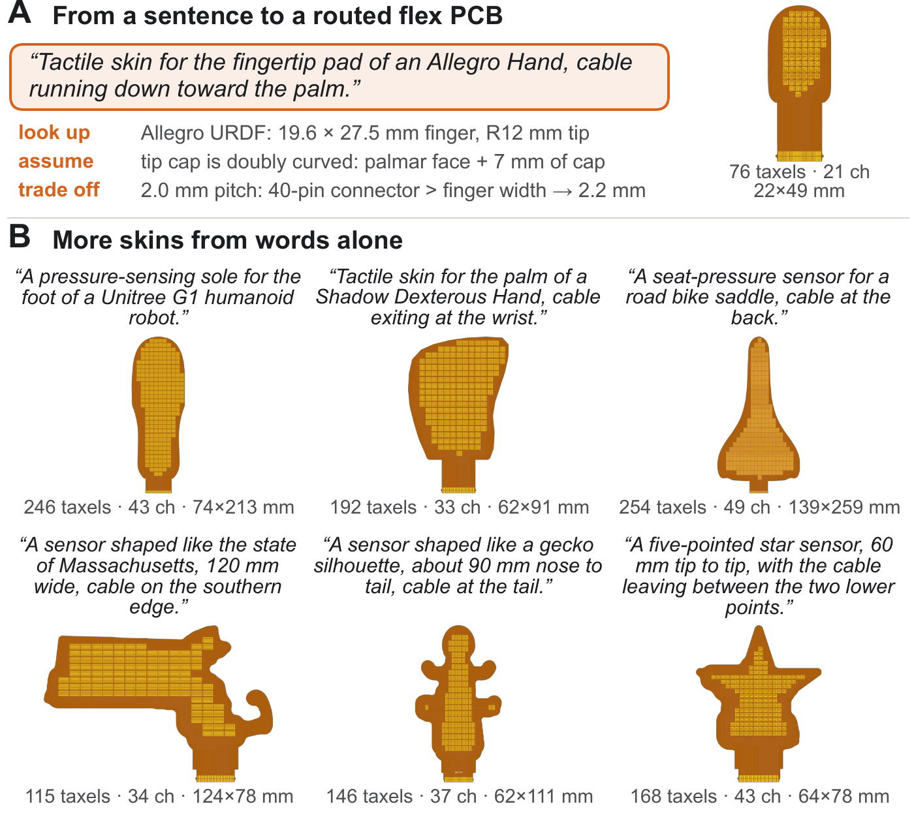

# Design with an AI agent

Some sensors are easier to describe than to draw: "a pressure-sensing insole, size 9, cable at the heel". The repository includes a skill that lets a coding agent turn such a request into a finished board. The agent looks up the real dimensions, builds the outline, runs the same OpenTac CAD compiler on your computer, and hands back the KiCad files, Gerbers and manifest.

## Set up

1. Clone the repository ([Get started](../get-started.md)).
2. **Claude Code:** start `claude` in the repository folder. It loads the skill from `.claude/skills/opentac/` by itself.
3. **Other agents** (Codex, Cursor, Gemini CLI, ...): they read [`AGENTS.md`](https://github.com/opentac/opentac.github.io/blob/main/AGENTS.md) at the repository root, which points them to the skill's instructions, [`SKILL.md`](https://github.com/opentac/opentac.github.io/blob/main/.claude/skills/opentac/SKILL.md).

The agent runs Python through the repository's own environment (`uv run python ...`), so it uses exactly the package versions the CAD tool uses. Nothing is sent to a server.

## Ask for a sensor

Say what the sensor is for, its shape and size, and where the cable should leave. The agent will ask about anything that is a real choice, for example which of two plausible dimensions to match, or whether the outline must stay fixed. Requests from the paper:

> Tactile skin for the fingertip pad of an Allegro Hand, cable running down toward the palm.

> A pressure-sensing sole for the foot of a Unitree G1 humanoid robot.

> Tactile skin for the palm of a Shadow Dexterous Hand, cable exiting at the wrist.

> A sensor shaped like the state of Massachusetts, 120 mm wide, cable on the southern edge.

The agent can also start from a DXF outline or an STL part: give it the file and say which surface to cover.

<figure class="ot-fig" markdown="span">
  { loading=lazy }
  <figcaption>Skins designed from one-sentence requests by a coding agent using OpenTac CAD and web search. (A) The agent's logged decisions for an Allegro fingertip: it looked up the finger's dimensions, noticed the tip cap is doubly curved and covered only part of it, and raised the pitch from 2.0 to 2.2&nbsp;mm so the connector fits the finger width. (B) Further designs. All nine agent-generated designs in the paper passed the design-rule check.</figcaption>
</figure>

## What to check in the result

The agent reports what was built: the taxel count, the board size and the design-rule check. Before ordering, do what you would for any design:

- open the generated board preview and look at it;
- print the 1:1 PDF from the export and hold it against the part;
- confirm the connector matches your [readout board](../hardware.md).

You can also open the agent's `design.json` (or the whole ZIP) in OpenTac CAD to adjust it by hand.

## Online: the Describe tab

The hosted tool at [`/cad/`](../../cad/) has a **Describe** tab: a chat assistant that designs with the same generator and loads the result into the editor. It needs no install but is slower and less capable than a local agent with web search, and it is not available when you run the tool locally.
