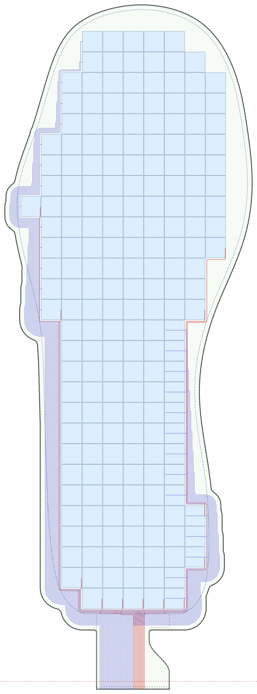

# Design with an AI agent

OpenTac-CAD can also be used through a coding agent. Given a description of the intended surface, dimensions and cable exit, the agent constructs an outline and calls the same compiler used by the graphical tool. The repository provides a skill with the design conventions, commands and checks needed for this workflow. The output includes KiCad files, Gerbers and a sensor manifest, which can be inspected or edited in OpenTac-CAD.

## Configure the agent { #set-up }

1. Clone the repository ([Get started](../get-started.md)).
2. **Claude Code:** start `claude` in the repository folder. It loads the skill from `.claude/skills/opentac/` by itself.
3. **Other agents** (Codex, Cursor, Gemini CLI, ...): they read [`AGENTS.md`](https://github.com/opentac/opentac/blob/main/AGENTS.md) at the repository root, which points them to the skill's instructions, [`SKILL.md`](https://github.com/opentac/opentac/blob/main/.claude/skills/opentac/SKILL.md).

The agent invokes the CAD compiler through the repository's environment (`uv run python ...`), using the same package versions as the graphical tool. CAD generation runs locally; the coding agent's own processing and data handling depend on the agent and provider you use.

## Specify the design request { #ask-for-a-sensor }

Specify the contact surface, its dimensions, the cable-exit location, and whether the board outline must remain fixed. Where dimensions or mounting constraints are ambiguous, resolve them before fabrication. The following prompts were used in the paper:

> Tactile skin for the fingertip pad of an Allegro Hand, cable running down toward the palm.

> A pressure-sensing sole for the foot of a Unitree G1 humanoid robot.

> Tactile skin for the palm of a Shadow Dexterous Hand, cable exiting at the wrist.

> A sensor shaped like the state of Massachusetts, 120 mm wide, cable on the southern edge.

The agent can also start from a DXF outline or an STL part: give it the file and say which surface to cover.

<figure class="ot-fig" markdown="span">
  { loading=lazy }
  <figcaption>Skins designed from one-sentence requests by a coding agent using OpenTac-CAD and web search. (A) The agent's logged decisions for an Allegro fingertip: it looked up the finger's dimensions, noticed the tip cap is doubly curved and covered only part of it, and raised the pitch from 2.0 to 2.2&nbsp;mm so the connector fits the finger width. (B) Additional generated layouts. All nine agent-generated designs evaluated in the paper passed the design-rule check.</figcaption>
</figure>

## Inspect the generated design { #what-to-check-in-the-result }

<figure class="ot-fig ot-fig--aside" markdown="span">
  [{ loading=lazy }](../assets/diagrams/agent_insole.svg)
  <figcaption><code>preview.svg</code> from the skill's worked example, a size 9 insole with the cable at the heel: 200 taxels of 8.4&nbsp;mm in 28 rows and 10 columns.</figcaption>
</figure>

Review the generated layout and the agent's reported taxel count, board dimensions and design-rule checks. An electrically valid layout still needs to fit the intended part:

- inspect the board boundary, taxel coverage, connector and routing in the generated preview;
- print the 1:1 PDF from the export and hold it against the part;
- confirm the connector matches your [readout board](../hardware.md).

You can also open the agent's `design.json` (or the whole ZIP) in OpenTac-CAD to adjust it by hand.

## Use the Describe tab { #online-the-describe-tab }

The hosted tool at [`/cad/`](../../cad/) provides a **Describe** tab that uses the same generator and loads the result into the editor. It requires no local installation, although generation is slower than running locally. To enable this assistant in a local installation, provide a Gemini API key from [Google AI Studio](https://aistudio.google.com/) and install the chat dependencies through the `demo` extra:

```sh
export GEMINI_API_KEY=your-key        # or put GEMINI_API_KEY=... in opentac/cad/.env
uv run --extra demo opentac cad
```
