<!-- Generated by scripts/make_example_designs.py (--page-only rewrites just this page). Edit the script, not this file. -->

# Ready-to-order designs

These are the sensors we fabricated for the paper, regenerated with the current
OpenTac-CAD for the OpenTac readout boards. Each download is the same complete export
OpenTac-CAD's **Download ZIP** gives: KiCad board, Gerbers, manifest, the saved design
(open it in OpenTac-CAD to edit), a printable 1:1 PDF, the piezoresistive-layer cut
files and the [printed case](../build/index.md#the-printed-case) in `case/` (bottom,
bumped lid, and flat and hatched lids). Order the board as described in
[Order the sensor](../build/order-sensor.md), then build it with the
[assembly guide](../build/assembly.md).

All are 2-layer boards made in grow mode. Open a design in OpenTac-CAD to switch to
4 layers, change the outline or the taxel size. In the previews, taxels are pale blue,
columns red (top copper) and rows blue (bottom copper); click one to open it full size.

## Robot hands and grippers

<figure class="ot-design" markdown="span">
[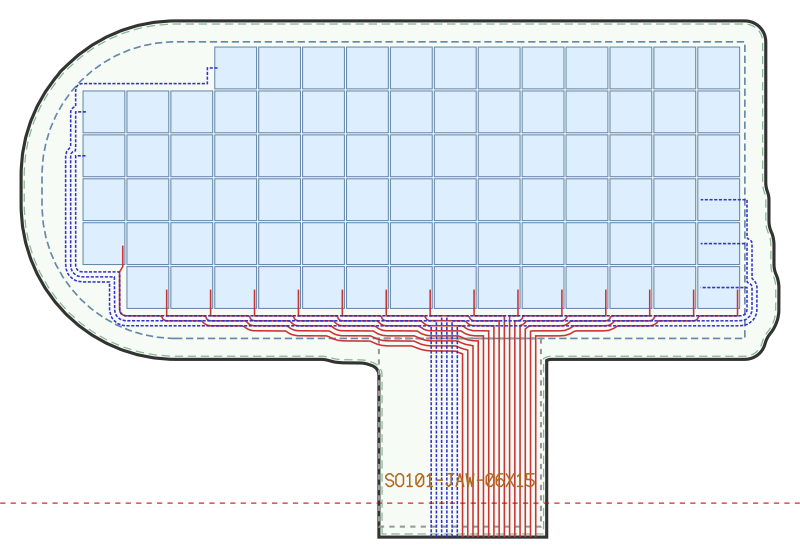{ width="240" height="167" loading="lazy" }](../designs/files/so101-jaw-06x15.svg)
<figcaption markdown="span">**SO-101 gripper jaw** 86 taxels, 6 × 15 grid 4.2 mm pitch, 30-pin board [Download ZIP (392 KB)](../designs/files/so101-jaw-06x15.zip)</figcaption>
</figure>
<figure class="ot-design" markdown="span">
[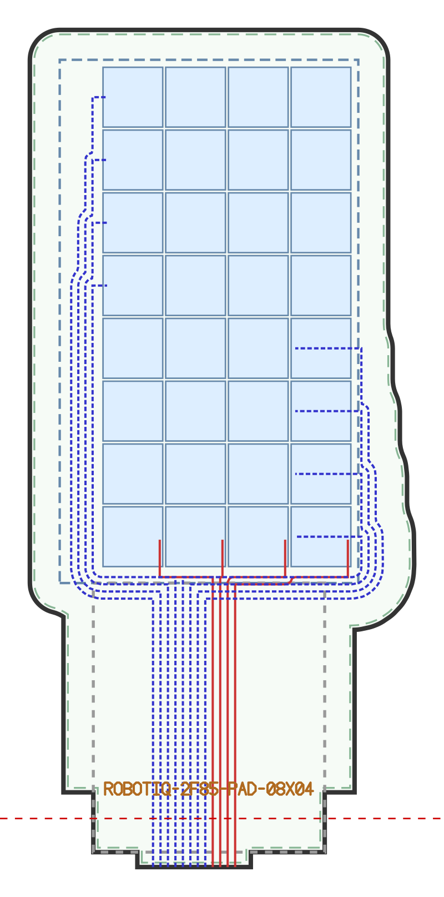{ width="89" height="180" loading="lazy" }](../designs/files/robotiq-2f85-pad-08x04.svg)
<figcaption markdown="span">**Robotiq 2F-85 finger pad (coarse)** 32 taxels, 8 × 4 grid 4.2 mm pitch, 30-pin board [Download ZIP (285 KB)](../designs/files/robotiq-2f85-pad-08x04.zip)</figcaption>
</figure>
<figure class="ot-design" markdown="span">
[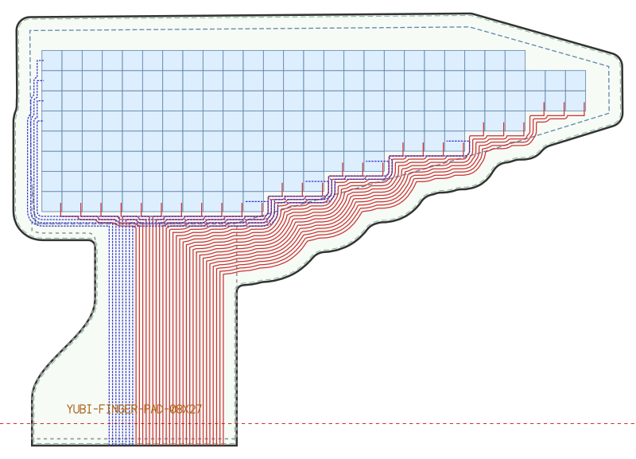{ width="240" height="173" loading="lazy" }](../designs/files/yubi-finger-pad-08x27.svg)
<figcaption markdown="span">**YUBI finger pad** 165 taxels, 8 × 27 grid 3 mm pitch, 60-pin board [Download ZIP (674 KB)](../designs/files/yubi-finger-pad-08x27.zip)</figcaption>
</figure>
<figure class="ot-design" markdown="span">
[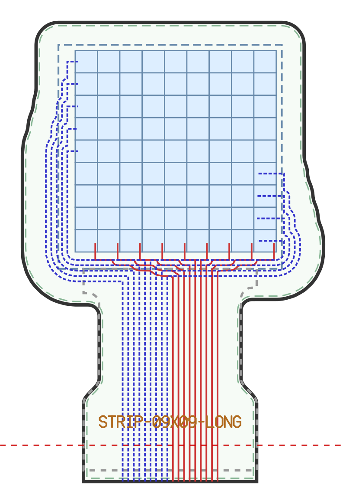{ width="124" height="180" loading="lazy" }](../designs/files/strip-09x09-long.svg)
<figcaption markdown="span">**9 x 9 patch, long tail** 81 taxels, 9 × 9 grid 2 mm pitch, 30-pin board [Download ZIP (366 KB)](../designs/files/strip-09x09-long.zip)</figcaption>
</figure>
<figure class="ot-design" markdown="span">
[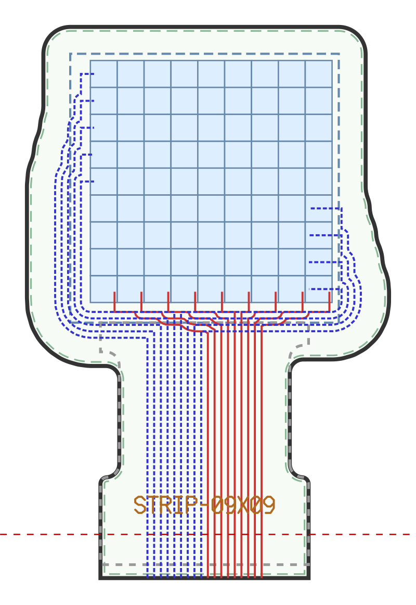{ width="124" height="180" loading="lazy" }](../designs/files/strip-09x09.svg)
<figcaption markdown="span">**9 x 9 patch** 81 taxels, 9 × 9 grid 2 mm pitch, 30-pin board [Download ZIP (365 KB)](../designs/files/strip-09x09.zip)</figcaption>
</figure>
<figure class="ot-design" markdown="span">
[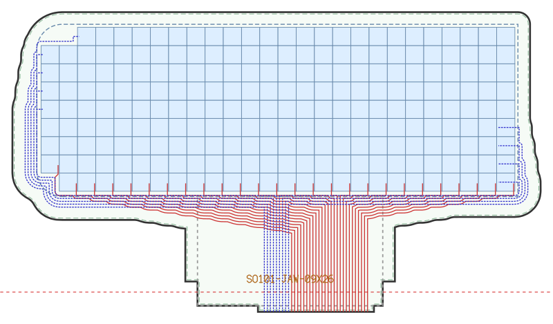{ width="240" height="175" loading="lazy" }](../designs/files/so101-jaw-09x26.svg)
<figcaption markdown="span">**SO-101 gripper jaw (wide)** 231 taxels, 9 × 26 grid 3 mm pitch, 60-pin board [Download ZIP (732 KB)](../designs/files/so101-jaw-09x26.zip)</figcaption>
</figure>
<figure class="ot-design" markdown="span">
[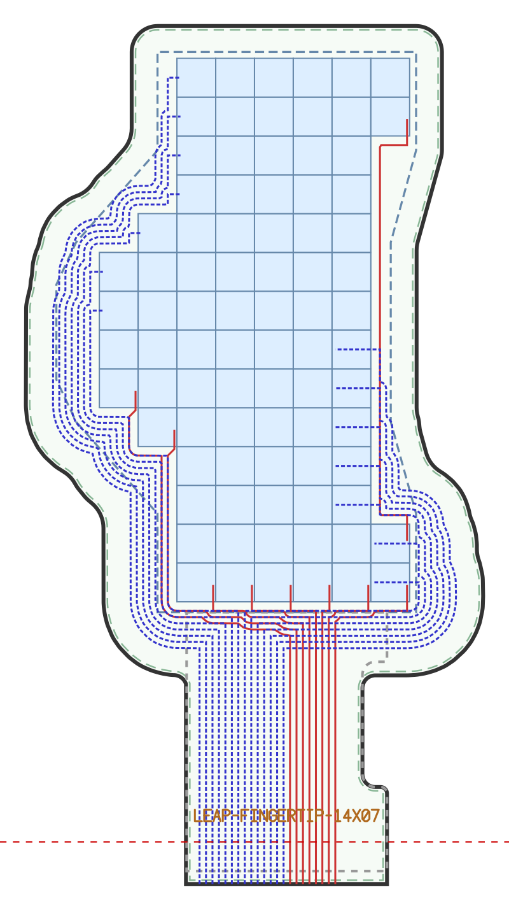{ width="101" height="180" loading="lazy" }](../designs/files/leap-fingertip-14x07.svg)
<figcaption markdown="span">**LEAP Hand fingertip** 84 taxels, 14 × 8 grid 3 mm pitch, 30-pin board [Download ZIP (506 KB)](../designs/files/leap-fingertip-14x07.zip)</figcaption>
</figure>
<figure class="ot-design" markdown="span">
[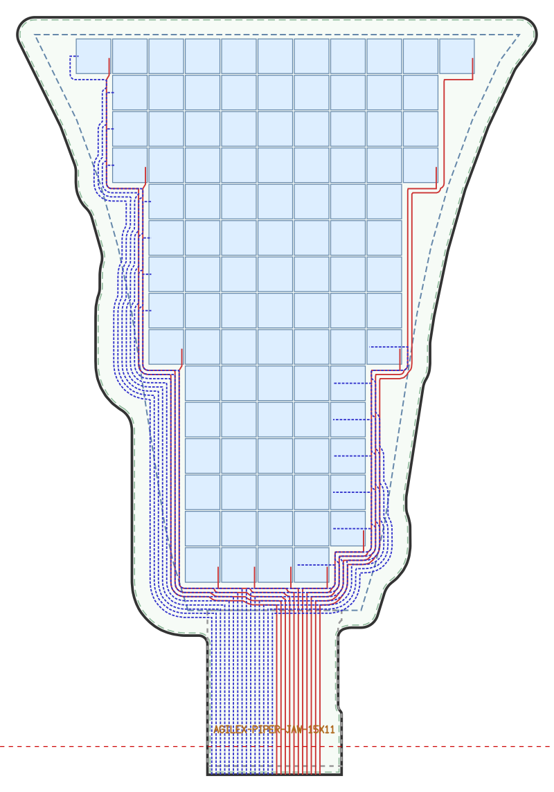{ width="126" height="180" loading="lazy" }](../designs/files/agilex-piper-jaw-15x11.svg)
<figcaption markdown="span">**AgileX Piper jaw** 102 taxels, 15 × 11 grid 4.2 mm pitch, 30-pin board [Download ZIP (582 KB)](../designs/files/agilex-piper-jaw-15x11.zip)</figcaption>
</figure>
<figure class="ot-design" markdown="span">
[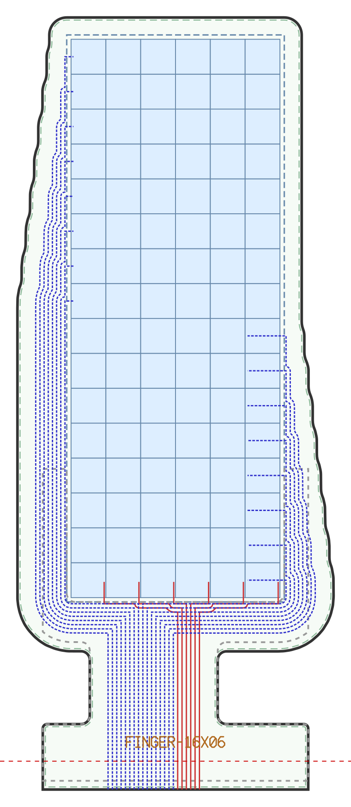{ width="68" height="180" loading="lazy" }](../designs/files/finger-16x06.svg)
<figcaption markdown="span">**Finger strip 16 x 6** 96 taxels, 16 × 6 grid 4 mm pitch, 60-pin board [Download ZIP (507 KB)](../designs/files/finger-16x06.zip)</figcaption>
</figure>
<figure class="ot-design" markdown="span">
[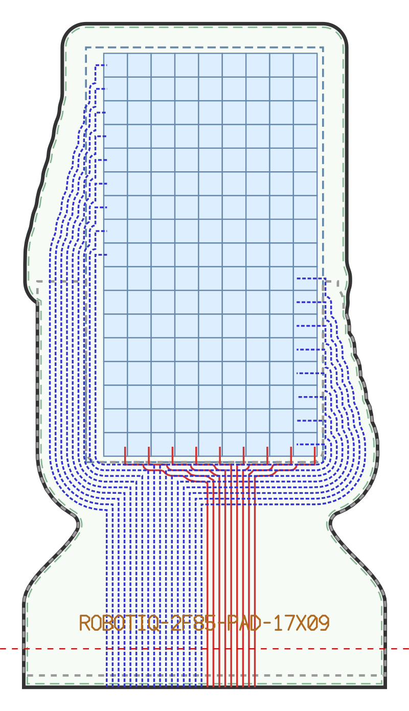{ width="90" height="180" loading="lazy" }](../designs/files/robotiq-2f85-pad-17x09.svg)
<figcaption markdown="span">**Robotiq 2F-85 finger pad** 153 taxels, 17 × 9 grid 2 mm pitch, 60-pin board [Download ZIP (507 KB)](../designs/files/robotiq-2f85-pad-17x09.zip)</figcaption>
</figure>
<figure class="ot-design" markdown="span">
[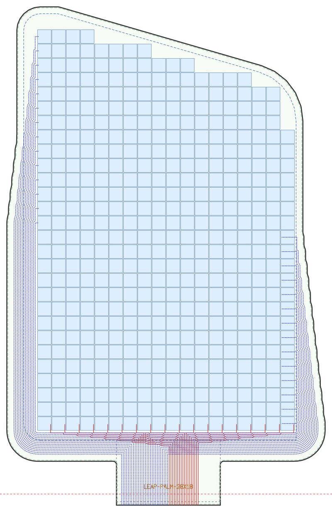{ width="111" height="180" loading="lazy" }](../designs/files/leap-palm-28x18.svg)
<figcaption markdown="span">**LEAP Hand palm** 467 taxels, 28 × 18 grid 4.2 mm pitch, 60-pin board [Download ZIP (1114 KB)](../designs/files/leap-palm-28x18.zip)</figcaption>
</figure>
<figure class="ot-design" markdown="span">
[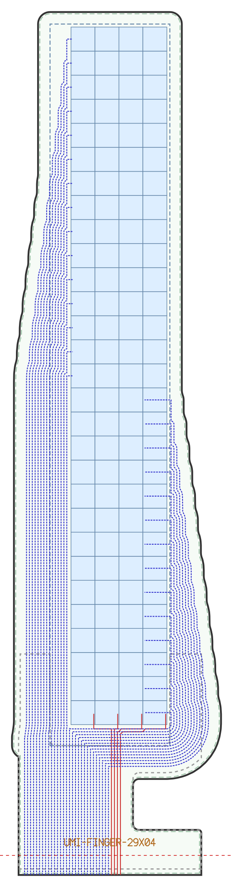{ width="45" height="180" loading="lazy" }](../designs/files/umi-finger-29x04.svg)
<figcaption markdown="span">**UMI soft finger (narrow)** 116 taxels, 29 × 4 grid 4 mm pitch, 60-pin board [Download ZIP (643 KB)](../designs/files/umi-finger-29x04.zip)</figcaption>
</figure>
<figure class="ot-design" markdown="span">
[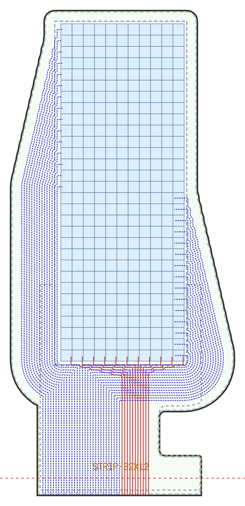{ width="82" height="180" loading="lazy" }](../designs/files/strip-32x12.svg)
<figcaption markdown="span">**Strip 32 x 12** 330 taxels, 30 × 11 grid 2.122 mm pitch\*, 60-pin board [Download ZIP (870 KB)](../designs/files/strip-32x12.zip)</figcaption>
</figure>
<figure class="ot-design" markdown="span">
[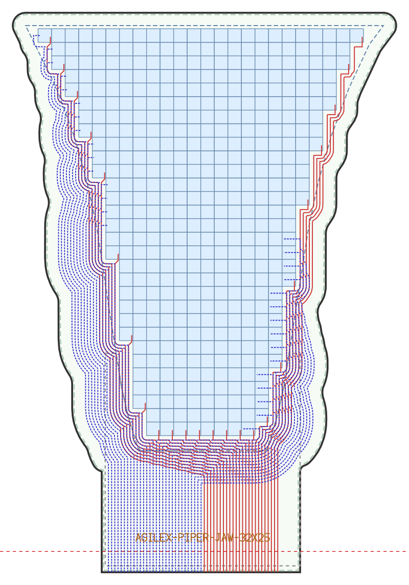{ width="124" height="180" loading="lazy" }](../designs/files/agilex-piper-jaw-32x25.svg)
<figcaption markdown="span">**AgileX Piper jaw (dense)** 441 taxels, 30 × 24 grid 2.122 mm pitch\*, 60-pin board [Download ZIP (1291 KB)](../designs/files/agilex-piper-jaw-32x25.zip)</figcaption>
</figure>
<figure class="ot-design" markdown="span">
[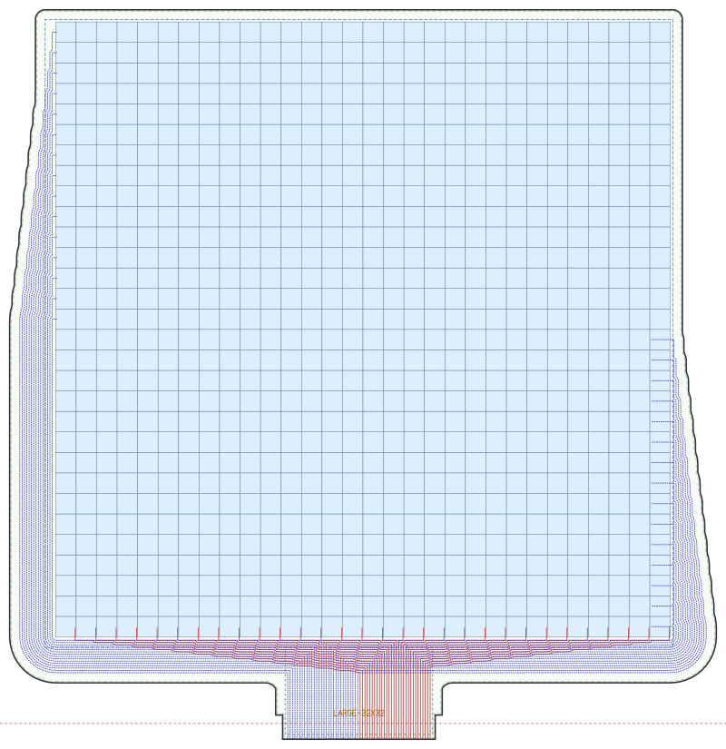{ width="170" height="180" loading="lazy" }](../designs/files/large-32x32.svg)
<figcaption markdown="span">**Large 32 x 32 array** 900 taxels, 30 × 30 grid 4.244 mm pitch\*, 60-pin board [Download ZIP (1660 KB)](../designs/files/large-32x32.zip)</figcaption>
</figure>
<figure class="ot-design" markdown="span">
[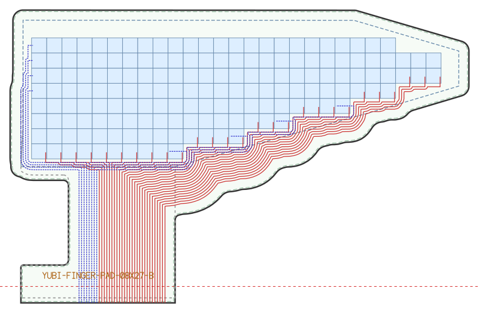{ width="240" height="172" loading="lazy" }](../designs/files/yubi-finger-pad-08x27-b.svg)
<figcaption markdown="span">**YUBI finger pad (variant)** 164 taxels, 8 × 27 grid 3 mm pitch, 60-pin board [Download ZIP (677 KB)](../designs/files/yubi-finger-pad-08x27-b.zip)</figcaption>
</figure>
<figure class="ot-design" markdown="span">
[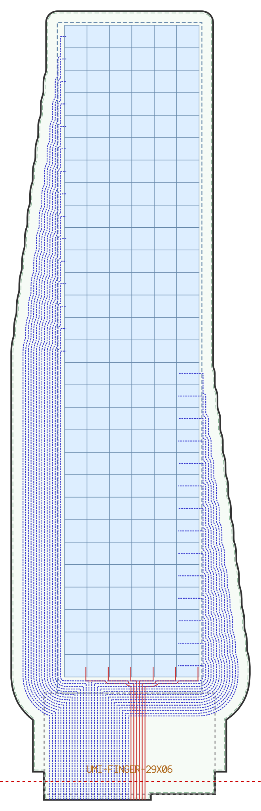{ width="52" height="180" loading="lazy" }](../designs/files/umi-finger-29x06.svg)
<figcaption markdown="span">**UMI soft finger** 174 taxels, 29 × 6 grid 4 mm pitch, 60-pin board [Download ZIP (778 KB)](../designs/files/umi-finger-29x06.zip)</figcaption>
</figure>

## Legged robots

<figure class="ot-design" markdown="span">
[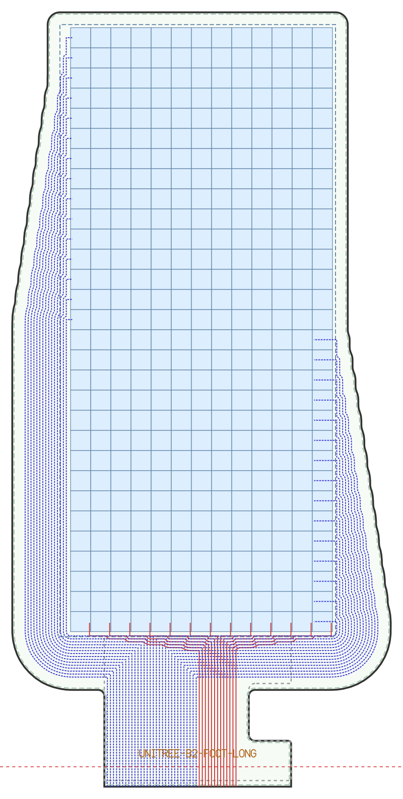{ width="88" height="180" loading="lazy" }](../designs/files/unitree-b2-foot-long.svg)
<figcaption markdown="span">**Unitree B2 foot (long)** 390 taxels, 30 × 13 grid 3.289 mm pitch\*, 60-pin board [Download ZIP (1069 KB)](../designs/files/unitree-b2-foot-long.zip)</figcaption>
</figure>
<figure class="ot-design" markdown="span">
[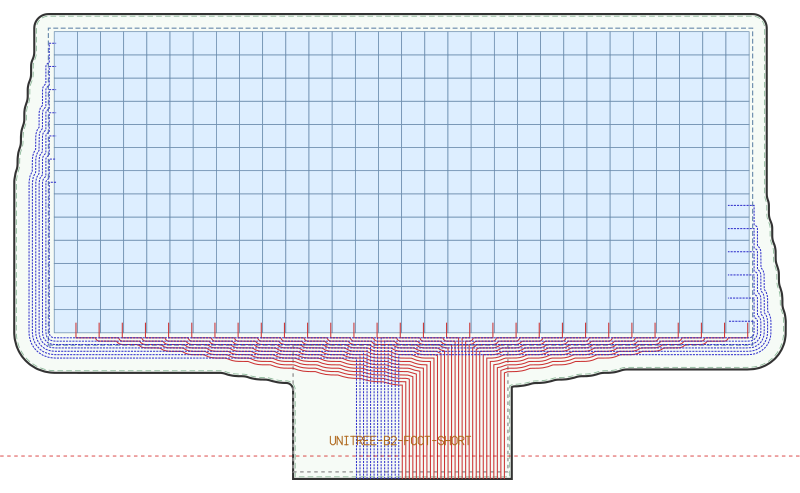{ width="240" height="169" loading="lazy" }](../designs/files/unitree-b2-foot-short.svg)
<figcaption markdown="span">**Unitree B2 foot (short)** 390 taxels, 13 × 30 grid 3.289 mm pitch\*, 60-pin board [Download ZIP (970 KB)](../designs/files/unitree-b2-foot-short.zip)</figcaption>
</figure>

## Calibration set

<figure class="ot-design" markdown="span">
[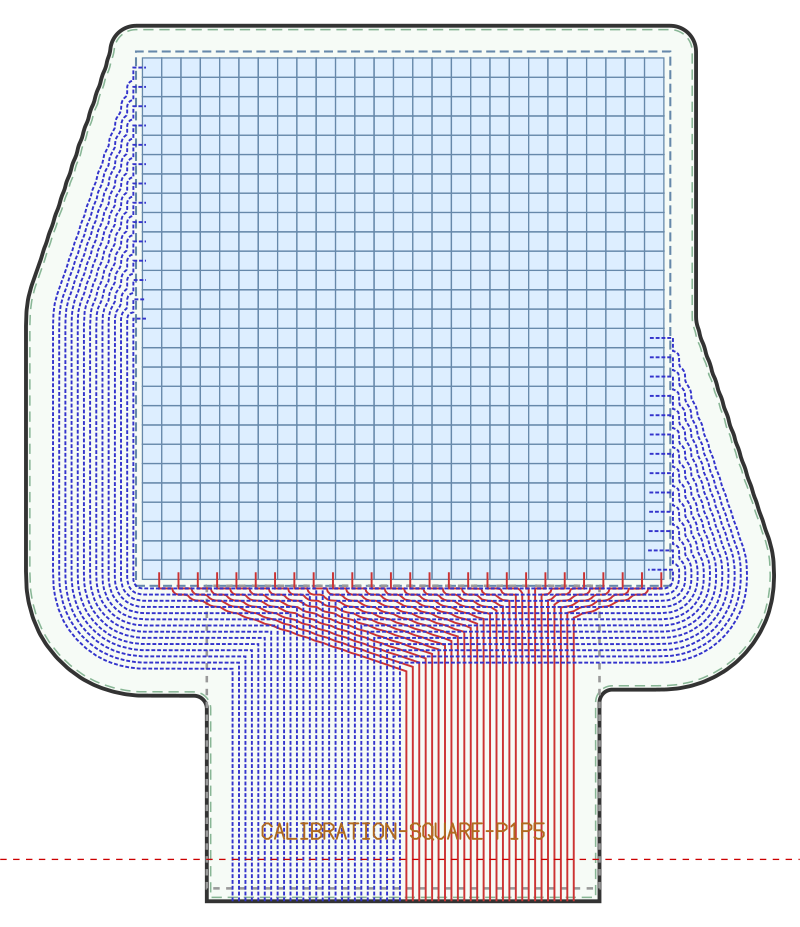{ width="155" height="180" loading="lazy" }](../designs/files/calibration-square-p1p5-gap0p2.svg)
<figcaption markdown="span">**Calibration: square p1.5 gap0.2** 729 taxels, 27 × 27 grid 1.5 mm pitch, 60-pin board [Download ZIP (1114 KB)](../designs/files/calibration-square-p1p5-gap0p2.zip)</figcaption>
</figure>
<figure class="ot-design" markdown="span">
[{ width="142" height="180" loading="lazy" }](../designs/files/calibration-square-p2p0-gap0p2.svg)
<figcaption markdown="span">**Calibration: square p2.0 gap0.2** 400 taxels, 20 × 20 grid 2 mm pitch, 60-pin board [Download ZIP (773 KB)](../designs/files/calibration-square-p2p0-gap0p2.zip)</figcaption>
</figure>
<figure class="ot-design" markdown="span">
[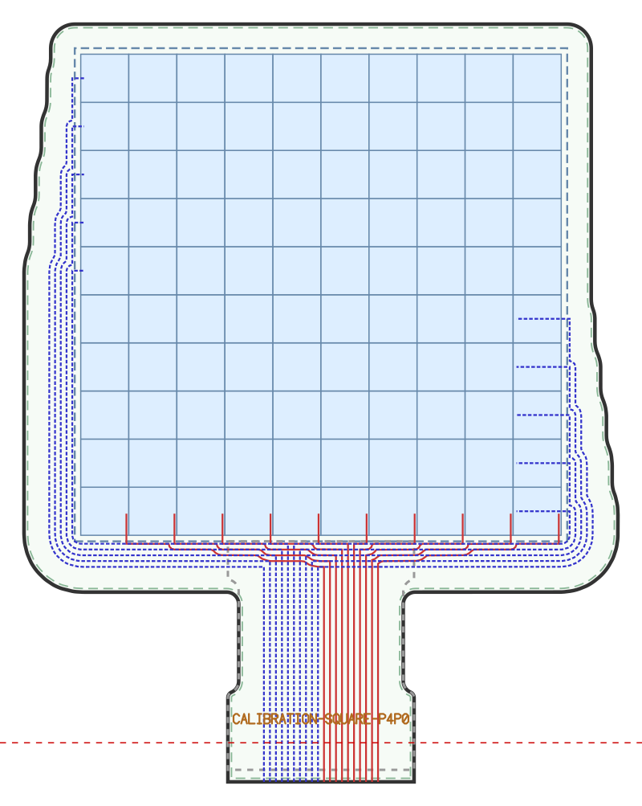{ width="144" height="180" loading="lazy" }](../designs/files/calibration-square-p4p0-gap0p2.svg)
<figcaption markdown="span">**Calibration: square p4.0 gap0.2** 100 taxels, 10 × 10 grid 4 mm pitch, 30-pin board [Download ZIP (443 KB)](../designs/files/calibration-square-p4p0-gap0p2.zip)</figcaption>
</figure>
<figure class="ot-design" markdown="span">
[{ width="142" height="180" loading="lazy" }](../designs/files/calibration-square-p2p0-gap0p1.svg)
<figcaption markdown="span">**Calibration: square p2.0 gap0.1** 400 taxels, 20 × 20 grid 2 mm pitch, 60-pin board [Download ZIP (773 KB)](../designs/files/calibration-square-p2p0-gap0p1.zip)</figcaption>
</figure>
<figure class="ot-design" markdown="span">
[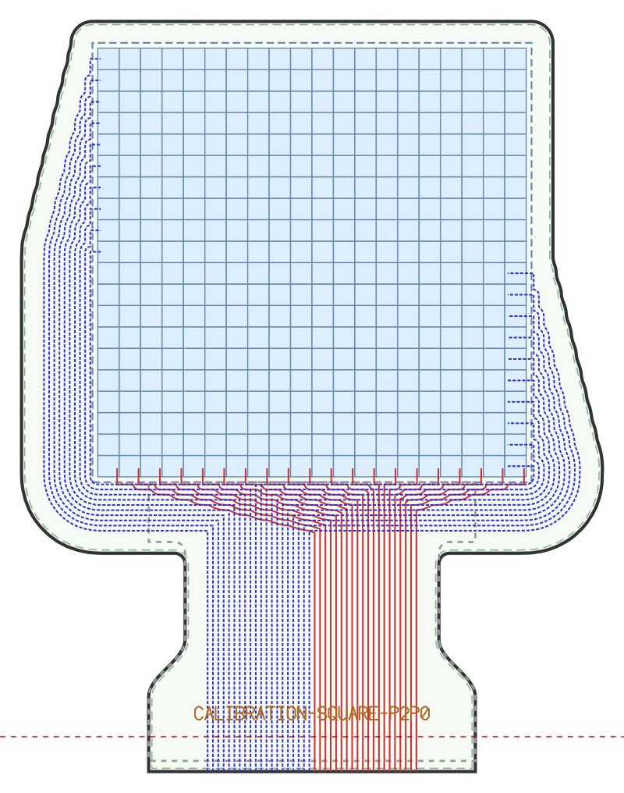{ width="142" height="180" loading="lazy" }](../designs/files/calibration-square-p2p0-gap0p3.svg)
<figcaption markdown="span">**Calibration: square p2.0 gap0.3** 400 taxels, 20 × 20 grid 2 mm pitch, 60-pin board [Download ZIP (773 KB)](../designs/files/calibration-square-p2p0-gap0p3.zip)</figcaption>
</figure>
<figure class="ot-design" markdown="span">
[{ width="142" height="180" loading="lazy" }](../designs/files/calibration-square-p2p0-gap0p4.svg)
<figcaption markdown="span">**Calibration: square p2.0 gap0.4** 400 taxels, 20 × 20 grid 2 mm pitch, 60-pin board [Download ZIP (773 KB)](../designs/files/calibration-square-p2p0-gap0p4.zip)</figcaption>
</figure>
<figure class="ot-design" markdown="span">
[{ width="142" height="180" loading="lazy" }](../designs/files/calibration-square-p2p0-gap0p5.svg)
<figcaption markdown="span">**Calibration: square p2.0 gap0.5** 400 taxels, 20 × 20 grid 2 mm pitch, 60-pin board [Download ZIP (772 KB)](../designs/files/calibration-square-p2p0-gap0p5.zip)</figcaption>
</figure>
<figure class="ot-design" markdown="span">
[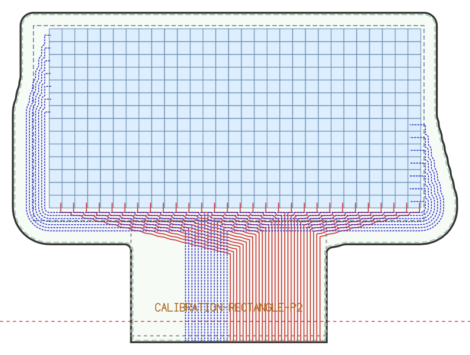{ width="203" height="180" loading="lazy" }](../designs/files/calibration-rectangle-p2p0-gap0p2.svg)
<figcaption markdown="span">**Calibration: rectangle p2.0 gap0.2** 406 taxels, 14 × 29 grid 2 mm pitch, 60-pin board [Download ZIP (759 KB)](../designs/files/calibration-rectangle-p2p0-gap0p2.zip)</figcaption>
</figure>
<figure class="ot-design" markdown="span">
[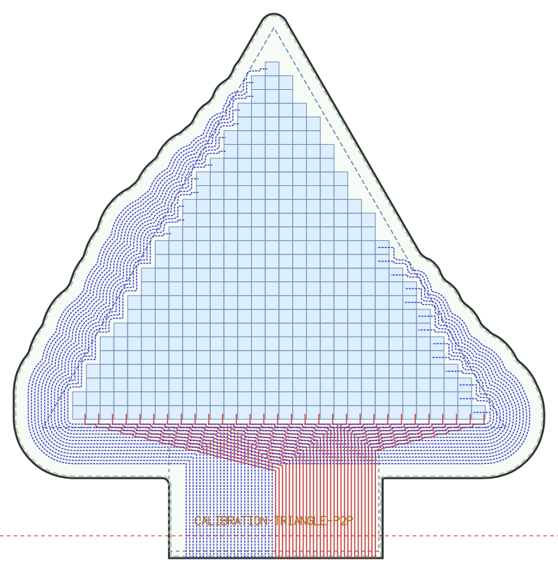{ width="166" height="180" loading="lazy" }](../designs/files/calibration-triangle-p2p0-gap0p2.svg)
<figcaption markdown="span">**Calibration: triangle p2.0 gap0.2** 409 taxels, 26 × 30 grid 2 mm pitch, 60-pin board [Download ZIP (1117 KB)](../designs/files/calibration-triangle-p2p0-gap0p2.zip)</figcaption>
</figure>
<figure class="ot-design" markdown="span">
[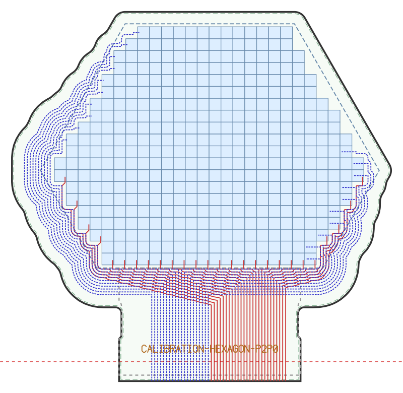{ width="166" height="180" loading="lazy" }](../designs/files/calibration-hexagon-p2p0-gap0p2.svg)
<figcaption markdown="span">**Calibration: hexagon p2.0 gap0.2** 406 taxels, 20 × 26 grid 2 mm pitch, 60-pin board [Download ZIP (958 KB)](../designs/files/calibration-hexagon-p2p0-gap0p2.zip)</figcaption>
</figure>
<figure class="ot-design" markdown="span">
[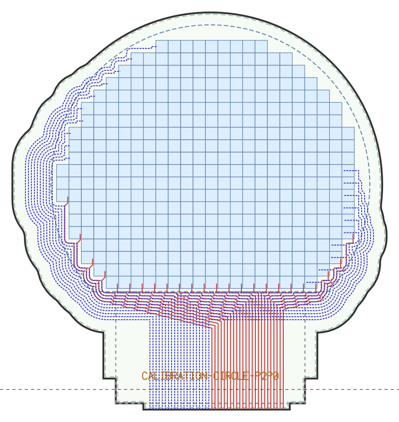{ width="153" height="180" loading="lazy" }](../designs/files/calibration-circle-p2p0-gap0p2.svg)
<figcaption markdown="span">**Calibration: circle p2.0 gap0.2** 403 taxels, 20 × 24 grid 2 mm pitch, 60-pin board [Download ZIP (960 KB)](../designs/files/calibration-circle-p2p0-gap0p2.zip)</figcaption>
</figure>
<figure class="ot-design" markdown="span">
[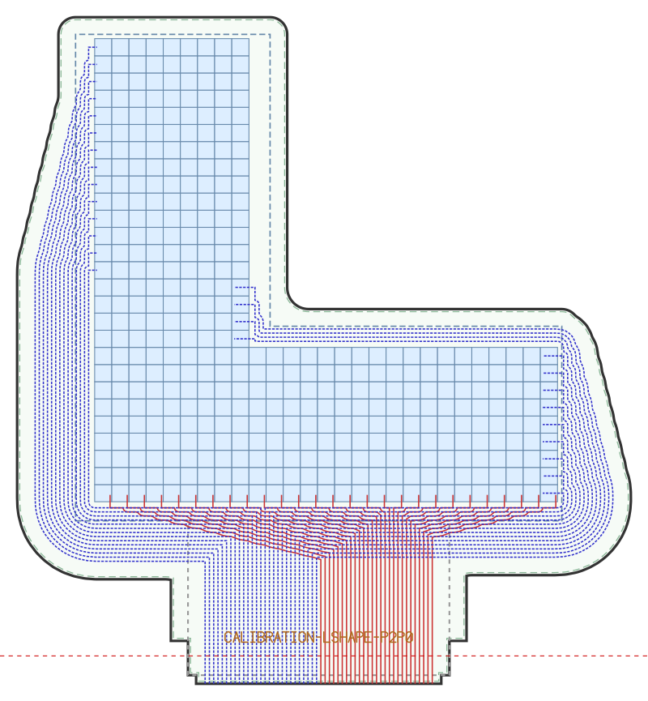{ width="160" height="180" loading="lazy" }](../designs/files/calibration-lshape-p2p0-gap0p2.svg)
<figcaption markdown="span">**Calibration: lshape p2.0 gap0.2** 405 taxels, 27 × 27 grid 2 mm pitch, 60-pin board [Download ZIP (921 KB)](../designs/files/calibration-lshape-p2p0-gap0p2.zip)</figcaption>
</figure>

\* Fabricated with more than 30 rows or columns, for an earlier 70-pin readout
board. The pitch here is raised just enough to fit the 60-pin board.
