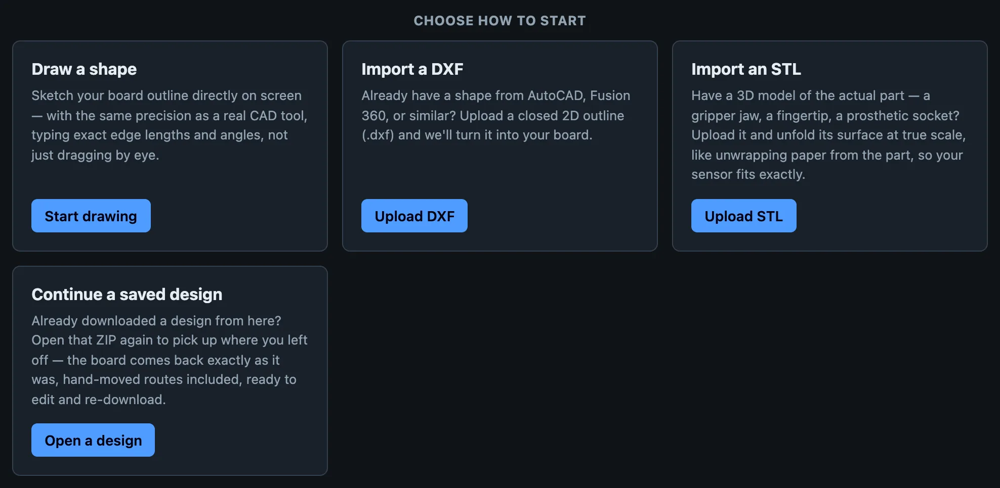
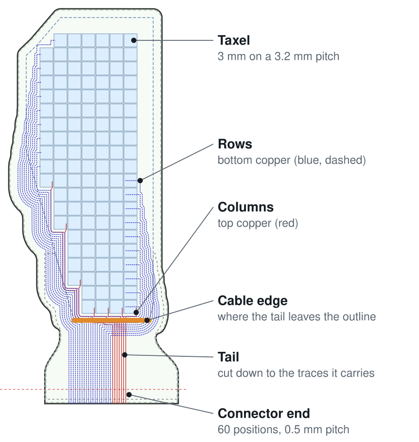
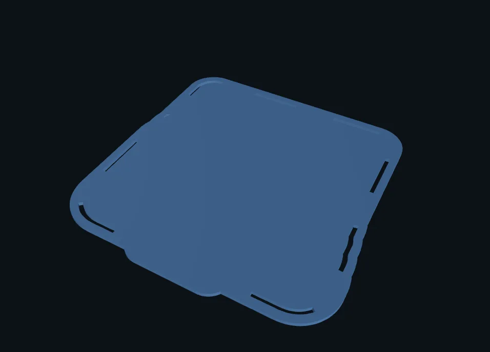
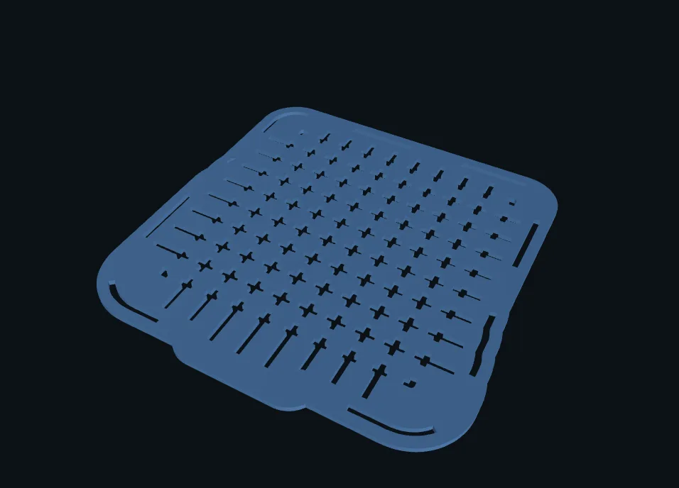
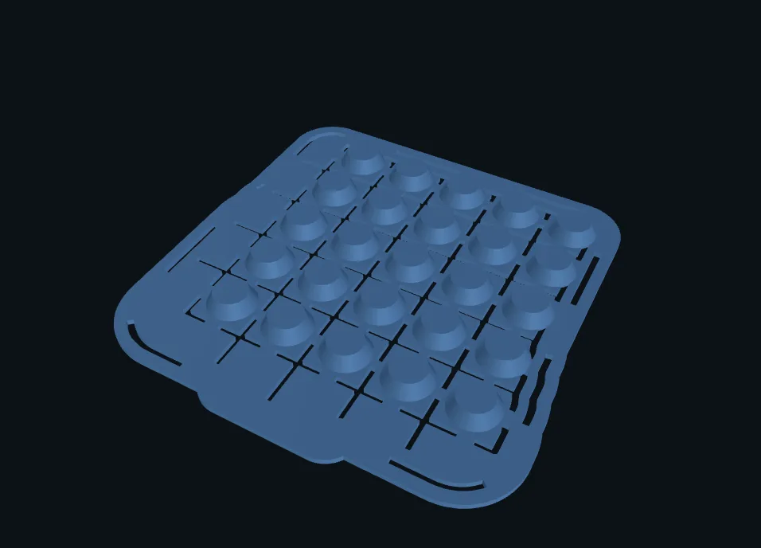

# Design a sensor

OpenTac-CAD generates a tactile sensor from a 2D outline or a surface selected on a 3D model. It places taxels within the sensing region, routes each row and column to a connector, and checks the layout against fabrication rules. The resulting export includes the flex-PCB fabrication files, a 3D-printable case, and a manifest describing the sensor's geometry and wiring. The same tool runs [online](../cad/) and [on your computer](../get-started.md#run-it-on-your-computer).

  <video data-loop muted loop playsinline preload="none" poster="../../assets/loops/cad_demo.jpg"
         aria-label="Screen recording: load a gripper finger, click its contact surface, set the cable edge and taxel size, generate the board, then the printed case">
    <source src="../../assets/loops/cad_demo.mp4" type="video/mp4">
  </video>

## Where to run OpenTac-CAD { #online-or-local }

| | Online, at `/cad/` | On your computer |
|---|---|---|
| Installation | No installation required | clone, then double-click `Start_OpenTac` ([Get started](../get-started.md)) |
| Generation time | The free server sleeps when idle; the first request can take a minute | Typically a second or two per design |
| CAD input files | Uploaded to the server for generation | Processed locally |
| Natural-language design | **Describe** tab (a hosted chat assistant) | your own coding agent with the [OpenTac skill](agent.md) |

Both run the same code; a design saved in one opens in the other.

## Specify the sensor geometry { #five-ways-to-start }

**Draw.** Sketch the outline with line, rectangle and arc tools. Select an edge or a vertex to type an exact length and angle, as in a CAD program.

**Import a DXF.** Upload a closed 2D outline from AutoCAD, Fusion, Onshape or similar. The tool takes the largest closed shape in the file and reads its units.

**Import an STL.** Upload a 3D model of the part, select the surface the sensor should cover, and unfold it flat at true scale. See [Shapes and surfaces](shapes.md) for which surfaces can be covered.

**Open a saved design.** Every download contains `design.json`; open the ZIP again (no need to unzip) and the board comes back as you left it, hand-moved routes included.

**Describe it.** The **Describe** tab takes a sentence ("an insole for a size 9 shoe, cable at the heel") and a chat assistant designs the board with the same generator, then loads it into the editor. See [Design with an AI agent](agent.md).

The robot gallery on the start screen has surfaces of real grippers, hands and feet already unfolded, and finished example designs to start from.

<figure class="ot-fig ot-fig--clear ot-screen" markdown>

<figure markdown="span">
  [{ loading=lazy width="988" height="483" }](../assets/screens/cad_ways_to_start.webp)
  <figcaption>Outline import and saved designs.</figcaption>
</figure>
<figure markdown="span">
  [{ loading=lazy width="988" height="443" }](../assets/screens/cad_robot_gallery.webp)
  <figcaption>Robot gallery: example gripper and hand surfaces.</figcaption>
</figure>

<figcaption>OpenTac-CAD's start screen. The gallery has 34 surfaces; orange is the surface the sensor covers. Where the chat assistant is set up (the hosted tool, or a local copy with a Gemini key), a fifth card opens the <strong>Describe</strong> tab.</figcaption>
</figure>

## Sensor layout and connector settings { #the-settings-that-matter }

**Cable edge.** Select the edge from which the flex tail should exit toward the readout board. This must be a straight segment at least as wide as the connector, with room to route the cable on the mounted part. **Generate** remains disabled until an edge is selected explicitly.

**Tail geometry and length.** After routing, the tool narrows the flex tail around its traces, without removing taxels. Near the connector, the tail widens to the connector width through a step 1.5 mm long, with a 1 mm inner fillet and a 0.5 mm outer corner radius. The junction with the board also has 1 mm rounded corners. These transitions avoid sharp inner corners where the flex could tear.

**Tail length** specifies the distance from the board to the connector. Leaving it blank selects a length of at least 12 mm that allows the [printed case](../build/index.md#the-printed-case) to clear the connector; entering a value overrides this choice. After generation, **Redo padding** applies a new length without rerouting. It can extend the tail or shorten it as far as the existing straight trace segments allow. Further shortening requires **Generate** to route the board again.

<figure class="ot-fig" markdown="span" style="max-width: 30rem">
  [{ loading=lazy }](../assets/diagrams/design_settings.svg)
  <figcaption>Annotated Yubi finger-pad layout: 122 taxels, each 3&nbsp;mm wide, at 3.2&nbsp;mm pitch in a 20-row, 7-column grid. The board uses two copper layers and grow mode. Its row count requires the 60-pin readout board; the automatic 14.5&nbsp;mm tail provides clearance for the printed case.</figcaption>
</figure>

**Taxel size and pitch.** The defaults are 4&nbsp;mm taxels at 4.2&nbsp;mm centre-to-centre spacing. Reducing the pitch increases the number of taxels within a given area and provides finer spatial sampling; increasing taxel size increases the signal measured under the conditions in [Results](../results.md#material-and-spatial-response). Width and height can be set independently for elongated sensing regions. Keep both above 1.5&nbsp;mm. In grow mode, you can instead specify the desired row and column counts and let the tool compute the taxel dimensions.

**Readout board.** Every row and every column is one wire to the connector. The 60-pin readout board reads up to 30 rows and 30 columns; the 30-pin board up to 15 and 15. The limit is per direction: a 20&times;10 sensor has 30 wires but does not fit the 30-pin board. Choose under **Board sizing &rarr; Readout board**:

- *picked automatically* (the default): the 30-pin board when the grid fits 15&times;15, otherwise the 60-pin board;
- *30-pin board*, or *60-pin board*, to match a board you already have.

The sensor's connector follows the choice: 30 or 60 positions at 0.5&nbsp;mm pitch, wired to match that board's pads. See [Readout boards](../hardware.md).

### Grow the board, or keep the outline fixed

| | Grow board to fit wiring (default) | Keep outline fixed, shrink sensor grid |
|---|---|---|
| Board edge | grows outward until every wire fits, then is shrink-wrapped about 2&nbsp;mm around the copper | exactly the shape you drew |
| Taxels | The specified sensing region retains its taxels; the board grows to accommodate routing | A routing band inside the boundary reduces the available sensing area |
| Use when | The mounting surface allows the board to extend beyond the sensing region | The board must fit a prescribed boundary, such as a recess, lid or shoe |

Both modes check trace clearances, crossings and copper outside the board boundary. Print the 1:1 PDF to verify the manufactured outline against the mounting surface before ordering.

### Two or four copper layers

On **2 layers**, columns run on the top copper and rows on the bottom. Routing these connections to the connector requires space around the sensing region, reducing the area available for taxels when the board outline is fixed.

On **4 layers**, the rows use two inner copper layers. One routes rows through the sensing region toward the connector; the other reconnects row segments separated by notches in the outline. This removes the peripheral routing band needed for the rows, leaving more of a fixed outline available for taxels. The additional coverage can be useful on small or irregular surfaces, such as fingertips, at the cost of more expensive fabrication.

<figure class="ot-fig" markdown="span">
  [{ loading=lazy }](../assets/diagrams/design_modes.svg)
  <figcaption>OpenTac-CAD's Arch example (60&nbsp;&times;&nbsp;40&nbsp;mm, 3&nbsp;mm taxels on a 3.2&nbsp;mm pitch) generated three ways, at one scale, the drawn shapes aligned; each tail length was left automatic. Red: columns, top copper. Blue: rows, bottom copper. Amber and green: rows on the two inner layers.</figcaption>
</figure>

## The printed case

Tick **Add a printed case** after generating. The case is two TPU parts cut from the board's own outline: a bottom tray with a pocket for the flex and the piezoresistive layer, and a lid held on by a rib around the edge, with no glue or screws. The lid comes in three versions:

- **Flat**: normal force only.
- **Hatched**: grooves or cuts between taxels reduce the spread of a local load to neighbouring taxels.
- **Shear-sensing bumps**: one deformable bump per 2&times;2 group of taxels. Tangential loading tilts the bump and produces unequal loads on the underlying taxels, from which shear is estimated.

<figure class="ot-fig ot-fig--clear ot-screen" markdown>

<figure markdown="span">
  { loading=lazy width="478" height="344" }
  <figcaption>Flat lid.</figcaption>
</figure>
<figure markdown="span">
  { loading=lazy width="478" height="344" }
  <figcaption>Hatched lid with cuts between taxels.</figcaption>
</figure>
<figure markdown="span">
  { loading=lazy width="478" height="344" }
  <figcaption>Bump sheet for normal and shear sensing.</figcaption>
</figure>

<figcaption>Three lid geometries for the same Square patch sensor, shown in the case preview.</figcaption>
</figure>

The case and board are generated from the same design, so the lid positions each bump over its corresponding taxels ([The printed case](../build/index.md#the-printed-case)). Use TPU around 85&ndash;95A: shear sensing relies on the bumps deforming under tangential load. Regenerating the board clears the case because its geometry must be recomputed for the new layout.

**Download ZIP** generates the bottom and all three lids in the archive's `case/` folder, using the case-panel settings or their defaults. Opening the case panel is only necessary to inspect or change those settings. See [What the export contains](export.md).

## Before you order

<figure class="ot-fig ot-fig--clear ot-screen" markdown="span">
  { loading=lazy width="925" height="78" }
  <figcaption>Download controls for naming the sensor and exporting the fabrication, cutting and assembly files.</figcaption>
</figure>

1. Give the design a **name** in the download bar before generating: it is printed on the board.
2. Check that the design-rule check reports no violations.
3. Download the **printable PDF**, print it at 100% (measure the 100&nbsp;mm ruler), cut it out and hold it against the part. Verify both the board boundary and the tail routing before fabrication.
4. Download the **ZIP**. [What the export contains](export.md) lists every file; [Order the sensor](../build/order-sensor.md) covers the board order.

The [assembly guide](../build/assembly.md) describes how to combine the fabricated PCB, printed case and piezoresistive layer, then configure the readout board and inspect the sensor response.
