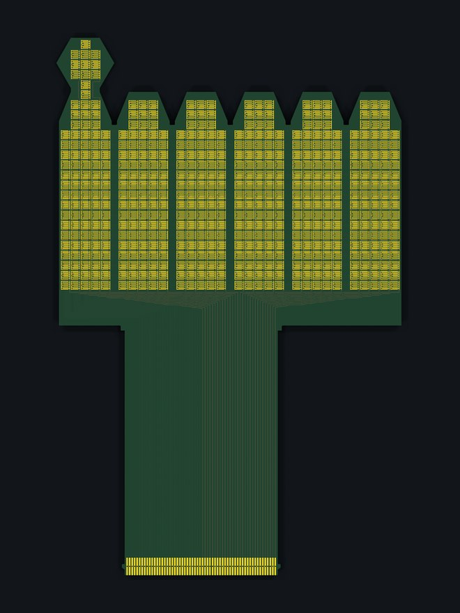
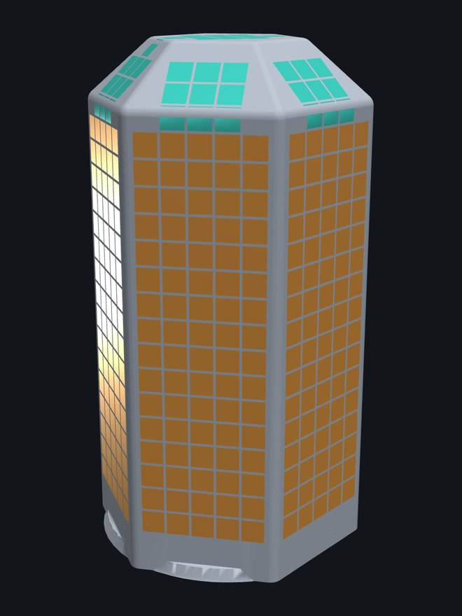

# Shapes and surfaces

A flex PCB is a thin sheet. It bends easily, but only one way at a time, the way a sheet of paper does. That decides which surfaces OpenTac can sensorize directly.

## Surfaces that work

**Flat and singly curved surfaces** can be covered with one board: a gripper jaw, the flat pad of a finger, a cylinder, a cone, or a strip that wraps around a corner. These are *developable* surfaces: they unroll flat without stretching, so the unfolded outline is exactly the board you need.

In the STL importer, pick the surface in one of four ways:

- **Single face** or **Multiple faces**: click flat faces of the model.
- **Curved surface**: grow a smooth patch from a click, within a normal-angle limit.
- **Draw patch**: click points on the surface to outline the sensor by hand; the tool can smooth away texture such as tread patterns.

**Unfold selection** flattens the patch triangle by triangle at true scale. If the selection spans surfaces that don't share a mesh edge (a fingertip's front face and its two sides, say), the tool asks you to match the corners where they join, one cut at a time.

## Surfaces that don't

**Doubly curved surfaces** (a sphere, a dome, the rounded cap of a fingertip, a saddle) cannot be covered by one flat sheet without wrinkling or stretching it, and copper does not stretch. Such a surface cannot be sensorized directly.

Approximate it instead:

1. **Split it into flat facets.** Model the curved region as a set of flat faces, and design the sensor over those faces. The facets fold along straight lines, which a flex PCB does well.
2. **Prefer hexagons where they fit.** A hexagonal facet pattern follows a rounded surface more closely than squares with the same number of folds. The D'Claw fingertip below is a hexagonal prism: six side faces, a hexagon on the tip, and a leaf on each face that folds onto the chamfer between them.
3. **Or sensorize only the part that matters.** The paper's agent-designed Allegro fingertip covers the palmar face plus the first 7&nbsp;mm of the curved tip cap, and leaves the rest of the cap bare (see [Design with an AI agent](agent.md)).

<figure markdown="span">
  { loading=lazy }
  <figcaption>Unfolded: six faces with a leaf each, the hexagon for the tip, one tail.</figcaption>
</figure>
<figure markdown="span">
  { loading=lazy }
  <figcaption>Folded onto the printed core: 546 taxels, 2&nbsp;mm, five columns centred on every face and leaf, 25 &times; 30 on the 60-pin board.</figcaption>
</figure>

## Practical rules

- **The cable edge should be a real straight edge** at least as wide as the connector. On a smooth outline, cut a short flat where the cable should leave.
- **Concave shapes are fine.** Where a notch cuts a row or column in two, the router joins the pieces with a link that runs around the notch, so the row is still one wire. Deep notches cost taxels in fixed-outline mode; four copper layers recover most of them.
- **Leave room for the tail.** The tail runs from the cable edge to the readout board. Set its length in the **Tail** section so it reaches; print the 1:1 PDF and wrap it around the part to check.
- **Pairs of grippers:** design the left jaw, then **Mirror** it for the right. The cable edge stays on the same physical edge.
