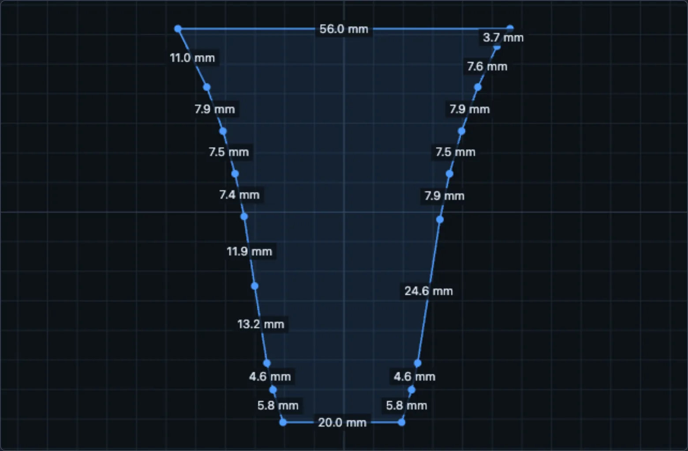

# Shapes and surfaces

A flex PCB can bend around a surface, but it cannot conform to arbitrary curvature without in-plane deformation. The relevant distinction is whether the target surface can be unfolded into a flat sheet without stretching. This determines whether one continuous board can cover it, or whether the design needs cuts, facets or partial coverage.

## Developable surfaces { #surfaces-that-work }

**Flat and developable surfaces** can be covered by a board cut to their unfolded outline. Examples include a planar gripper pad, a cylindrical surface, a cone, or a strip folded around a corner. These surfaces flatten without in-plane stretching, so their unfolded geometry provides the PCB outline.

In the STL importer, pick the surface in one of four ways:

- **Single face** or **Multiple faces**: click flat faces of the model.
- **Curved surface**: grow a smooth patch from a click, within a normal-angle limit.
- **Draw patch**: click points on the surface to outline the sensor by hand; the tool can smooth away texture such as tread patterns.

**Unfold selection** flattens the patch triangle by triangle at true scale. If the selection spans surfaces that don't share a mesh edge (a fingertip's front face and its two sides, say), the tool asks you to match the corners where they join, one cut at a time.

<figure class="ot-fig ot-fig--clear ot-screen" markdown>

<figure markdown="span">
  { loading=lazy width="374" height="417" }
  <figcaption>Contact surface selected on the 3D model.</figcaption>
</figure>
<figure markdown="span">
  { loading=lazy width="780" height="512" }
  <figcaption>Selected surface unfolded at true scale.</figcaption>
</figure>

<figcaption>The AgileX Piper jaw from the robot gallery: its curved contact surface, selected on the model and unfolded at true scale into the board outline.</figcaption>
</figure>

## Doubly curved surfaces { #surfaces-that-dont }

**Doubly curved surfaces**, such as a sphere, dome, rounded fingertip cap or saddle, cannot be flattened without distortion. A continuous flex PCB therefore cannot conform to them exactly without stretching, wrinkling or cuts. For these regions, change the surface approximation or restrict the coverage.

There are three practical options:

1. **Split it into flat facets.** Model the curved region as a set of flat faces, and design the sensor over those faces. The facets fold along straight lines, which a flex PCB does well.
2. **Choose facets to match the part.** The D'Claw fingertip below uses a hexagonal prism: six side faces, a hexagonal tip, and a leaf on each side that folds over the intervening chamfer. This provides a faceted approximation to the fingertip's curved contact region.
3. **Restrict coverage to the contact region.** The paper's agent-designed Allegro fingertip covers the palmar face plus the first 7&nbsp;mm of the curved tip cap, and leaves the rest of the cap bare (see [Design with an AI agent](agent.md)).

<figure markdown="span">
  { loading=lazy }
  <figcaption>Unfolded D'Claw sensor: six side faces with chamfer tabs, a hexagonal tip, and one connector tail.</figcaption>
</figure>
<figure markdown="span">
  { loading=lazy }
  <figcaption>Sensor folded onto the printed fingertip core: 546 taxels of 2&nbsp;mm, with five columns centred on each face and tab. The 25 &times; 30 grid uses the 60-pin readout board.</figcaption>
</figure>

## Constraints on the outline and tail { #practical-rules }

- **Select a straight cable edge** at least as wide as the connector. On a smooth outline, cut a short flat where the cable should leave.
- **Concave outlines require additional routing.** Where a notch cuts a row or column in two, the router joins the pieces with a link that runs around the notch, so the row is still one wire. In fixed-outline mode, this routing reduces the area available for taxels. Four copper layers can recover coverage by moving row connections to the inner layers.
- **Leave room for the tail.** The tail runs from the cable edge to the readout board. Set its length in the **Tail** section so it reaches; print the 1:1 PDF and wrap it around the part to check.
- **Paired gripper jaws:** design the left jaw, then **Mirror** it for the right. The cable edge stays on the same physical edge.
