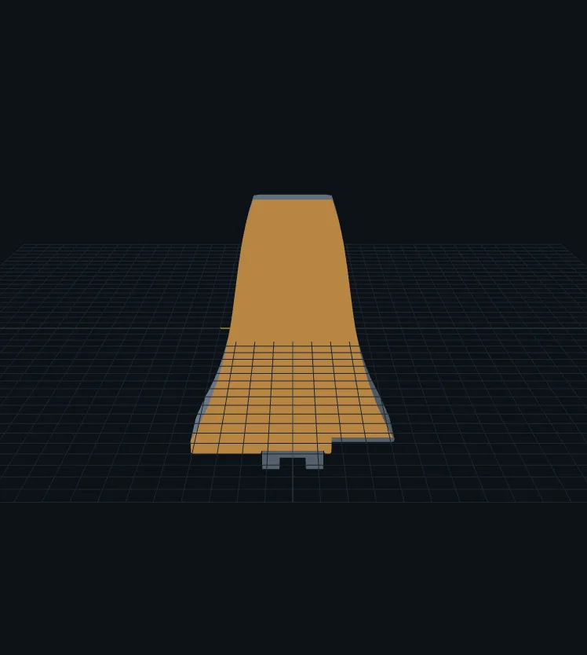

# Get started

OpenTac is one repository: the CAD tool, the readout firmware and Python package, the readout-board hardware files and this website. Most people clone it and run it locally. The hosted version is there to try the CAD tool without installing anything.

## Try it online

Open [OpenTac-CAD](../cad/){ .md-button .md-button--primary } in your browser. You can draw an outline, import a DXF or STL, generate a board and download the files.

The online tool runs its design engine on a free server that sleeps when idle, so the first **Generate** of the day can take up to a minute while it wakes. Locally, a design generates in a second or two and your files never leave your computer.

<figure class="ot-fig ot-fig--clear ot-screen" markdown="span" style="max-width: 32rem">
  [{ loading=lazy width="939" height="995" }](assets/screens/cad_generated.webp)
  <figcaption>OpenTac-CAD after <strong>Generate</strong> on one of its examples, the Yubi finger pad: the design check, the routed board, and the downloads.</figcaption>
</figure>

## Run it on your computer

You need [git](https://git-scm.com/downloads) (or download the repository as a ZIP from GitHub) and nothing else: the start script installs [uv](https://docs.astral.sh/uv/), a small Python installer, if you don't have it.

1. Get the code:

    ```bash
    git clone --depth 1 https://github.com/opentac/opentac.github.io opentac
    ```

2. Open the `opentac` folder and double-click the start script:

    | System | File |
    |---|---|
    | macOS | `Start_OpenTac.command` |
    | Windows | `Start_OpenTac.bat` |
    | Linux | run `bash Start_OpenTac.command` in a terminal |

3. The first run downloads what the tool needs into the folder's own environment (a few minutes, once). After that it starts in seconds and opens OpenTac-CAD in your browser.

!!! note "If macOS blocks the double-click"
    Open Terminal, type `bash ` (with a trailing space), drag `Start_OpenTac.command` onto the window and press Enter.

From a terminal the same thing is one command, run in the repository folder:

```bash
uv run opentac cad
```

## Design with an AI agent

The repository includes a skill that teaches a coding agent to design sensors with the same compiler the CAD tool uses. [Claude Code](https://claude.com/claude-code) loads it automatically from `.claude/skills/opentac/` when you start it in the repository folder; other agents read [`AGENTS.md`](https://github.com/opentac/opentac.github.io/blob/main/AGENTS.md), which points them to the same instructions. Describe the sensor in your own words, with its size, shape and where the cable should leave. See [Design with an AI agent](design/agent.md).

## From a design to live readings

The whole path, with a page for each step. The [assembly guide](build/assembly.md) covers steps 2, 5 and 6 on one page, with photos and a video.

<div class="ot-photos ot-photos--three" markdown>
<figure markdown="span">
  { loading=lazy }
  <figcaption>1. Design.</figcaption>
</figure>
<figure markdown="span">
  { loading=lazy }
  <figcaption>2. Check the fit on paper.</figcaption>
</figure>
<figure markdown="span">
  { loading=lazy }
  <figcaption>3. Order the flex PCB.</figcaption>
</figure>
<figure markdown="span">
  { loading=lazy }
  <figcaption>4. Gather materials and cut the piezoresistive layer.</figcaption>
</figure>
<figure markdown="span">
  { loading=lazy }
  <figcaption>5. Print the case and assemble.</figcaption>
</figure>
<figure markdown="span">
  { loading=lazy }
  <figcaption>6. Flash, set up and view.</figcaption>
</figure>
</div>

1. **Design** the sensor in [OpenTac-CAD](design/index.md) and download the ZIP: the board files and the [printed case](build/index.md#the-printed-case), generated from the same design so they line up.
2. **Print the 1:1 PDF** from the ZIP and hold it against the part to check the fit (see [Check the fit on paper](build/assembly.md#check-the-fit-on-paper)).
3. **Order** the [flex PCB](build/order-sensor.md) and, if you don't have one, a [readout board](build/order-readout.md).
4. **Gather** the [materials](build/materials.md): a piezoresistive film or fabric, TPU filament, a USB cable.
5. **Print the case** from the ZIP's `case/` folder, cut the film, and [assemble](build/assembly.md).
6. **Flash** the readout board, **set it up** once with your design, and **view** the live map:

    ```bash
    uv run opentac flash                  # put firmware on the readout board
    uv run opentac setup my_design.zip    # tell the board which sensor is plugged in (once)
    uv run opentac view                   # live heatmap
    ```

    The end of the [assembly guide](build/assembly.md#read-the-sensor) says what you should see and what to check if something looks wrong. [Flash the firmware](use/flash.md) and [Read a sensor](use/sensor.md) have the details.

## What you need on the bench

<figure class="ot-fig ot-fig--clear" markdown="span" style="max-width: 34rem">
  { loading=lazy width="1280" height="720" }
  <figcaption>The parts of one sensor, from left: printed tray, flex PCB, piezoresistive textile, bump sheet. A readout board and a USB cable complete it.</figcaption>
</figure>

- the flex PCB from your design, as ordered;
- a readout board: the 60-pin board for sensors up to 30&times;30 taxels, or the 30-pin pair for up to 15&times;15 (see [Readout boards](hardware.md));
- a piezoresistive layer, such as LINQSTAT film or a piezoresistive textile (see [Materials](build/materials.md));
- a 3D printer and TPU filament (85&ndash;95A) for the case and bump sheet;
- double-sided tape, scissors, printer paper;
- a micro-USB data cable for the readout board;
- `dfu-util` or STM32CubeProgrammer, to flash the readout board (see [Flash the firmware](use/flash.md)).

## What it costs

Example quotes from JLCPCB, October 2026, shipping extra:

- $16 for 5 flex PCBs of an example two-layer sensor, 89 &times; 60&nbsp;mm, at a special-offer price ([Order the sensor](build/order-sensor.md));
- $378 for 5 assembled 60-pin readout boards ([Order the readout board](build/order-readout.md));
- about $372 for 5 assembled 30-pin pairs ($205.85 for the top boards and $165.98 for the bottom boards).

## Getting help

Questions and bug reports go to the repository's [issue tracker](https://github.com/opentac/opentac.github.io/issues). For a problem with a board or a sensor, include the output of `uv run opentac info`, run with the board plugged in, and attach the design ZIP if a design is involved.
