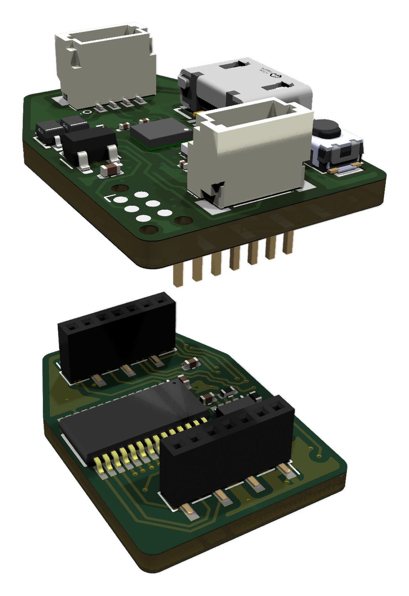

# Readout boards

Every OpenTac sensor plugs into one of two readout boards. Both run the same firmware, read any layout the CAD tool makes, and talk to the computer over USB.

<figure>
  <video data-loop muted loop playsinline preload="none" poster="../assets/boards/readout60.png"
         aria-label="Turntable render of the 60-pin readout board">
    <source src="../assets/boards/readout60_spin.mp4" type="video/mp4">
  </video>
  <figcaption><strong>60-pin board.</strong> Up to 30&times;30 taxels; 37&nbsp;&times;&nbsp;34.3&nbsp;mm.</figcaption>
</figure>
<figure>
  <video data-loop muted loop playsinline preload="none" poster="../assets/boards/readout30.png"
         aria-label="Turntable render of the stacked 30-pin readout boards">
    <source src="../assets/boards/readout30_spin.mp4" type="video/mp4">
  </video>
  <figcaption><strong>30-pin pair.</strong> Up to 15&times;15 taxels; two 16&nbsp;&times;&nbsp;22.8&nbsp;mm boards, stacked.</figcaption>
</figure>

Use the **60-pin board** for most sensors. Use the **30-pin pair** where space is tight, such as inside a finger or a small gripper. The limit is per direction: the 60-pin board takes up to 30 rows *and* 30 columns, the 30-pin pair up to 15 and 15.

## What the boards do

<ol class="ot-features" markdown>
<li markdown>

**Zero-potential readout, so taxels don't leak into each other.** A sensor is a passive grid: every taxel connects one row to one column. Read it naively, and current from the driven row also finds paths through other pressed taxels into the measured column, so a press shows up where nobody touched (crosstalk, or "ghosting"). The board drives one row to the supply voltage and holds every other row at ground. A multiplexer connects one column to an inverting amplifier whose + input is grounded, so that column sits at virtual ground: the same potential as the idle rows. The other taxels on that column have no voltage across them and carry no current, and current leaking through other pressed taxels drains into the grounded rows rather than into the amplifier. Each reading is the one taxel at the driven row and the selected column.

</li>
<li markdown>

**An IMU on the board.** Each board carries an ST LSM6DSV16BX inertial sensor. The firmware streams its accelerometer for vibration, at up to 1920&nbsp;Hz (960&nbsp;Hz by default), and its orientation as a quaternion computed on the chip by its own sensor-fusion block, at up to 480&nbsp;Hz (240&nbsp;Hz by default). On a gripper or a fingertip, that adds vibration and orientation alongside the tactile frames, from the same board.
<!-- CHECK: IMU on while scanning (README notes IMU-related spikes on one board; post-drain-wait fix in RELEASE_PLAN workstream A) -->

</li>
<li markdown>

**Daisy-chain over I2C.** Each board has two 4-pin JST-SH connectors (5&nbsp;V, GND, SCL, SDA). Chain several 30-pin boards with JST-SH cables and read them all through one controller, a Teensy 4.0, to cover a whole hand or several fingers from one USB port. See [Daisy-chain boards](use/daisy-chain.md). The 60-pin board has the connectors, but its firmware does not run as a chain node yet: a 30 x 30 sensor does not fit the node's memory.

</li>
<li markdown>

**Plugs straight into USB.** A micro-USB cable connects the board to the computer. It shows up as a serial port, with no adapter or programmer, and the same cable flashes new firmware ([Flash the firmware](use/flash.md)).

</li>
<li markdown>

**Small.** The 60-pin board is 37&nbsp;&times;&nbsp;34.3&nbsp;mm. The 30-pin version splits the circuit over two 16&nbsp;&times;&nbsp;22.8&nbsp;mm boards stacked on 1.27&nbsp;mm headers: the bottom board carries the sensor connector and the analog front end, the top board the microcontroller, IMU, USB and daisy-chain connectors.

</li>
</ol>

<figure class="ot-fig" markdown="span">
  { loading=lazy }
  <figcaption>The 30-pin pair, pulled apart.</figcaption>
</figure>

## Specifications

| | 60-pin board | 30-pin pair |
|---|---|---|
| Largest sensor | 30 rows &times; 30 columns | 15 rows &times; 15 columns |
| Size | 37 &times; 34.3 mm | two boards, 16 &times; 22.8 mm, stacked |
| Sensor connector | Molex 505110-6091, 60 positions, 0.5 mm pitch | Molex 505110-3091, 30 positions, 0.5 mm pitch |
| Connector pads | 1&ndash;30 rows, 31&ndash;60 columns | 1&ndash;15 columns, 16&ndash;30 rows |
| Microcontroller | STM32G431 | STM32G431 |
| Row drive | four 74HC595 shift registers | two 74HC595 shift registers |
| Column select | ADG732 (32:1) | ADG706 (16:1) |
| Gain | 16 settings: four feedback resistors switched in by a MAX14662 over I2C ([Gain](use/sensor.md#gain-60-pin-board)) | fixed |
| IMU | LSM6DSV16BX | LSM6DSV16BX |
| Computer link | micro-USB, serial | micro-USB, serial |
| Daisy chain | connectors fitted; firmware not yet | 2 &times; JST-SH 4-pin, I2C |
| Copper layers | 4 | 4 (top), 2 (bottom) |
| Files | [`hardware/readout_60pin/`](https://github.com/opentac/opentac.github.io/tree/main/hardware/readout_60pin) | [`hardware/readout_30pin/`](https://github.com/opentac/opentac.github.io/tree/main/hardware/readout_30pin) |

The connector is a bottom-contact ZIF type that takes a 0.30&nbsp;mm thick flex end, which is why the sensor's tail carries a [stiffener](build/order-sensor.md#stiffener).

## Files and ordering

Each board's folder has the KiCad project (schematic and layout) and a `production/` folder ready for JLCPCB assembly: a Gerber ZIP, a bill of materials with LCSC part numbers, and a placement (CPL) file. [Order the readout board](build/order-readout.md) walks through the order.

An earlier 70-pin board (READOUT32) is still supported by the firmware for boards already in use, but new designs should use the 60-pin board.
