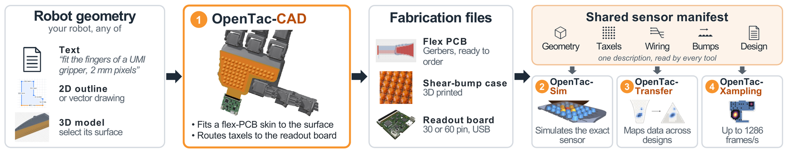
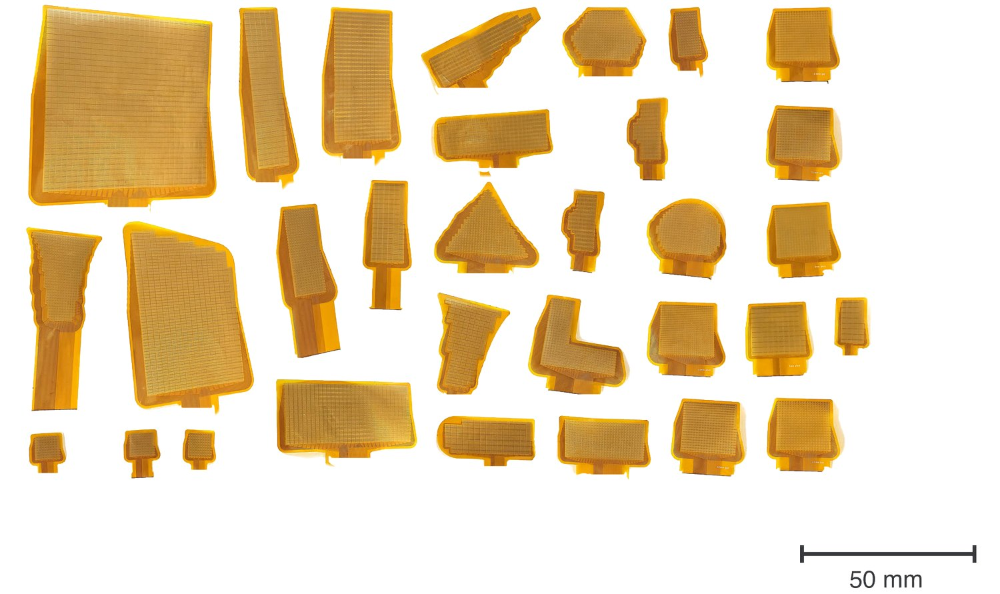
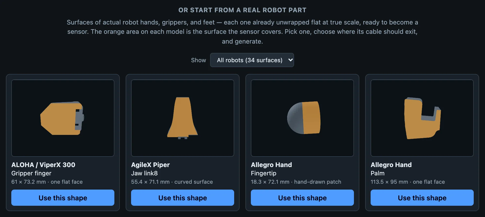

<!--
  Home page story. Layout classes live in docs/stylesheets/opentac.css:
    ot-story        one section: text + one visual (add ot-story--flip to swap sides)
    ot-media        a rounded media frame; data-loop videos autoplay when visible
    ot-strip        a row of clips of different shapes at one height
                    (ot-strip--stack: two wide clips stacked beside two tall ones)
    ot-stack        wide comparison clips, one per row at full width
    ot-clip         a figure: one ot-media clip with a one-line caption under it
  A clip below the first screen names its still as data-poster="..." (set by
  docs/javascripts/opentac.js when it nears the screen); only a clip in the
  first screen uses poster="...".
  Numbers here come only from the paper text; see results.md for the full list.
-->

<section class="ot-video" aria-labelledby="flow">
<h2 id="flow" class="ot-section-title">Automatically sensorize any surface on a robot</h2>
<figure>
<div class="ot-media ot-media--video">
  <video data-loop muted loop playsinline preload="none" poster="assets/loops/concept.jpg"
         aria-label="As part of the OpenTac ecosystem, we develop OpenTac-CAD, a design tool to automatically sensorize any surface on a robot with OpenTac tactile sensors. In this visualization, we show examples for six different robots.">
    <source src="assets/loops/concept.mp4" type="video/mp4">
  </video>
</div>
<figcaption>As part of the OpenTac ecosystem, we develop OpenTac-CAD, a design tool to automatically sensorize any surface on a robot with OpenTac tactile sensors. In this visualization, we show examples for six different robots from the <a href="https://github.com/google-deepmind/mujoco_menagerie">MuJoCo Menagerie</a> (Unitree G1 and Go2, LEAP Hand, AgileX Piper, Robotiq 2F-85, UMI gripper). Contact responses in the animation are simulated.</figcaption>
</figure>
</section>

<section class="ot-video" aria-labelledby="video">
<h2 id="video" class="ot-section-title">Overview</h2>
<p class="ot-video__lede">
OpenTac is an ecosystem for highly customizable, scalable, and transferable tactile sensing. We provide tools ranging across sensor design, simulation, cross-sensor transfer, data visualization, tactile policy learning, and more.
</p>
<div class="ot-media ot-media--video">
  <video controls preload="none" playsinline poster="assets/loops/overview.jpg"
         aria-label="Narrated overview of OpenTac, with subtitles in the picture">
    <source src="assets/loops/overview.mp4" type="video/mp4">
  </video>
</div>
<figure class="ot-fig">
  <a href="assets/figures/ecosystem.png"></a>
  <figcaption>The OpenTac ecosystem. OpenTac-CAD turns a text description, a 2D outline or a 3D model into a fabrication-ready sensor: flex-PCB Gerbers and a 3D-printed shear-bump case, read out by a reusable USB readout board. Every design also has a sensor manifest, which OpenTac-Sim, OpenTac-Transfer and OpenTac-Xampling use to simulate the sensor, map data across designs and acquire it at high frame rates.</figcaption>
</figure>
</section>

<section class="ot-evidence" aria-labelledby="evidence" markdown>
<h2 id="evidence" class="ot-section-title">OpenTac tactile sensors in action</h2>

<div class="ot-strip ot-strip--stack">
<figure class="ot-strip__item ot-strip__item--wide">
  <video data-loop muted loop playsinline preload="none" data-poster="assets/loops/real_sensor.jpg"
         aria-label="A finger presses and twists a bump sensor; the live map shows normal force as colour and shear as arrows">
    <source src="assets/loops/real_sensor.mp4" type="video/mp4">
  </video>
  <figcaption>A finger presses and twists a sensor. Colour is normal force; arrows are shear.</figcaption>
</figure>
<figure class="ot-strip__item ot-strip__item--wide">
  <video data-loop muted loop playsinline preload="none" data-poster="assets/loops/durability.jpg"
         aria-label="A sensor is touched lightly, struck with a hammer, unplugged, thrown on the floor, stomped on and run over with an office chair, then plugged back in and touched again; an enlarged inset shows the live map">
    <source src="assets/loops/durability.mp4" type="video/mp4">
  </video>
  <figcaption>Hammered, thrown, stomped on and run over with an office chair, then plugged back in: the sensor works just as well.</figcaption>
</figure>
<figure class="ot-strip__item ot-strip__item--tall">
  <video data-loop muted loop playsinline preload="none" data-poster="assets/video/dynamic_range_poster.jpg"
         aria-label="Pressure readings from about 0.1 newton to about 10 newtons">
    <source src="assets/video/dynamic_range.mp4" type="video/mp4">
  </video>
  <figcaption>From about 0.1&nbsp;N to about 10&nbsp;N at 10&nbsp;k&Omega; feedback (default gains; can be tweaked to change range).</figcaption>
</figure>
<figure class="ot-strip__item ot-strip__item--tall">
  <video data-loop muted loop playsinline preload="none" data-poster="assets/video/heat_gun_poster.jpg"
         aria-label="A heat gun directed at the sensor produces no false contact response.">
    <source src="assets/video/heat_gun.mp4" type="video/mp4">
  </video>
  <figcaption>A heat gun directed at the sensor produces no false contact response.</figcaption>
</figure>
</div>

<div class="ot-keys" markdown>

| | Some key results |
|---|---|
| Design and fabrication | We designed over 30 sensors automatically, using our OpenTac-CAD tool. All these designs passed design-rule checks, and resulted in sensors that were fabricated and tested. |
| Normal and shear force accuracy | Against an OptoForce reference, a bumped 4&times;4 patch achieves in-sample R&sup2; of 0.95, 0.93 and 0.96 for F<sub>x</sub>, F<sub>y</sub> and F<sub>z</sub>. |
| Fast readout | We use an adaptive readout mechanism for sparse and fast scanning. On a 1024-taxel skin, conventional (raster) scanning results in 67 frames/s; while our adaptive method (OpenTac-Xampling) results in 1286 partial frames/s (16 taxels per frame). |
| Policy learning | We use the sensor in tactile policy learning experiments involving contact rich insertion tasks on the SO-101 robot arm and a bimanual YAM robot. We find that shear data is crucial in these tasks. |
| Grasp control | We demonstrate, on a Dexmate Vega-1 Pro robot, that shear aids slip prevention when holding a cup under impulsive loading. |

[All results](results.md){ .ot-more }

</div>
</section>


<section class="ot-story" aria-labelledby="sense" markdown>
<div class="ot-story__text" markdown>

## The OpenTac sensor: normal and shear force from taxel-aligned bumps { #sense }

Each skin is a flexible PCB with a grid of interdigitated electrodes (taxels), a piezoresistive film on top, and a 3D-printed lid with one soft bump over every 2&times;2 group of taxels.

Pressing a bump with a downward normal force results in an approximately uniform pressure distribution over the four underlying taxels. Tangential force tilts the bumps, creating a pressure (and consequently, resistance) differential over the underlying taxels, allowing us to estimate shear forces. The sum of the four readings gives the normal force, and their differences give the two shear components. Because each bump is generated with the board and is guaranteed to sit over a known 2&times;2 group of taxels, both components are computed directly from the four readings and can be calibrated to newtons against a reference sensor.

[How it works](learn/index.md){ .ot-more }

</div>
<div class="ot-media">
  <video data-loop muted loop playsinline preload="none" data-poster="assets/loops/bump_principle.jpg"
         aria-label="Animation of the sensor layers and of a bump responding to press, shear and twist">
    <source src="assets/loops/bump_principle.mp4" type="video/mp4">
  </video>
</div>
</section>

<section class="ot-story ot-story--flip" aria-labelledby="design" markdown>
<div class="ot-story__text" markdown>

## OpenTac-CAD: Design a sensor for any surface { #design }

We develop a design tool, OpenTac-CAD, to automatically sensorize new surfaces. Given a 2D outline drawn within our tool, a DXF file, or an STL file, OpenTac-CAD lays out a taxel grid, places and routes wires, designs the connector, and produces a set of Gerber files (for the flexible PCB), a 3D-printable TPU bump case (for shear sensing and alignment), and a manifest file (for sharing sensor metadata across the OpenTac ecosystem). Automatic designs cover more of the target surface than the largest rectangular array that fits, sensorizing 75&ndash;93% of the target area on five robot surfaces in 0.7&ndash;2.6&nbsp;s.

[Try it online](cad/){ .ot-more } [Design guide](design/index.md){ .ot-more }

</div>
<div class="ot-media">
  <video data-loop muted loop playsinline preload="none" data-poster="assets/loops/cad_demo.jpg"
         aria-label="Screen recording of OpenTac-CAD sensorizing a gripper finger: load the model, click the contact surface, set the cable edge and taxel size, generate the board, then the printed case">
    <source src="assets/loops/cad_demo.mp4" type="video/mp4">
  </video>
</div>
</section>

<figure class="ot-wide" markdown="span">
  [{ loading=lazy }](assets/figures/fabricated.jpg)
  <figcaption>The 31 sensors we show here were all designed using OpenTac-CAD and subsequently fabricated, and found to work reliably.</figcaption>
</figure>

<section class="ot-story" aria-labelledby="build" markdown>
<div class="ot-story__text" markdown>

## Order and assemble an OpenTac sensor { #build }

Fabricating an OpenTac sensor involves 3 phases. First, we use the OpenTac-CAD tool to design a sensor for the surface we want to mount it on. Second, we fabricate the flexible PCB from the generated Gerber files, which can be ordered from manufacturers such as JLCPCB or PCBWay, and the readout board from its released fabrication files. Third, we 3D-print a TPU bump sheet (also generated by OpenTac-CAD) using a commodity 3D printer. Assembly is straightforward: the designed case makes it extremely convenient to stack the flex PCB, a piezoresistive film, and the TPU bump grid.

[Assembly guide](build/assembly.md){ .ot-more } [Build steps](build/index.md){ .ot-more }

</div>
<figure class="ot-media">
  <video data-loop muted loop playsinline preload="none"
         data-poster="assets/video/assembly_poster.jpg"
         aria-label="Sensor assembly at four times normal speed: placing the flex PCB in its tray, adding the piezoresistive film and bump sheet, and connecting the readout board">
    <source src="assets/loops/assembly.mp4" type="video/mp4">
  </video>
</figure>
</section>

<section class="ot-story ot-story--flip" aria-labelledby="read" markdown>
<div class="ot-story__text" markdown>

## USB readout boards can be re-used across designs { #read }

We provide two default readout board designs, based on the number of taxels / wires a sensor has. The 60-pin readout board reads up to 30&times;30 taxels in 37&nbsp;&times;&nbsp;34.3&nbsp;mm and plugs straight into USB; a stacked 30-pin pair reads up to 15&times;15 in a 16&nbsp;&times;&nbsp;22.8&nbsp;mm footprint. Each board carries an IMU, and 30-pin boards can be daisy-chained over I2C to read a whole hand from one USB port.

The board stores the sensor's layout in its own flash, so after a one-time setup the live view knows where every taxel is. It is possible to customize and design larger readout boards if needed -- we make our gerbers freely available for customization.

[Readout boards](hardware.md){ .ot-more } [Read a sensor](use/sensor.md){ .ot-more }

</div>
<div class="ot-media ot-media--board">
  <video data-loop muted loop playsinline preload="none" data-poster="assets/boards/readout60_poster.jpg"
         aria-label="Turntable render of the 60-pin OpenTac readout board">
    <source src="assets/boards/readout60_spin.mp4" type="video/mp4">
  </video>
</div>
</section>

<section class="ot-story" aria-labelledby="xampling" markdown>
<div class="ot-story__text" markdown>

## Adaptive, kilohertz-rate sampling { #xampling }

OpenTac-Xampling is an adaptive acquisition method that results in fast readouts. Instead of scanning every single taxel when reading out every frame, we leverage the idea that most contact events tend to be sparse. Each frame reads a small search sample of taxels and then grows around any contact until it is fully measured. This enables skipping through large swaths of empty taxels, works on any sensor layout, and, in grow mode, is guaranteed to be no worse than raster scanning.

This helps capture contacts that happen in a few milliseconds (and are missed by raster scanning). E.g., on a 1024-taxel skin, full raster scanning gives 67 frames/s; reading 16 taxels per frame gives 1286 frames/s. Raster scanning caught two of six ~3&nbsp;ms tennis-ball impacts; budgets of 16 to 256 taxels per frame caught all three impacts tested at each budget.

[Xampling](use/xampling.md){ .ot-more }

</div>
<figure class="ot-clip">
<div class="ot-media">
  <video data-loop muted loop playsinline preload="none" data-poster="assets/loops/xampling.jpg"
         aria-label="Two tennis-ball drops in slow motion: raster scanning misses the impact, Xampling at 32 taxels per frame captures it">
    <source src="assets/loops/xampling.mp4" type="video/mp4">
  </video>
</div>
<figcaption>Two 30&nbsp;cm drops at 128&times; slow motion: raster scanning misses the impact; Xampling at 32 taxels per frame catches it. The 996 updates/s on the clip is the rate of that recording.</figcaption>
</figure>
</section>

<section class="ot-story ot-story--flip ot-story--pair" aria-labelledby="sim" markdown>
<div class="ot-story__text" markdown>

## Simulating OpenTac sensors and cross-sensor transfer { #sim }

The shared sensor manifest produced by OpenTac-CAD is used to specify mechanical and electronic properties of the sensor. This manifest can be used to create simulation models of the sensor. We build a simulation tool, OpenTac-Sim, which models each bump as a rigid body on a five-degree-of-freedom compliant joint in MuJoCo. We also have a foam-contact model for plain skins (i.e., variants of OpenTac that do not require shear sensing and forgo the TPU bump grid).

OpenTac-Transfer maps calibrated contact between skins of different shape and taxel pitch, in physical coordinates and without paired data. Across four skins it reached a median shape F1 of 0.750, against 0.714 and 0.634 for two array-resizing baselines. For now, OpenTac-Transfer works on flat skins. We welcome contributors extending this module further.

[Simulate](sim.md){ .ot-more } [Transfer](transfer.md){ .ot-more }

</div>
<div class="ot-pair">
  <figure class="ot-clip">
  <div class="ot-media">
    <video data-loop muted loop playsinline preload="none" data-poster="assets/loops/sim_peg.jpg"
           aria-label="Simulated peg insertion with deformable tactile pads: the normal-and-shear policy inserts the peg, the normal-only policy fails">
      <source src="assets/loops/sim_peg.mp4" type="video/mp4">
    </video>
  </div>
  <figcaption>Peg insertion in the simulator of the paper's policy experiments, with deformable pads: the normal-and-shear policy inserts the peg, the normal-only policy does not.</figcaption>
  </figure>
  <figure class="ot-clip">
  <div class="ot-media">
    <video data-loop muted loop playsinline preload="none" data-poster="assets/loops/transfer.jpg"
           aria-label="One block pressed into three skins of different shape and pitch, mapped onto one millimetre grid">
      <source src="assets/loops/transfer.mp4" type="video/mp4">
    </video>
  </div>
  <figcaption>OpenTac-Transfer: one block pressed into three skins of different shape and pitch, placed on one millimetre grid.</figcaption>
  </figure>
</div>
</section>

<section class="ot-robots" aria-labelledby="robots" markdown>
<div class="ot-robots__text" markdown>

## Robot control and manipulation policy learning { #robots }

We deployed the skins on four robots and a handheld UMI gripper. On an SO-101 arm, we evaluated two contact-rich tasks (peg-in-hole insertion, plug-in-socket insertion). On both tasks, shear sensors had the highest success rates. Particularly on the plug insertion task, shear was crucial -- merely adding normal force did not yield any improvements over proprioception alone. On a bimanual YAM robot, we designed a custom fixture for a lock-key insertion task, and only policies with shear information could achieve substantial success rates.

**Note**: All our robot learning experiments solely use tactile information and proprioception. No visual information was used.

[All results](results.md){ .ot-more }

</div>
<div class="ot-stack">
  <figure class="ot-clip"><div class="ot-media"><video data-loop muted loop playsinline preload="none" data-poster="assets/loops/so101_plug.jpg" style="aspect-ratio: 1920 / 786" aria-label="SO-101 arm, plug-in-socket insertion: OpenTac-3D inserts the plug; while OpenTac-1D and proprioception-only fail"><source src="assets/loops/so101_plug.mp4" type="video/mp4"></video></div><figcaption>SO-101 arm, plug-in-socket insertion: OpenTac-3D inserts the plug; while OpenTac-1D and proprioception-only fail.</figcaption></figure>
  <figure class="ot-clip"><div class="ot-media"><video data-loop muted loop playsinline preload="none" data-poster="assets/loops/yam_keylock.jpg" style="aspect-ratio: 1920 / 620" aria-label="Lock-key insertion with bimanual YAM arms (sensors used only on the left gripper): OpenTac-3D inserts the key; OpenTac-1D and proprioception-only fail while attempting insertion"><source src="assets/loops/yam_keylock.mp4" type="video/mp4"></video></div><figcaption>Lock-key insertion with bimanual YAM arms (sensors used only on the left gripper): OpenTac-3D inserts the key; OpenTac-1D and proprioception-only fail while attempting insertion.</figcaption></figure>
</div>
<div class="ot-grid3">
  <figure class="ot-clip ot-clip--tall2"><div class="ot-media"><video data-loop muted loop playsinline preload="none" data-poster="assets/loops/ur5_controllers.jpg" style="aspect-ratio: 720 / 804" aria-label="A UR5 moves a ball along the edge of a sensor plate under a normal-force controller (top) and a shear-force controller (bottom), each with its contact map"><source src="assets/loops/ur5_controllers.mp4" type="video/mp4"></video></div><figcaption>UR5 moving a ball along the plate's edge: the normal-force controller (top) is quicker but cuts across the sensor; the shear-force controller (bottom) is slower and does not.</figcaption></figure>
  <figure class="ot-clip"><div class="ot-media"><video data-loop muted loop playsinline preload="none" data-poster="assets/loops/dexmate_admittance.jpg" aria-label="A stick pushes a Dexmate forearm covered in a tactile skin; the arm moves with the push and stops when it ends, next to the skin's live map"><source src="assets/loops/dexmate_admittance.mp4" type="video/mp4"></video></div><figcaption>Dexmate forearm skin: pushed with a stick, the arm yields in the direction of the push and holds its pose when the push stops.</figcaption></figure>
  <figure class="ot-clip"><div class="ot-media"><video data-loop muted loop playsinline preload="none" data-poster="assets/loops/dexmate.jpg" aria-label="Dexmate humanoid holding a cup with two probes, force-only versus force-and-shear feedback"><source src="assets/loops/dexmate.mp4" type="video/mp4"></video></div><figcaption>Dexmate Vega-1 Pro, bimanual cup holding: normal-only feedback (left) and normal-and-shear feedback (right).</figcaption></figure>
  <figure class="ot-clip"><div class="ot-media"><video data-loop muted loop playsinline preload="none" data-poster="assets/loops/umi_ball.jpg" aria-label="UMI gripper holding a ball that a hand turns, with live normal and shear maps from both finger skins"><source src="assets/loops/umi_ball.mp4" type="video/mp4"></video></div><figcaption>UMI gripper: a hand turns the held ball; normal and shear on both finger skins.</figcaption></figure>
  <figure class="ot-clip"><div class="ot-media"><video data-loop muted loop playsinline preload="none" data-poster="assets/loops/umi_external.jpg" aria-label="A hand pushes a screwdriver held by the UMI gripper; the contact shows in both finger skins"><source src="assets/loops/umi_external.mp4" type="video/mp4"></video></div><figcaption>UMI gripper, external contact: a hand pushes the held screwdriver, and the force shows in both finger skins.</figcaption></figure>
</div>
</section>

<section class="ot-start" aria-labelledby="start" markdown>
<div class="ot-start__cols" markdown>
<div markdown>

## How to get started { #start }

Clone the repository and double-click `Start_OpenTac.command` (macOS) or `Start_OpenTac.bat` (Windows); the CAD tool opens in your browser. Or try the hosted version first, no install needed.

```bash
git clone --depth 1 https://github.com/opentac/opentac opentac
cd opentac
uv run opentac cad
```

To build a sensor from a design, follow the [assembly guide](build/assembly.md): it goes from a paper fit check to the sensor showing live readings.

Working with an AI coding agent? The repository ships a skill for designing sensors: Claude Code loads it automatically, and other agents read `AGENTS.md`.

</div>
<figure class="ot-start__shot" markdown="span">
  { loading=lazy width="988" height="443" }
  <figcaption>OpenTac-CAD's start screen, first row of the robot gallery.</figcaption>
</figure>
</div>
<div class="ot-hero__buttons ot-start__buttons">
  <a class="ot-btn ot-btn--primary" href="cad/">Try it online</a>
  <a class="ot-btn ot-btn--dark" href="get-started/">Get started</a>
  <a class="ot-btn ot-btn--dark" href="paper/">Paper and citation</a>
</div>
</section>
