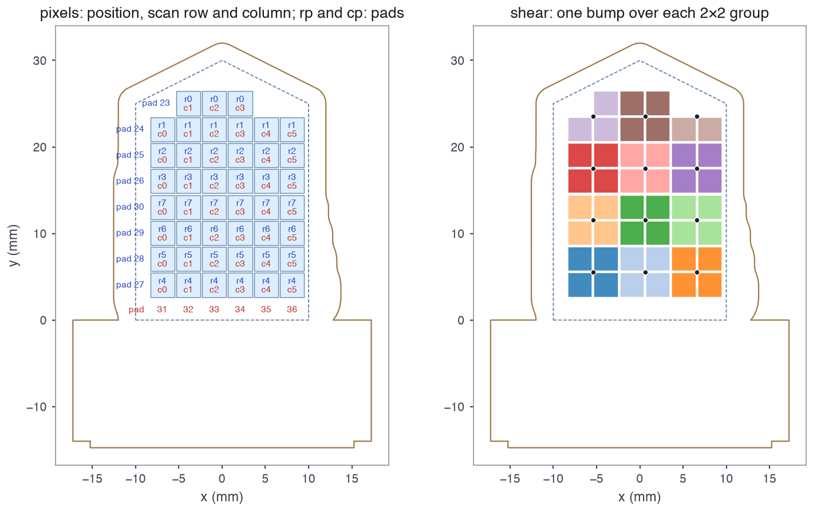

# Manifest

`manifest.json` is the shared description of a sensor's geometry, wiring and optional shear groups. OpenTac-CAD includes it in every design ZIP. Lengths are expressed in millimetres, with Y increasing upward and the cable edge at the bottom. Downstream code should use the physical coordinates in `pixels` rather than infer geometry from scan indices.

```python
from opentac import manifest
m = manifest.load("my_design.zip")      # or manifest.json, or a dict
m.xy, m.row, m.col, m.w, m.h            # taxel centres (mm), scan indices, taxel size
```

`opentac manifest check FILE` validates a manifest and says which readout
boards it fits.

## Format versions { #versions }

The field `v` is the version. Each version added fields and changed none, so
code written for version 3 reads all of them.

| `v` | Added |
|---|---|
| 3 | the base fields below |
| 4 | `design`: the recipe OpenTac-CAD uses to rebuild or edit the board |
| 5 | `shear`: which taxels share a shear bump |
| 6 | `sim3d`: where each taxel sits on the 3-D part it was unrolled from |

## Manifest fields { #fields }

| Field | Meaning |
|---|---|
| `pixels` | one `[x, y, row, col]` per taxel. Defines physical taxel positions and the ordering of values in each frame. |
| `w`, `h` | one taxel's width and height |
| `footprint` | the rest of the taxel copper: `trace_w`, `gap`, `center_clear`, `edge_clear`, `via_drill`, `via_dia` |
| `outline` | the shape the user drew |
| `edge_cuts` | the board as manufactured up to the connector: grown board and cable tail, closed across the connector's open edge (the Gerber `Edge.Cuts` adds the connector tab) |
| `r`, `c` | number of scan rows and columns |
| `m` | which taxels exist: `r` strings of `c` characters, `1` for a taxel |
| `rp`, `cp` | connector pad of each scan row and column |
| `px`, `py`, `ox`, `oy` | scan-order pitch and origin. Use `pixels` for physical geometry. |
| `shear` | `bumps`: bump centres. `b`: one entry per taxel, parallel to `pixels`, the taxel's bump index or -1 for none. |
| `design` | the CAD recipe (v4 on) |
| `sim3d` | 3-D placement (v6, sensors designed on a mesh) |
| `_readme` | Human-readable notes; ignored by programs |

Scan indices follow connector-pad order, which can differ from spatial order. OpenTac-CAD reverses the lower half of the row indices to match routing on the right side. Consequently, expressions such as `ox + col * px` do not generally reconstruct taxel positions. Use the explicit coordinates in `pixels`.

<figure class="ot-fig" markdown="span">
  [{ loading=lazy }](../assets/diagrams/manifest_fields.png)
  <figcaption>Fields of <code>examples/manifests/finger_8x6_60pin.json</code>: <code>pixels</code> with their scan rows (r) and columns (c), <code>rp</code> and <code>cp</code> (pads), and <code>shear</code> (right). Rows 4&ndash;7, the lower half, run upward. Dashed: <code>outline</code>; solid: <code>edge_cuts</code>.</figcaption>
</figure>

## Validation constraints { #rules-a-manifest-must-follow }

`manifest.load()` validates the following constraints and reports the first violation:

- `m` has `r` rows of `c` characters of `0`/`1`.
- `pixels` lists exactly the taxels `m` marks, in the order of reading `m`
  row by row.
- `rp` has `r` pads, `cp` has `c` pads, and no pad is used twice.
- `shear.b`, if present, has one entry per taxel.
- Positions are finite numbers; `w` and `h` are positive.

A readout board also needs the taxels on one regular grid: every taxel
position must be a whole number of pitches from the first one.

## Configuration stored on the readout board { #what-the-readout-board-gets }

`opentac setup` uploads a compact scanning configuration: array dimensions, connector-line assignments, active-taxel mask, grid pitch and positions, and shear grouping. This uses 241 bytes for a 9 × 9 sensor and at most 2,336 bytes. The full `pixels`, `outline`, `design` and other fields remain on the host. The board stores the CRC-32 of the original manifest bytes as the sensor ID, and the host caches the file under that ID in `~/.opentac/manifests/`.

## Map connector pads to readout lines { #pads-and-readout-boards }

A pad number in `rp`/`cp` is the pad on the sensor's cable tail. Which line of
the readout board it reaches belongs to the board, and is listed per board in
`opentac/device/boards/*.json`:

| Board | Pads | Pad p reaches |
|---|---|---|
| 60-pin | 1 to 60 | `62 - p`: pads 1-30 are read by mux channels 29..0, pads 31-60 are driven by shift-register steps 31..2 |
| 30-pin | 1 to 30 | pads 1-15 are driven by shift-register steps 14..0, pads 16-30 are read by mux channels 14..0 |

Every taxel needs one driven line and one read line. The readout firmware
accepts a skin with its rows on either side of the connector.
