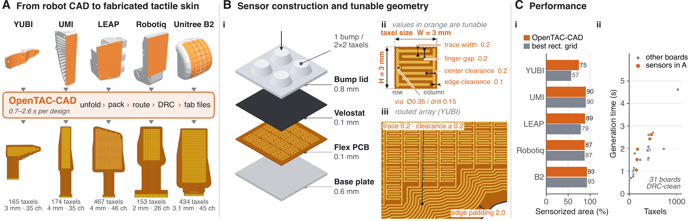
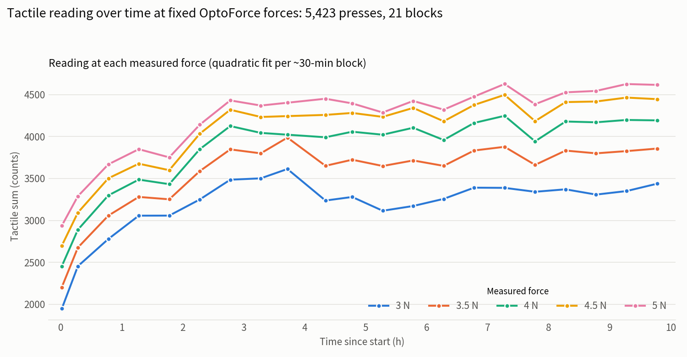
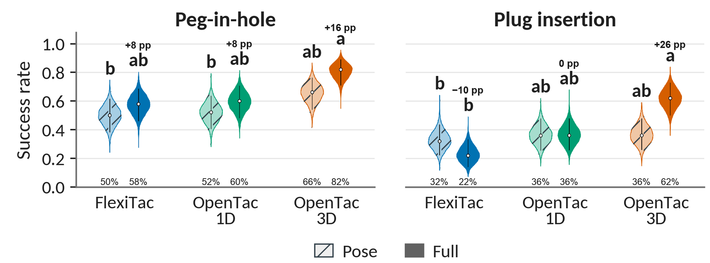
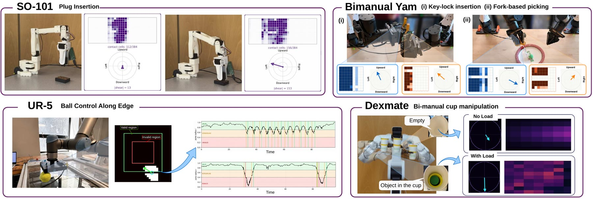
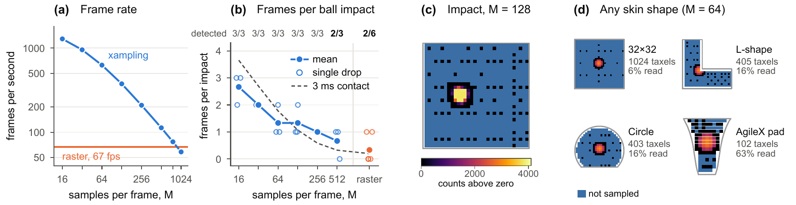
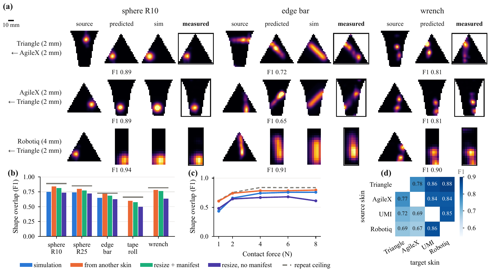
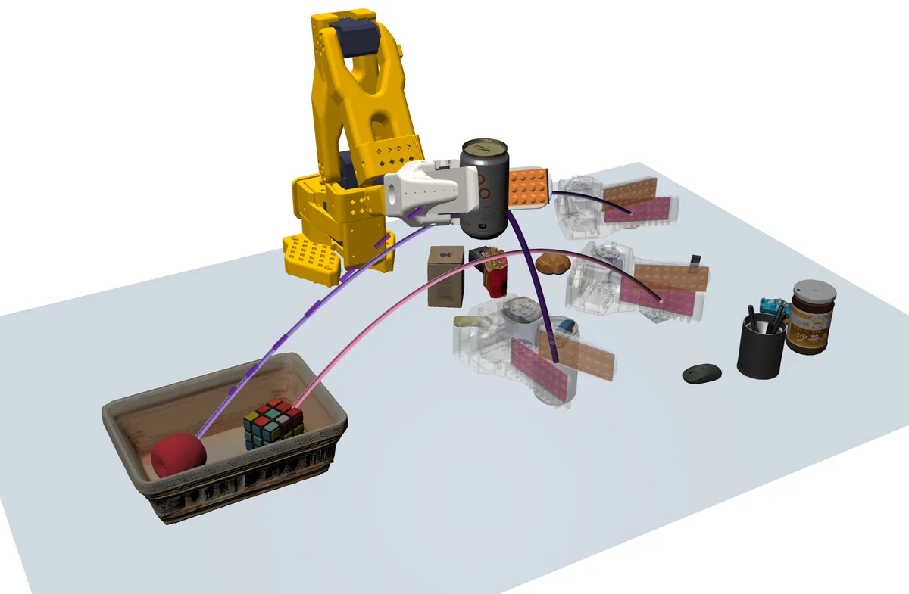
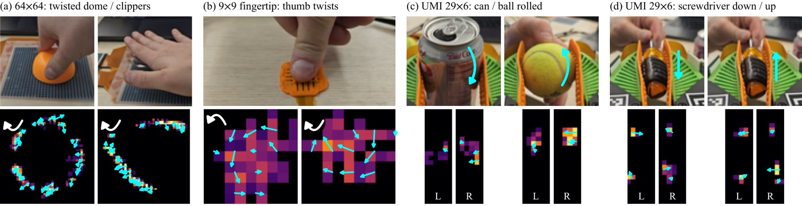

# Results

We evaluate OpenTac across sensor fabrication, force estimation, adaptive acquisition, cross-sensor transfer, simulation, and robot control and policy learning. This page presents the [paper](paper.md)'s measurements alongside two additional tests: [repeated pressing over 10 hours](#repeated-pressing) and [mechanical durability](#durability).

## Sensor response demonstrations { #demos }

The clips below illustrate force response, heating and normal/shear readout under the demonstrated conditions.

<!--
  To add a demo: copy one <figure class="ot-demo"> block below.
  Portrait clips (phone video) need nothing else; for a landscape clip add
  class "ot-demo--wide" (it spans two columns). Files go in docs/assets/video/
  as name.mp4 + name.jpg (poster), muted, under ~5 MB. Below the first screen,
  write data-poster= instead of poster=, so the still loads only near the screen.
-->

<figure class="ot-demo">
  <video data-loop muted loop playsinline preload="none" poster="../assets/video/dynamic_range_poster.jpg"
         aria-label="Sensor response to applied forces from approximately 0.1 to 10 newtons">
    <source src="../assets/video/dynamic_range.mp4" type="video/mp4">
  </video>
  <figcaption><strong>Dynamic range.</strong> Applied forces from about 0.1&nbsp;N to about 10&nbsp;N, read at 10&nbsp;k&Omega; feedback (the default gain). A lower gain, or a different piezoresistive layer, extends the measurable force range at the cost of sensitivity to smaller loads.</figcaption>
</figure>
<figure class="ot-demo">
  <video data-loop muted loop playsinline preload="none" poster="../assets/video/heat_gun_poster.jpg"
         aria-label="A heat gun is directed at the sensor while its tactile response is monitored">
    <source src="../assets/video/heat_gun.mp4" type="video/mp4">
  </video>
  <figcaption><strong>Heating demonstration.</strong> The sensor shows no apparent false contact response while exposed to the heat gun in this clip.</figcaption>
</figure>
<figure class="ot-demo ot-demo--wide">
  <video data-loop muted loop playsinline preload="none" data-poster="../assets/loops/real_sensor.jpg"
         aria-label="A finger presses and twists a bump sensor; the live map shows normal force as colour and shear as arrows">
    <source src="../assets/loops/real_sensor.mp4" type="video/mp4">
  </video>
  <figcaption><strong>Normal and shear.</strong> A finger presses and twists a bump sensor. Colour is normal force; arrows are shear.</figcaption>
</figure>

## Fabrication and coverage

We generated and fabricated 31 boards using OpenTac-CAD. All passed the design-rule check and produced functional sensors. The five highlighted designs contain 153&ndash;467 taxels on 35&ndash;46 channels, with generation times of 0.7&ndash;2.6&nbsp;s. Shape-aware packing covers 75&ndash;93% of each target region. On the tapered YUBI and LEAP regions, coverage exceeds the largest inscribed rectangular grid by 18 and 10 percentage points, respectively. Separately, all nine designs generated from one-sentence requests by a coding agent passed the design-rule check ([Design with an AI agent](design/agent.md)).

<figure class="ot-fig" markdown="span">
  [{ loading=lazy }](assets/figures/cad2sensor.png)
  <figcaption>(A) Selected surfaces (orange) on five robots and the generated flex PCBs. (B) The sensor stack, with one bump per 2&times;2 taxel group, and a generated taxel and routed corner; compiler inputs in orange. (C) Sensorized area against the largest inscribed rectangle, and generation time, for all 31 fabricated boards.</figcaption>
</figure>

<figure class="ot-fig" markdown="span">
  [{ loading=lazy }](assets/figures/fabricated.jpg)
  <figcaption>The 31 sensors fabricated from OpenTac-CAD layouts: up to 1,024 taxels each.</figcaption>
</figure>

## Material and spatial response { #material-and-spatial-response }

We measured force response against a load cell at 1&nbsp;kΩ feedback resistance, varying one design parameter at a time. At 2.0&nbsp;mm pitch and 0.2&nbsp;mm electrode gap, LINQSTAT did not saturate through 60&nbsp;N, whereas Chibitronics saturated earlier. Increasing taxel pitch increased the signal per taxel while reducing spatial resolution. The force response therefore depends on both the piezoresistive material and electrode geometry.

On a bumped 4&times;4 patch, the bump decoding (sum of the four taxels under a bump for normal force, their differences for shear) reaches an in-sample R&sup2; of 0.95, 0.93 and 0.96 for Fx, Fy and Fz, with RMSE of 0.11&ndash;0.16&nbsp;N, against an OptoForce reference.

<figure class="ot-fig" markdown="span" style="max-width: 36rem">
  [{ loading=lazy }](assets/figures/calibration.png)
  <figcaption>Per-taxel normal response against a load cell (median and interquartile range; diamonds mark the onset of saturation) for (a) three films, (b) electrode gaps of 0.1&ndash;0.5&nbsp;mm and (c) pitches of 1.5&ndash;4.0&nbsp;mm. (d) Three-axis calibration of a bumped 4&times;4 patch.</figcaption>
</figure>

## Repeated pressing over 10 hours { #repeated-pressing }

A UR5 repeatedly loaded one bump while an OptoForce sensor measured the applied force. The robot pressed at a fixed baseline force and, every 30 minutes, performed a measurement cycle at 3, 3.5, 4, 4.5 and 5&nbsp;N. The test comprised 5,423 presses in 21 blocks over 10 hours. At each reference force, the tactile reading increased over approximately the first three hours before remaining nearly constant. The responses at the five forces remained separated throughout, despite the initial drift.

  <figure class="ot-clip">
<video data-loop muted loop playsinline preload="none" data-poster="../assets/loops/pressing_10h.jpg" aria-label="A UR5 end effector with a force sensor presses repeatedly into a bump of an orange flex sensor, at 50 times speed"><source src="../assets/loops/pressing_10h.mp4" type="video/mp4"></video>
<figcaption>Repeated loading shown at 50&times; speed; 12&nbsp;s of video corresponds to 10 minutes of the test.</figcaption></figure>

<figure class="ot-fig" markdown="span" style="max-width: 40rem">
  [{ loading=lazy width="1500" height="780" }](assets/figures/pressing_10h.webp)
  <figcaption>Tactile reading (summed counts) at each measured force, from a quadratic fit per ~30-minute block: 5,423 presses in 21 blocks over 10&nbsp;h at 3&ndash;5&nbsp;N. Readings rise over the first ~3&nbsp;h, then hold nearly constant; the five forces stay separated throughout.</figcaption>
</figure>

## Durability

A connected sensor was touched lightly with a pen, a tape roll and a hand, struck hard with a hammer several times, and touched again. It was then unplugged, thrown on the floor, stomped and jumped on, and run over with an office chair. Plugged back in, it still responded to light touches and object contacts.

<figure class="ot-fig" style="max-width: 40rem">

  <video controls preload="none" playsinline data-poster="../assets/video/durability_poster.jpg"
         aria-label="Durability test with sound: light touches with a tape roll, a pen and a hand; hammer strikes; the same touches; the sensor unplugged, thrown on the floor, stomped and jumped on, and run over with an office chair; then plugged back in and touched again. An enlarged inset shows the live map.">
    <source src="../assets/video/durability.mp4" type="video/mp4">
  </video>

<figcaption>Shortened from 2&nbsp;min&nbsp;12&nbsp;s, in order, with the original sound. Inset: the monitor's live map, enlarged; colour is normal force, arrows are shear.</figcaption>
</figure>

## Policy learning with shear

On an SO-101 arm, action-chunking-transformer (ACT) policies perform peg-in-hole and plug insertion with one of three sensors: FlexiTac, OpenTac-1D (normal force only) or OpenTac-3D (normal and shear). For each sensor, policies are trained on touch plus joint angles ("full") or joint angles alone ("pose"), each with 100 demonstrations, and evaluated over 50 trials, without vision.

- OpenTac-3D-full has the highest observed success on both tasks: 82% on peg-in-hole and 62% on plug insertion.
- On plug insertion, neither normal-only sensor improves on its pose-only baseline (FlexiTac 32% &rarr; 22%, OpenTac-1D 36% &rarr; 36%); OpenTac-3D improves from 36% to 62%.
- In the illustrated insertion sequence, normal maps are similar before and during socket contact, while the shear maps distinguish these states.

Each sensor has its own pose-only baseline, and the bumps change contact mechanics as well as adding shear, so the differences cannot be attributed to shear alone.

<figure class="ot-fig" markdown="span">
  [{ loading=lazy }](assets/figures/policy.png)
  <figcaption>Success over 50 trials per condition, without vision. "Pose": joint angles only; "full": joint angles and touch. Conditions that share no letter differ significantly (&gt;90% confidence).</figcaption>
</figure>

The following clips compare individual rollouts of policies using proprioception with normal and shear readings (OpenTac-3D), proprioception with normal readings (OpenTac-1D), or proprioception alone. Each comparison begins from the same start configuration. In addition to SO-101 plug insertion, the clips show key-lock insertion with two YAM arms. For that task, only the left gripper, which holds the key, carries a tactile sensor on each finger; the right gripper holds the lock without tactile sensing.

  <figure class="ot-clip">
<video data-loop muted loop playsinline preload="none" data-poster="../assets/loops/so101_plug.jpg" style="aspect-ratio: 1920 / 786" aria-label="Three SO-101 arms insert a plug from the same start pose: the OpenTac-3D policy succeeds, the OpenTac-1D and proprioception-only policies fail"><source src="../assets/loops/so101_plug.mp4" type="video/mp4"></video>
<figcaption>SO-101 plug insertion from one start pose with the same plug: OpenTac-3D inserts the plug; OpenTac-1D and proprioception only fail.</figcaption></figure>
  <figure class="ot-clip">
<video data-loop muted loop playsinline preload="none" data-poster="../assets/loops/yam_keylock.jpg" style="aspect-ratio: 1920 / 620" aria-label="Two YAM arms insert a key into a lock under three policies: the OpenTac-3D policy inserts the key, the OpenTac-1D policy fails at the insertion, and the proprioception-only policy stalls there"><source src="../assets/loops/yam_keylock.mp4" type="video/mp4"></video>
<figcaption>YAM key-lock insertion: OpenTac-3D inserts the key; OpenTac-1D fails at the insertion; with proprioception only, the policy stalls there and does not open the gripper.</figcaption></figure>

  <figure class="ot-clip">
<video data-loop muted loop playsinline preload="none" data-poster="../assets/loops/sim_peg.jpg" aria-label="Simulated peg insertion: the normal-and-shear policy inserts the peg, the normal-only policy fails"><source src="../assets/loops/sim_peg.mp4" type="video/mp4"></video>
<figcaption>Peg insertion in simulation, with the deformable pads described under <a href="#simulation">Simulation</a>: the normal-and-shear policy inserts the peg, the normal-only policy does not.</figcaption></figure>

## Grasp control with shear feedback

A Dexmate Vega-1 Pro holds a paper cup between two OpenTac probes under proprioceptive, wrist force/torque, normal or shear feedback, with the same trajectories, gains and a 2.5&nbsp;N nominal grip. The shear controller raises its grip target before the cup slips. Under impulsive loading, shear feedback holds the cup for 40&nbsp;s in 16 of 20 trials, against 9 of 20 for force/torque and normal-only feedback, with half the slip.

| | | Proprio | Wrist F/T | OpenTac-1D | OpenTac-3D |
|---|---|---|---|---|---|
| No load | Held (of 20) | 3 | 20 | 20 | 20 |
| | Slip (cm) | &mdash; | 0.15 &plusmn; 0.08 | 0.2 &plusmn; 0.1 | **0.11 &plusmn; 0.06** |
| Load | Held (of 20) | 0 | 9 | 9 | **16** |
| | Slip (cm) | &mdash; | 5.5 &plusmn; 1.3 | 5.8 &plusmn; 2.1 | **2.6 &plusmn; 1.2** |

Held: trials reaching 40&nbsp;s. Slip: net displacement, mean &plusmn; standard deviation; &mdash;: dropped.

In the ball-rolling task, a UR5 carries a 32&times;32 skin on a square end effector and rolls a ball along its edges without observing the ball position. The shear controller steers toward a shear vector aligned with the intended edge. It returns from the borderline region to the valid region more reliably than the normal-force controller. In the clip, normal-force feedback produces faster, straighter motion but cuts across the sensor; shear feedback produces slower, oscillatory motion, particularly at corners, while maintaining the edge-following behaviour.

A separate demonstration uses a skin on a Dexmate forearm to provide contact feedback for compliant motion. The arm yields in the direction of an applied push and holds its resulting pose when contact ends.

<figure class="ot-fig" markdown="span">
  [{ loading=lazy }](assets/figures/robots.jpg)
  <figcaption>OpenTac on four robot platforms: SO-101 plug insertion, YAM bimanual manipulation, UR5 ball control and Dexmate bimanual cup holding.</figcaption>
</figure>

  <figure class="ot-clip ot-clip--tall2">
<video data-loop muted loop playsinline preload="none" data-poster="../assets/loops/ur5_controllers.jpg" style="aspect-ratio: 720 / 804" aria-label="A UR5 moves a ball along the edge of a sensor plate under a normal-force controller (top) and a shear-force controller (bottom), each with its contact map"><source src="../assets/loops/ur5_controllers.mp4" type="video/mp4"></video>
<figcaption>UR5 ball rolling: the normal-force controller (top) and the shear-force controller (bottom), with their contact maps.</figcaption></figure>
  <figure class="ot-clip">
<video data-loop muted loop playsinline preload="none" data-poster="../assets/loops/dexmate.jpg" aria-label="Dexmate holding a cup, force-only versus force-and-shear feedback"><source src="../assets/loops/dexmate.mp4" type="video/mp4"></video>
<figcaption>Dexmate Vega-1 Pro, bimanual cup holding: normal-only feedback (left) and normal-and-shear feedback (right).</figcaption></figure>
  <figure class="ot-clip">
<video data-loop muted loop playsinline preload="none" data-poster="../assets/loops/dexmate_admittance.jpg" aria-label="A stick pushes a Dexmate forearm covered in a tactile skin; the arm moves with the push and stops when it ends, next to the skin's live map"><source src="../assets/loops/dexmate_admittance.mp4" type="video/mp4"></video>
<figcaption>Dexmate forearm skin and its live map: the arm yields to the push and holds its pose when it stops.</figcaption></figure>

## Sampling budget and fast contacts (Xampling)

OpenTac-Xampling selects taxels adaptively, using a coarse-to-fine search and expanding around detected contact. In the fixed-budget evaluation, each frame samples M of N taxels. On a 1024-taxel skin, raster scanning reaches 67 frames/s, while a budget of M&nbsp;=&nbsp;16 reaches 1286 partial frames/s. The higher rate describes partial updates, not complete measurements of the array.

In 30&nbsp;cm tennis-ball drops (contacts of about 3&nbsp;ms, detection at 50% of ADC full scale), raster scanning detected two of six impacts; budgets of M&nbsp;=&nbsp;16&ndash;256 detected all three impacts tested at each budget, and M&nbsp;=&nbsp;512 two of three. Reading fewer taxels per frame raises the frame rate and catches brief contacts better, at the cost of spatial coverage within each frame. The number of trials is small, which limits conclusions about detection reliability.

<figure class="ot-fig" markdown="span">
  [{ loading=lazy }](assets/figures/xampling.png)
  <figcaption>(a) Frame rate against budget M on a 32&times;32 skin. (b) Frames capturing a 30&nbsp;cm tennis-ball drop; dashed: frames spanned by a 3&nbsp;ms contact. (c) An impact at M&nbsp;=&nbsp;128. (d) Sampling patterns at M&nbsp;=&nbsp;64 on four skin shapes (blue: not sampled).</figcaption>
</figure>

  <figure class="ot-clip">
<video data-loop muted loop playsinline preload="none" data-poster="../assets/loops/xampling.jpg" aria-label="Two tennis-ball drops at 128 times slow motion: raster scanning misses the impact, Xampling at M = 32 captures it"><source src="../assets/loops/xampling.mp4" type="video/mp4"></video>
<figcaption>Two 30&nbsp;cm drops at 128&times; slow motion: raster scanning misses the impact; Xampling at M&nbsp;=&nbsp;32 catches it. The 996 updates/s on the clip is the rate the board ran at in this one recording; the benchmark in panel (a) gives 954 frames/s at M&nbsp;=&nbsp;32, the mean of two rounds (<a href="../use/xampling/#measured-frame-rates">Xampling</a>).</figcaption></figure>

## Transfer between sensors

OpenTac-Transfer maps calibrated normal-force distributions between skins of different shape and pitch in physical coordinates, using each skin's manifest and no paired data. It was evaluated on four LINQSTAT skins without bumps (Triangle, 409 taxels, and AgileX, 502, at 2&nbsp;mm pitch; UMI, 174, and Robotiq, 96, at 4&nbsp;mm), pressing five objects at 95 locations at 1&ndash;8&nbsp;N.

- Transfer reaches a median shape F1 of 0.750 over 5,290 predictions, against 0.714 for raw-count area averaging over the manifest geometry and 0.634 for bilinear array resizing.
- Within the region both skins cover, it reaches 0.788, close to the 0.800 repeatability of the same skin.
- Targets with 4&nbsp;mm pitch score higher than those with 2&nbsp;mm pitch (0.84&ndash;0.88 against 0.67&ndash;0.78).
- The reduced foam model from OpenTac-Sim reaches 0.727 on the three skins left out of its fit.

<figure class="ot-fig" markdown="span">
  [{ loading=lazy }](assets/figures/transfer.png)
  <figcaption>(a) Median-performing presses at &ge;4&nbsp;N; rows are target &larr; source at a shared physical scale (bar: 10&nbsp;mm). (b) Median shape F1 by object; grey marks same-sensor repeatability. (c) F1 against calibrated force. (d) Transfer F1 for each ordered skin pair on co-visible support.</figcaption>
</figure>

## Simulation

The paper's policy-learning simulation is a MuJoCo SO-101 peg-insertion environment with CAD-derived tetrahedral pads attached to the gripper fingers. Each pad has 40 bumps on a 10&times;4 reduced deformation grid (165 degrees of freedom), with collision on the detailed surface mesh; each bump reports one normal and two tangential displacements, interpolated to 16&times;32 tactile images.

<figure class="ot-fig" markdown="span">
  [{ loading=lazy width="1600" height="920" }](assets/figures/sim_scenes.webp)
  <figcaption>OpenTac-Sim scenes from the paper, in MuJoCo with CAD-derived tetrahedral bump pads. Left: the SO-101 follows a trajectory toward the insertion target; blue spheres and yellow cubes mark training and evaluation positions, and the enlarged views show the shear at each bump of the fixed and moving pads at two moments. Right: grasping a can with the SO-101, and dual-arm insertion with ALOHA.</figcaption>
</figure>

Simulated insertion success (%), from the paper. Adding shear to normal touch raised success from 74% to 86% on peg insertion and from 18% to 90% on plug insertion, and on the unfixtured dual-arm ALOHA task from 1 to 3 of 30 trials. Peg insertion uses a shear-based executor guard; ALOHA uses none.

| Tactile input | Peg | Plug | ALOHA |
|---|---|---|---|
| Proprioception | 26 | 0 | 0 |
| + normal | 74 | 18 | 3.3 |
| + normal and shear | **86** | **90** | **10.0** |

<figure class="ot-fig" markdown="span" style="max-width: 32rem">
  [{ loading=lazy width="1200" height="785" }](assets/figures/sim_sorting.webp)
  <figcaption>A simulated tabletop sorting task: the arm picks up objects and places them in a basket.</figcaption>
</figure>

  <figure class="ot-clip">
<video data-loop muted loop playsinline preload="none" data-poster="../assets/loops/sim_elastomer.jpg" style="aspect-ratio: 1280 / 672" aria-label="Simulation: the same cylindrical indenter presses two textured elastomer pads, 33.6 MPa on the left and 5 MPa on the right"><source src="../assets/loops/sim_elastomer.mp4" type="video/mp4"></video>
<figcaption>Two textured elastomer pads, elastic modulus 33.6&nbsp;MPa (left) and 5&nbsp;MPa (right), under the same cylindrical indenter: the softer pad deforms more locally.</figcaption></figure>
  <figure class="ot-clip">
<video data-loop muted loop playsinline preload="none" data-poster="../assets/loops/sim_closeup.jpg" style="aspect-ratio: 1280 / 672" aria-label="Simulation: a cylindrical indenter presses a 5 MPa textured pad, shown as its surface and, in sync, as its tetrahedral mesh"><source src="../assets/loops/sim_closeup.mp4" type="video/mp4"></video>
<figcaption>The 5&nbsp;MPa pad under the indenter: its surface (left) and its tetrahedral mesh (right), in sync.</figcaption></figure>

The released OpenTac-Sim package (`opentac.sim`) provides two reduced contact models for flat sensors specified by manifests. Smooth skins use the reduced foam-contact model of the transfer study (a Winkler layer, smoothed and integrated over the manifest's taxels before the target calibration is applied). Bump sheets use rigid bumps on spring joints, which report normal force per taxel and shear per bump. See [Simulate](sim.md).

## Recorded tactile fields { #example-data }

<figure class="ot-fig" markdown="span">
  [{ loading=lazy }](assets/figures/tactile_examples.jpg)
  <figcaption>Heatmaps show normal load; cyan arrows show shear at each bump; white arcs indicate rotation. (a) 64&times;64 skin (4,096 taxels; not one of the 31 layouts above), twisting a dome and clippers. (b) 9&times;9 fingertip, opposite thumb twists. (c) UMI gripper, 29&times;6 finger skins: a can and a ball rocked in the grasp. (d) Extrinsic contact: a screwdriver moved down and up.</figcaption>
</figure>

  <figure class="ot-clip">
<video data-loop muted loop playsinline preload="none" data-poster="../assets/loops/umi_external.jpg" aria-label="A hand pushes a screwdriver held by the UMI gripper; the force reaches the finger skins through the object"><source src="../assets/loops/umi_external.mp4" type="video/mp4"></video>
<figcaption>UMI gripper, external contact: a hand pushes the held screwdriver, and the force reaches both finger skins through it.</figcaption></figure>
  <figure class="ot-clip">
<video data-loop muted loop playsinline preload="none" data-poster="../assets/loops/umi_ball.jpg" aria-label="A hand turns a ball held by the UMI gripper, with live normal and shear maps"><source src="../assets/loops/umi_ball.mp4" type="video/mp4"></video>
<figcaption>UMI gripper: a hand turns the held ball; normal and shear on both finger skins.</figcaption></figure>

## Limitations

Flex PCBs require developable surfaces (see [Shapes and surfaces](design/shapes.md)), and piezoresistive films show hysteresis, drift and temperature dependence. Force calibration is evaluated in-sample. The effect of acquisition rate on learned policies remains to be evaluated.

## Reporting tactile experiments { #what-to-report }

To make tactile experiments comparable, the paper recommends reporting, with each result: the geometry (active surface, taxel count, pitch, footprint, coverage), the material and mechanics (film, electrode gap, bump geometry, mounting, preload), the calibration (baseline subtraction, fitted mapping, load range, evaluation split), the acquisition (taxel count N, budget M, sampling strategy, measured rate), and for learning and control the observation channels, demonstrations, per-sensor pose-only baseline and controller settings. The manifest covers the geometry; the rest belongs in the experiment record.

## Data and code { #data-and-code }

Released in the [code repository](https://github.com/opentac/opentac) and [website repository](https://github.com/opentac/opentac.github.io):

- OpenTac-CAD (`opentac/cad/`), the readout firmware (`firmware/`, with prebuilt binaries), the readout boards' KiCad and JLCPCB files (`hardware/`), and the `opentac` Python package for reading and recording sensors, OpenTac-Sim (`opentac.sim`) and OpenTac-Transfer (`opentac.transfer`).
- The 31 fabricated designs, regenerated for the current readout boards, each with its Gerbers, KiCad board and manifest: [Ready-to-order designs](design/examples.md).
- The nine recorded presses behind [How it works](learn/index.md) (three objects on three skins), in the form the page plays them, in [`docs/learn/data/takes/`](https://github.com/opentac/opentac.github.io/tree/main/docs/learn/data/takes/).

