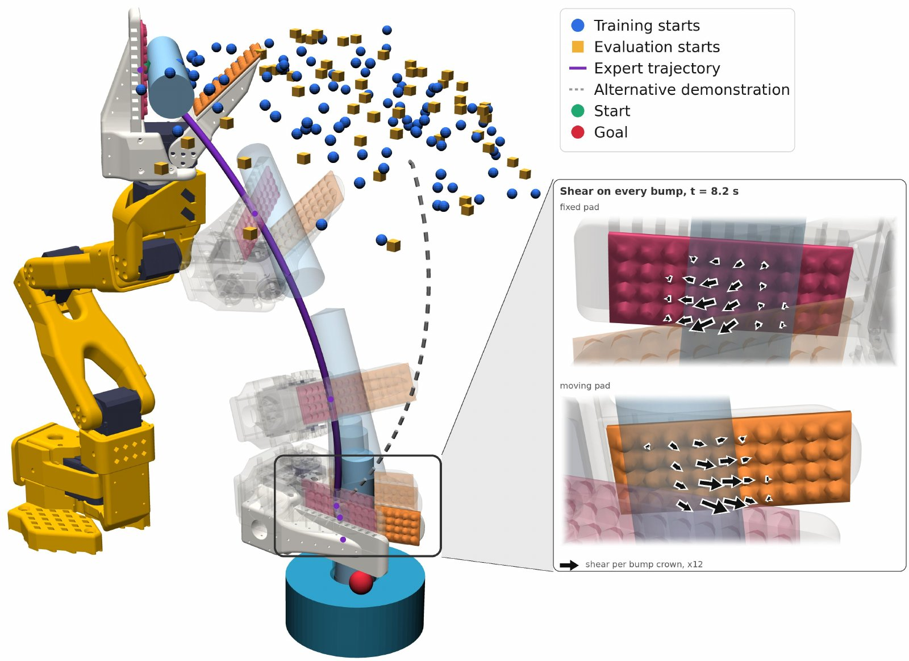

# Results

The paper's findings, with its figures. Every number on this page is from the [paper](paper.md).

## Demos

Short clips of single sensor properties.

<!--
  To add a demo: copy one <figure class="ot-demo"> block below.
  Portrait clips (phone video) need nothing else; for a landscape clip add
  class "ot-demo--wide" (it spans two columns). Files go in docs/assets/video/
  as name.mp4 + name.jpg (poster), muted, under ~5 MB. Below the first screen,
  write data-poster= instead of poster=, so the still loads only near the screen.
-->

<figure class="ot-demo">
  <video data-loop muted loop playsinline preload="none" poster="../assets/video/dynamic_range_poster.jpg"
         aria-label="Pressure readings from about 0.1 newton to about 10 newtons">
    <source src="../assets/video/dynamic_range.mp4" type="video/mp4">
  </video>
  <figcaption><strong>Dynamic range.</strong> Pressure from about 0.1&nbsp;N to about 10&nbsp;N. The piezoresistive layer sets the range: it can go higher at the cost of the low end.</figcaption>
</figure>
<figure class="ot-demo">
  <video data-loop muted loop playsinline preload="none" poster="../assets/video/heat_gun_poster.jpg"
         aria-label="A heat gun blown at the sensor produces no false signal">
    <source src="../assets/video/heat_gun.mp4" type="video/mp4">
  </video>
  <figcaption><strong>Heat.</strong> A heat gun blown at the sensor gives no false signal.</figcaption>
</figure>
<figure class="ot-demo ot-demo--wide">
  <video data-loop muted loop playsinline preload="none" data-poster="../assets/loops/real_sensor.jpg"
         aria-label="A finger presses and twists a bump sensor; the live map shows normal force as colour and shear as arrows">
    <source src="../assets/loops/real_sensor.mp4" type="video/mp4">
  </video>
  <figcaption><strong>Normal and shear.</strong> A finger presses and twists a bump sensor. Colour is normal force; arrows are shear.</figcaption>
</figure>

## Fabrication and coverage

We compiled and fabricated 31 boards. All passed the design-rule check and all were functional. The five designs highlighted in the figure have 153&ndash;467 taxels on 35&ndash;46 channels and compile in 0.7&ndash;2.6&nbsp;s. Shape-aware packing covers 75&ndash;93% of each target region, 18 and 10 percentage points more than the largest inscribed rectangular grid on the tapered YUBI and LEAP regions. All nine designs generated by a coding agent from one-sentence requests also passed the design-rule check ([Design with an AI agent](design/agent.md)).

<figure class="ot-fig" markdown="span">
  [{ loading=lazy }](assets/figures/cad2sensor.png)
  <figcaption>(A) Selected surfaces (orange) on five robots and the generated flex PCBs. (B) The sensor stack, with one bump per 2&times;2 taxel group, and a generated taxel and routed corner; compiler inputs in orange. (C) Sensorized area against the largest inscribed rectangle, and generation time, for all 31 fabricated boards.</figcaption>
</figure>

<figure class="ot-fig" markdown="span">
  [{ loading=lazy }](assets/figures/fabricated.jpg)
  <figcaption>The 31 sensors fabricated from OpenTac-CAD layouts: up to 1,024 taxels each.</figcaption>
</figure>

## Material and spatial response { #material-and-spatial-response }

Load-cell measurements that vary one design variable at a time show that the piezoresistive film strongly affects sensitivity and saturation: at 2.0&nbsp;mm pitch and 0.2&nbsp;mm electrode gap, LINQSTAT does not saturate through 60&nbsp;N, while Chibitronics saturates early. A larger taxel pitch gives more signal per taxel and lower spatial resolution; the measurable force range depends on the sensor geometry.

On a bumped 4&times;4 patch, the bump decoding (sum of the four taxels under a bump for normal force, their differences for shear) reaches an in-sample R&sup2; of 0.95, 0.93 and 0.96 for Fx, Fy and Fz, with RMSE of 0.11&ndash;0.16&nbsp;N, against an OptoForce reference.

<figure class="ot-fig" markdown="span" style="max-width: 36rem">
  [{ loading=lazy }](assets/figures/calibration.png)
  <figcaption>Per-taxel normal response against a load cell (median and interquartile range; diamonds mark the onset of saturation) for (a) three films, (b) electrode gaps of 0.1&ndash;0.5&nbsp;mm and (c) pitches of 1.5&ndash;4.0&nbsp;mm. (d) Three-axis calibration of a bumped 4&times;4 patch.</figcaption>
</figure>

## Policy learning with shear

On an SO-101 arm, action-chunking-transformer (ACT) policies perform peg-in-hole and plug insertion with one of three sensors: FlexiTac, OpenTac-1D (normal force only) or OpenTac-3D (normal and shear). For each sensor, policies are trained on touch plus joint angles ("full") or joint angles alone ("pose"), each with 100 demonstrations, and evaluated over 50 trials, without vision.

- OpenTac-3D-full has the highest observed success on both tasks: 82% on peg-in-hole and 62% on plug insertion.
- On plug insertion, neither normal-only sensor improves on its pose-only baseline (FlexiTac 32% &rarr; 22%, OpenTac-1D 36% &rarr; 36%); OpenTac-3D improves from 36% to 62%.
- During insertion, normal maps look nearly the same in air and in the socket; shear maps tell the two apart.

Each sensor has its own pose-only baseline, and the bumps change contact mechanics as well as adding shear, so the differences cannot be attributed to shear alone.

<figure class="ot-fig" markdown="span">
  [{ loading=lazy }](assets/figures/policy.png)
  <figcaption>Success over 50 trials per condition, without vision. "Pose": joint angles only; "full": joint angles and touch. Conditions that share no letter differ significantly (&gt;90% confidence).</figcaption>
</figure>

  <figure class="ot-clip">
<video data-loop muted loop playsinline preload="none" data-poster="../assets/loops/so101.jpg" aria-label="SO-101 plug insertion from the same start pose: the OpenTac-3D policy succeeds, the FlexiTac policy fails"><source src="../assets/loops/so101.mp4" type="video/mp4"></video>
<figcaption>SO-101 arm, plug insertion from one start pose: the OpenTac-3D policy succeeds, the FlexiTac policy fails. 2&times; speed.</figcaption></figure>
  <figure class="ot-clip">
<video data-loop muted loop playsinline preload="none" data-poster="../assets/loops/sim_peg.jpg" aria-label="Simulated peg insertion: the normal-and-shear policy inserts the peg, the normal-only policy fails"><source src="../assets/loops/sim_peg.mp4" type="video/mp4"></video>
<figcaption>Peg insertion in simulation, with the deformable pads described under <a href="#simulation">Simulation</a> (not part of this release): the normal-and-shear policy inserts the peg, the normal-only policy does not.</figcaption></figure>

## Grasp control with shear feedback

A Dexmate Vega-1 Pro holds a paper cup between two OpenTac probes under proprioceptive, wrist force/torque, normal or shear feedback, with the same trajectories, gains and a 2.5&nbsp;N nominal grip. The shear controller raises its grip target before the cup slips. Under impulsive loading, shear feedback holds the cup for 40&nbsp;s in 16 of 20 trials, against 9 of 20 for force/torque and normal-only feedback, with half the slip.

| | | Proprio | Wrist F/T | OpenTac-1D | OpenTac-3D |
|---|---|---|---|---|---|
| No load | Held (of 20) | 3 | 20 | 20 | 20 |
| | Slip (cm) | &mdash; | 0.15 &plusmn; 0.08 | 0.2 &plusmn; 0.1 | **0.11 &plusmn; 0.06** |
| Load | Held (of 20) | 0 | 9 | 9 | **16** |
| | Slip (cm) | &mdash; | 5.5 &plusmn; 1.3 | 5.8 &plusmn; 2.1 | **2.6 &plusmn; 1.2** |

Held: trials reaching 40&nbsp;s. Slip: net displacement, mean &plusmn; standard deviation; &mdash;: dropped.

UR5 ball rolling and teleoperation on bimanual YAM arms show the skins on further robot surfaces.

<figure class="ot-fig" markdown="span">
  [{ loading=lazy }](assets/figures/robots.jpg)
  <figcaption>OpenTac on four robots: SO-101 plug insertion, YAM teleoperation, UR5 ball control and Dexmate bimanual cup holding.</figcaption>
</figure>

  <figure class="ot-clip">
<video data-loop muted loop playsinline preload="none" data-poster="../assets/loops/dexmate.jpg" aria-label="Dexmate holding a cup, force-only versus force-and-shear feedback"><source src="../assets/loops/dexmate.mp4" type="video/mp4"></video>
<figcaption>Dexmate Vega-1 Pro, bimanual cup holding: normal-only feedback (left) and normal-and-shear feedback (right).</figcaption></figure>
  <figure class="ot-clip">
<video data-loop muted loop playsinline preload="none" data-poster="../assets/loops/ur5.jpg" aria-label="UR5 ball control with normal-force and shear-force controllers"><source src="../assets/loops/ur5.mp4" type="video/mp4"></video>
<figcaption>UR5 ball rolling under a normal-force controller (top) and a shear-force controller (bottom).</figcaption></figure>
  <figure class="ot-clip">
<video data-loop muted loop playsinline preload="none" data-poster="../assets/loops/yam.jpg" aria-label="YAM bimanual teleoperation with tactile readout"><source src="../assets/loops/yam.mp4" type="video/mp4"></video>
<figcaption>YAM arms, bimanual teleoperation with the tactile readout below.</figcaption></figure>

## Sampling budget and fast contacts (Xampling)

Xampling is compressive sampling: each frame reads M of the N taxels, chosen adaptively by a quadtree around contact, on any sensor layout. On a 1024-taxel skin, full raster scanning reaches 67 frames/s; adaptive scanning reaches 1286 partial frames/s at M&nbsp;=&nbsp;16 taxels per frame.

In 30&nbsp;cm tennis-ball drops (contacts of about 3&nbsp;ms, detection at 50% of ADC full scale), raster scanning detected two of six impacts; budgets of M&nbsp;=&nbsp;16&ndash;256 detected all three impacts tested at each budget, and M&nbsp;=&nbsp;512 two of three. Reading fewer taxels per frame raises the frame rate and catches brief contacts better, at the cost of spatial coverage within each frame. The number of trials is small, which limits conclusions about detection reliability.

<figure class="ot-fig" markdown="span">
  [{ loading=lazy }](assets/figures/xampling.png)
  <figcaption>(a) Frame rate against budget M on a 32&times;32 skin. (b) Frames capturing a 30&nbsp;cm tennis-ball drop; dashed: frames spanned by a 3&nbsp;ms contact. (c) An impact at M&nbsp;=&nbsp;128. (d) Sampling patterns at M&nbsp;=&nbsp;64 on four skin shapes (blue: not sampled).</figcaption>
</figure>

  <figure class="ot-clip">
<video data-loop muted loop playsinline preload="none" data-poster="../assets/loops/xampling.jpg" aria-label="Two tennis-ball drops at 128 times slow motion: raster scanning misses the impact, Xampling at M = 32 captures it"><source src="../assets/loops/xampling.mp4" type="video/mp4"></video>
<figcaption>Two 30&nbsp;cm drops at 128&times; slow motion: raster scanning misses the impact; Xampling at M&nbsp;=&nbsp;32 catches it. The 996 updates/s on the clip is the rate the board ran at in this one recording; the benchmark in panel (a) gives 954 frames/s at M&nbsp;=&nbsp;32, the mean of two rounds (<a href="../use/xampling/#measured-frame-rates">Xampling</a>).</figcaption></figure>

## Transfer between sensors

OpenTac-Transfer maps calibrated normal-force distributions between skins of different shape and pitch in physical coordinates, using each skin's manifest and no paired data. It was evaluated on four LINQSTAT skins without bumps (Triangle, 409 taxels, and AgileX, 502, at 2&nbsp;mm pitch; UMI, 174, and Robotiq, 96, at 4&nbsp;mm), pressing five objects at 95 locations at 1&ndash;8&nbsp;N.

- Transfer reaches a median shape F1 of 0.750 over 5,290 predictions, against 0.714 for raw-count area averaging over the manifest geometry and 0.634 for bilinear array resizing.
- Within the region both skins cover, it reaches 0.788, close to the 0.800 repeatability of the same skin.
- Targets with 4&nbsp;mm pitch score higher than those with 2&nbsp;mm pitch (0.84&ndash;0.88 against 0.67&ndash;0.78).
- The reduced foam model from OpenTac-Sim reaches 0.727 on the three skins left out of its fit.

<figure class="ot-fig" markdown="span">
  [{ loading=lazy }](assets/figures/transfer.png)
  <figcaption>(a) Median-performing presses at &ge;4&nbsp;N; rows are target &larr; source at a shared physical scale (bar: 10&nbsp;mm). (b) Median shape F1 by object; grey marks same-sensor repeatability. (c) F1 against calibrated force. (d) Transfer F1 for each ordered skin pair on co-visible support.</figcaption>
</figure>

## Simulation

The paper's policy-learning simulation is a MuJoCo SO-101 peg-insertion environment with CAD-derived tetrahedral pads attached to the gripper fingers. Each pad has 40 bumps on a 10&times;4 reduced deformation grid (165 degrees of freedom), with collision on the detailed surface mesh; each bump reports one normal and two tangential displacements, interpolated to 16&times;32 tactile images. **This environment is not part of this release**, and it has not been checked against hardware.

What ships as OpenTac-Sim (`opentac.sim`) builds flat sensors from their manifests, with two models. Smooth skins use the reduced foam-contact model of the transfer study (a Winkler layer, smoothed and integrated over the manifest's taxels before the target calibration is applied). Bump sheets use rigid bumps on spring joints, which report normal force per taxel and shear per bump; this model has not been checked against hardware either. See [Simulate](sim.md).

<figure class="ot-fig" markdown="span" style="max-width: 40rem">
  [{ loading=lazy }](assets/figures/simulation.jpg)
  <figcaption>SO-101 peg insertion with deformable tactile pads (the paper's environment, not part of this release). Blue spheres and orange cubes: training (n&nbsp;=&nbsp;100) and held-out evaluation (n&nbsp;=&nbsp;50) start poses. Right: the pads during insertion; arrows show per-bump tangential displacement.</figcaption>
</figure>

## Example data

<figure class="ot-fig" markdown="span">
  [{ loading=lazy }](assets/figures/tactile_examples.jpg)
  <figcaption>Heatmaps show normal load; cyan arrows per-bump shear; white arcs rotation estimates. (a) 64&times;64 skin (4,096 taxels; not one of the 31 layouts above), twisting a dome and clippers. (b) 9&times;9 fingertip, opposite thumb twists. (c) UMI gripper, 29&times;6 finger skins: a can and a ball rocked in the grasp. (d) Extrinsic contact: a screwdriver moved down and up.</figcaption>
</figure>

  <figure class="ot-clip">
<video data-loop muted loop playsinline preload="none" data-poster="../assets/loops/umi_external.jpg" aria-label="A hand pushes a screwdriver held by the UMI gripper; the force reaches the finger skins through the object"><source src="../assets/loops/umi_external.mp4" type="video/mp4"></video>
<figcaption>UMI gripper, external contact: a hand pushes the held screwdriver, and the force reaches both finger skins through it.</figcaption></figure>
  <figure class="ot-clip">
<video data-loop muted loop playsinline preload="none" data-poster="../assets/loops/umi_ball.jpg" aria-label="A hand turns a ball held by the UMI gripper, with live normal and shear maps"><source src="../assets/loops/umi_ball.mp4" type="video/mp4"></video>
<figcaption>UMI gripper: a hand turns the held ball; normal and shear on both finger skins.</figcaption></figure>

## Limitations

Flex PCBs require developable surfaces (see [Shapes and surfaces](design/shapes.md)), and piezoresistive films show hysteresis, drift and temperature dependence. Force calibration is evaluated in-sample. The effect of acquisition rate on learned policies remains to be evaluated.

## What to report

To make tactile experiments comparable, the paper recommends reporting, with each result: the geometry (active surface, taxel count, pitch, footprint, coverage), the material and mechanics (film, electrode gap, bump geometry, mounting, preload), the calibration (baseline subtraction, fitted mapping, load range, evaluation split), the acquisition (taxel count N, budget M, sampling strategy, measured rate), and for learning and control the observation channels, demonstrations, per-sensor pose-only baseline and controller settings. The manifest covers the geometry; the rest belongs in the experiment record.

## Data and code { #data-and-code }

Released in the [repository](https://github.com/opentac/opentac.github.io):

- OpenTac-CAD (`opentac/cad/`), the readout firmware (`firmware/`, with prebuilt binaries), the readout boards' KiCad and JLCPCB files (`hardware/`), and the `opentac` Python package for reading and recording sensors, OpenTac-Sim (`opentac.sim`) and OpenTac-Transfer (`opentac.transfer`).
- The 31 fabricated designs, regenerated for the current readout boards, each with its Gerbers, KiCad board and manifest: [Ready-to-order designs](design/examples.md).
- `tests/sim/test_paper_numbers.py`. It recomputes, to two decimals, the median shape F1 values under [Transfer between sensors](#transfer-between-sensors) (transfer, transfer on co-visible support, the two resizing baselines, the foam model and same-skin repeatability) and the foam model's contact-centre and area errors, from the per-press result rows in `results_pose.json`. That file (29&nbsp;MB) is not in the repository, so the test is skipped unless `OPENTAC_PAPER_RESULTS` points at a copy.
- The nine recorded presses behind [How it works](learn/index.md) (three objects on three skins), in the form the page plays them, in `docs/learn/data/takes/`.

Not released yet: the calibration data (the load-cell measurements behind the material response and the three-axis calibration; `opentac.calibrate` reads a calibration file, but none is included), the experiment data (the per-press transfer and simulation results, the policy-learning and grasp-control trials, the Xampling drop recordings, and the raw recordings behind How it works), and the policy-learning simulation described under [Simulation](#simulation).
