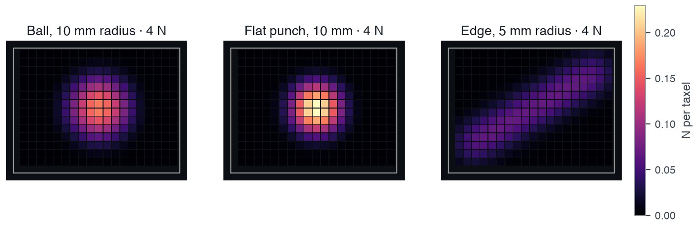
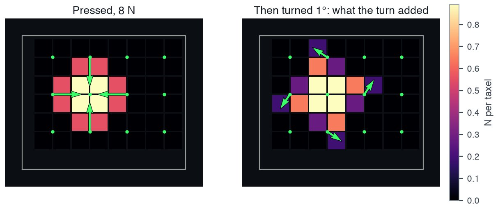
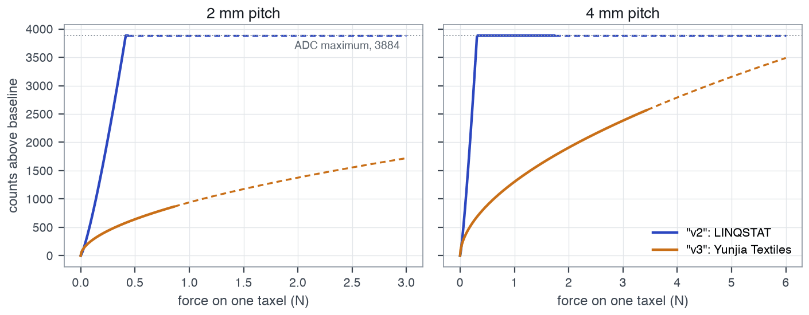

# Simulation

OpenTac-Sim (`opentac.sim`) models contact with a flat sensor and returns the same `Frame` interface used by the physical readout. It provides a foam-contact model for normal response and a bump model for normal and shear response. This shared interface lets downstream code consume simulated and recorded data, while the assumptions and calibration of each model determine how closely those frames correspond to a physical sensor.

```python
from opentac import manifest
from opentac.sim import Sensor

m = manifest.load("manifest.json")      # or the design .zip from OpenTac-CAD
s = Sensor(m)                           # foam model
frame = s.press("sphere", center_mm=(10, 12), force_n=5.0, radius_mm=5.0)

frame.taxels        # newtons per taxel, in manifest `pixels` order
frame.image(m)      # the same values as a 2-D array laid out like the sensor
```

`examples/sim_press.py` presses a 10 mm ball at 5 N and shows the image.

## Choose a contact model { #two-models }

| | `"foam"` | `"mujoco"` |
|---|---|---|
| Sensor | velostat under foam, **no bump sheet** | with the printed **TPU bump sheet** |
| Physics | Rigid indenter acting on a foam foundation | Rigid bumps with compliant normal, tangential and tilt coordinates |
| Output | normal force per taxel | normal force per taxel, plus shear per bump |
| Needs | numpy | numpy; the full solver also needs `mujoco` (`uv sync --extra sim`) |

**The default model is `"foam"`.** Select `model="mujoco"` explicitly when modelling a sensor with a bump sheet. The manifest alone cannot establish which lid was physically installed: OpenTac-CAD includes a `shear` block describing possible bump groups even when no bump sheet is printed. The skins used in the paper's foam and transfer evaluation had these blocks but no bump sheets.

The `"mujoco"` model needs the `shear` block and refuses a manifest without
one.

## Foam model

The foam model represents a piezoresistive layer beneath a compliant foam layer. A rigid indenter applies pressure according to a Winkler-foundation approximation:

    p(x, y) = k · max(δ − z(x, y), 0)

`z(x, y)` is the height of the indenter surface relative to the sensor, and `δ` is the indentation depth. Their difference gives local compression wherever contact occurs. The stiffness density `k`, in N/mm³, converts that compression into pressure in N/mm². A Gaussian with width σ approximates lateral load spreading through the foam, and the resulting pressure is integrated over the taxel sampling windows. The solver chooses `δ` to match the requested applied force, allowing the contact region to grow with load.

Two parameters, fitted once in the paper on one skin (robotiq_long: 96 taxels,
4 mm pitch) and used unchanged on every other skin:

- σ = 3.00 mm (`sigma_mm`)
- k = 0.00866 N/mm³ (`k_n_per_mm3`)

<figure class="ot-fig" markdown="span">
  [{ loading=lazy width="1409" height="458" }](assets/diagrams/sim_foam.jpg)
  <figcaption>The foam model on a 40&nbsp;&times;&nbsp;30&nbsp;mm skin with 2&nbsp;mm pitch generated by OpenTac-CAD (266 taxels): <code>"sphere_R10"</code>, <code>"punch_D10"</code> and <code>"edge_R5_L40"</code> (turned 30&deg;), each at 4&nbsp;N.</figcaption>
</figure>

Indenters for `press(shape, ...)`:

| `shape` | size arguments | notes |
|---|---|---|
| `"sphere"` | `radius_mm` | |
| `"disc"` | `radius_mm` | a flat round punch |
| `"bar"` | `radius_mm`, `length_mm` | a cylinder lying on the skin; `angle_deg` turns it from +x |
| `"sphere_R10"`, `"sphere_R25"`, `"punch_D10"`, `"edge_R5_L40"`, `"alignment_tip_R3"` | none | the paper's indenters |

`center_mm` defaults to the centroid of the taxels. `force_n` is the load on
the skin. Load that falls outside the taxels (an indenter over the edge, foam
spreading past the outline) is not read, so a frame can sum to less than
`force_n`.

**Integration-window convention.** Each taxel integrates pressure over a square window of width `(2·round(pitch) + 1) × 0.5` mm, which is not necessarily equal to the pitch. Windows wider than the pitch overlap, so the summed taxel forces can exceed the applied force. This convention is retained to reproduce the paper's results; `tests/sim/test_foam.py` checks the formula. It must be considered when interpreting total force.

| pitch (mm) | window (mm) | under uniform pressure, a taxel reads |
|---|---|---|
| 2.0 | 2.5 | 1.56 × the force on its own cell |
| 2.5 | 2.5 | 1.00 × |
| 3.1 | 3.5 | 1.27 × |
| 4.0 | 4.5 | 1.27 × |
| 4.2 | 4.5 | 1.15 × |

### Comparison with measured contacts { #how-well-it-matches-real-presses }

From the paper's hand-press experiment (`results_pose.json`): four skins
(409, 502, 96 and 174 taxels; 2.0 and 4.0 mm pitch), five objects, pressed by
hand and scored at 1, 2, 4, 6 and 8 N by each skin's own force calibration.
The fitted parameters were evaluated on three held-out skins. The pose of each press
was given to the model. "Shape F1" is the overlap between the taxels each
frame reads above about a quarter of its own peak, after smoothing over one
taxel, so it compares contact shape, not intensity.

| | median shape F1 | frames scored |
|---|---|---|
| foam model | 0.73 | 954 |
| another press on the same skin (repeatability limit) | 0.80 | 1857 |

The model put the contact centre closer than a repeat press did (median
1.56 mm against 2.29 mm), but predicted a contact area 1.44 times the measured area.
`tests/sim/test_paper_numbers.py` recomputes these numbers from the stored
result rows, `results_pose.json` (29 MB). That file is not in this repository,
so the test is skipped unless `OPENTAC_PAPER_RESULTS` points at a copy.

## Bump model (`"mujoco"`)

The bump model is ported from TactileSim as `opentac.sim.mujoco`. Each bump is a rigid body coupled through five compliant coordinates: normal displacement, two tangential displacements, and two tilts. Tangential loading tilts the bump and redistributes load across its underlying 2×2 taxels. `decode_shear` estimates force per bump from that differential response.

```python
s = Sensor(m, model="mujoco")                      # BumpParams fields as keywords, e.g. e_eff_mpa=3.5
frame = s.press("sphere", force_n=5.0, radius_mm=10.0)
angles = [0, 0.25, 0.5, 1, 2]                      # degrees
frames = s.twist(angles, force_n=8.0, radius_mm=250.0)  # press, then turn the object
shear = s.decode_shear(frames[-1])                 # (n_bumps, 2) N
s.degenerate_axes()                                # True where a cut-short bump cannot read shear
s.bump_xy_mm                                       # bump centres, same order

before = s.decode_shear(frames[0])
for a, f in zip(angles, frames):                   # the largest shear the turn added to a bump, N
    print(a, abs(s.decode_shear(f) - before).max().round(2))
```

With `m` loaded from `tests/sim/fixtures/flat_square.json` (48 taxels at
2.5 mm pitch, 12 bumps 5 mm apart) the loop prints:

    0 0.0
    0.25 0.28
    0.5 0.53
    1 0.69
    2 0.69

The shear grows while the bumps stick and levels off once they slip, here from
1°. Compare with the frame before the turn: a curved object loads each bump
unevenly, and `decode_shear` reads that as shear too.

<figure class="ot-fig" markdown="span" style="max-width: 36rem">
  [{ loading=lazy width="1213" height="512" }](assets/diagrams/sim_bumps.jpg)
  <figcaption>The example above, drawn: <code>decode_shear</code> per bump after the press (left: the curved ball alone reads as shear toward the centre), and what the 1&deg; turn added (right). The centre bump only turns in place and reads none. Colour is normal force per taxel.</figcaption>
</figure>

**Twist requires contact across multiple bumps.** The object rotates about `center_mm`, which defaults to a bump centre. A bump on the rotation axis has no tangential displacement in this model, so neighbouring loaded bumps provide the twist response. On the example board, a 40 mm ball at 8 N loads only the central bump and decodes 0.0 N at every tested angle. The flatter 250 mm ball also loads four neighbouring bumps.

Shapes: `"sphere"`, `"cylinder"` (axis along y) and `"plane"` (`tilt_deg`).
`center_mm` defaults to a bump near the middle of the board: between bumps a
small ball can touch nothing.

Two solvers:

- `solver="surrogate"` (default): each bump's force is its stiffness times how
  far the object pushes into it. No MuJoCo. 0.3–0.4 ms per press on boards of
  12–135 bumps.
- `solver="mujoco"`: the full MuJoCo scene, a ball on position servos pressed
  into real frustum-shaped bumps. Sphere only. 0.02–0.08 s per press on the
  same boards. The ball stops at the first step past the target force, so the
  total can overshoot: by 2–26 % over 12 test presses on the two test boards.
  In those presses the two solvers differed by 0.4–9.2 % of the peak bump
  force (RMS over bumps).

During `twist`, the surrogate holds the normal force constant; the full solver
holds the ball's height, so the force can drift.

The bump material parameters are estimates rather than measured properties.
`opentac.sim.mujoco.ESTIMATE_RANGES` gives the plausible spans: effective
modulus 3–44 MPa (default 15), friction 0.7–1.2, Poisson's ratio 0.40–0.49.
Results move most with the modulus.

## Map simulated forces to ADC counts { #counts-instead-of-newtons }

Give a `readout` and frames come back in ADC counts above baseline
(`frame.units == "counts"`):

```python
s = Sensor(m, readout="v3")
```

| Profile | Piezoresistive material | Calibration conditions |
|---|---|---|
| `"v2"` | LINQSTAT | flat presses through foam, no bump sheet; 1.5, 2.0 and 4.0 mm pitch; up to 109 kPa |
| `"v3"` | Yunjia Textiles | the same; up to 215 kPa |

Each profile is a power law in taxel pressure, clipped at the ADC maximum.
`Readout.extrapolating(forces, pitch)` flags taxels pressed harder than the
calibration went. `readout` also takes a profile JSON path, or any object with
a `counts(newtons)` method, such as a calibration fitted for your own skin.
Frames are noise-free; `Readout.counts(..., rng=...)` adds read noise.

<figure class="ot-fig" markdown="span" style="max-width: 36rem">
  [{ loading=lazy width="1410" height="550" }](assets/diagrams/sim_readout_profiles.png)
  <figcaption>The two profiles, counts against the force on one taxel. <code>"v2"</code> (LINQSTAT) reaches the ADC maximum, 3884 counts, at about 0.42&nbsp;N per taxel at 2&nbsp;mm pitch and 0.31&nbsp;N at 4&nbsp;mm; <code>"v3"</code> (Yunjia textile) stays below it over the forces shown. Dashed: beyond the pressures the profile was fitted to. Where a real board tops out depends on its gain setting and on the piezoresistive layer (<a href="../use/sensor/#gain-60-pin-board">Gain</a>).</figcaption>
</figure>

## Integrate simulated frames { #using-frames-in-your-own-code }

A simulated `Frame` has the same fields as one from a board:

- `taxels`: one value per taxel, in manifest `pixels` order.
- `units`: `"N"`, or `"counts"` with a readout.
- `mask`: all `True` (every taxel is simulated).
- `t`: `0.0`. `imu`: empty.

**Generate model inputs.** Sample contact centres, forces and object shapes, then stack `frame.taxels` into the same vector representation used for recorded data. For an image model, use `np.nan_to_num(frame.image(m))`; image rows and columns follow physical positions rather than scan order. Keep units consistent by applying a readout profile that matches the piezoresistive material, or by converting measured ADC counts to newtons.

**Couple to a physics simulator.** Use these contact queries to predict the
sensor response for a specified object pose and load. Each step, take the contact
point (in the manifest's millimetres) and the normal force from your
simulator and call `press`. For the bump model, `s.tactile.taxel_forces(surface)`
accepts any function `surface(x, y) -> z` giving the object's underside in
metres, in the sensor's frame, with z = 0 on the sheet the bumps stand on (bump
tips at `s.tactile.p.height`); for example from ray casts into your scene.

**Randomise uncertain model parameters**: `sigma_mm` and `k_n_per_mm3` (foam);
`e_eff_mpa`, `mu` (bumps); the readout gain (`Readout.gain_range`) and noise.

## Model assumptions and limitations { #limits }

- **Flat sensors only.** A manifest with a `sim3d` block (a sensor wrapped on a
  curved part) is refused by both models.
- **Foam: no shear, no dynamics.** The indenter is rigid and the press is
  static. Hysteresis and the speckle of real velostat are not modelled.
- **Readout profiles** were fitted without a bump sheet. Under a bump the
  pressure across a taxel is uneven, which a profile does not capture; for v3
  (pressure exponent 0.55) it then over-predicts counts.
