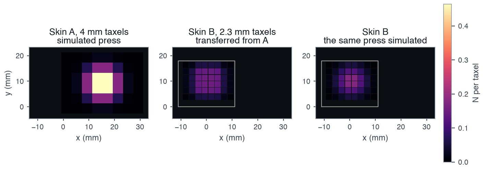

# Transfer between sensor layouts { #transfer }

OpenTac-Transfer (`opentac.transfer`) maps a calibrated normal-force distribution from one sensor layout to another using their physical geometry. The sensors can differ in outline, taxel pitch and taxel count. This supports reuse of recorded or simulated contact data across layouts, subject to assumptions about spatial resolution, calibration and contact placement.

```python
from opentac import manifest
from opentac.transfer import transfer

a = manifest.load("skin_a.json")
b = manifest.load("skin_b.json")
frame_b = transfer(frame_a, a, b)      # frame_a in newtons per taxel
```

`examples/transfer.py` simulates a press on a 4 mm skin, transfers it to a
2.5 mm skin, and compares it with the same press simulated on that skin.

<figure class="ot-fig" markdown="span">
  [{ loading=lazy width="1412" height="497" }](assets/diagrams/transfer_example.jpg)
  <figcaption>Example from <code>examples/transfer.py</code>: a 10&nbsp;mm ball at 3&nbsp;N simulated on skin A (4&nbsp;mm pitch), its transfer onto skin B (2.5&nbsp;mm pitch), and the same press simulated on B. Each taxel shows the newtons on its own area, so B's smaller taxels read less each.</figcaption>
</figure>

## Input data and placement { #inputs }

- `frame`: a `Frame` from skin A in **newtons** per taxel (`units == "N"`).
  ADC-count frames are rejected because the resampling operation sums force
  contributions. Convert counts with the source sensor's calibration first.
  Unread taxels (NaN) are treated as zero.
- `a`, `b`: the two skins' manifests (a `Manifest`, a manifest.json path, a
  design .zip, or a dict). Each skin's taxels must sit on one square grid; the
  two grids can have different pitches.
- `center=True` (default): the contact's centre of pressure goes to the
  centroid of B's taxels, or to `target=(x, y)` in B's millimetres. The centre
  uses only taxels above 10 % of the frame's peak, so noise does not pull it.
- `center=False`: A's millimetres are used as B's, moved by `shift_mm`.
- `angle_deg`: turn the contact by this angle.
- `kernel`: `"box"` (default) or `"tent"` (smoother when B is finer than A).

## Output and force conservation { #output }

A `Frame` on B: newtons per taxel in B's `pixels` order, `units == "N"`, the
input's `t`. `imu` is left empty, because it described A's board.

The resampling conserves force when the contribution outside the target is
accounted for: force assigned to B plus force outside B equals the force on A. To see the lost part, or to apply one placement to many frames, use
`Transfer` directly:

```python
from opentac.transfer import Transfer

tr = Transfer.centered(a, b, frame_a.taxels)   # or Transfer(a, b, angle_deg=..., shift_mm=...)
fb = tr.force(frames_a)                        # (n_frames, n_A) -> (n_frames, n_B), N
tr.lost(frame_a.taxels)                        # N that landed outside B's taxels
```

## Resample in physical coordinates { #how-it-works }

The transfer model assigns each taxel a square cell, centred on the taxel and one pitch wide. It treats the measured force as uniformly distributed over that cell. This piecewise-constant pressure approximation provides the basis for resampling in physical coordinates:

1. **Place A on B.** Rotate A's taxel positions by `angle_deg`, then shift
   them, so the contact sits where you want it on B.
2. **Resample by area.** Cut each A cell into small sub-cells, each carrying an
   equal share of that taxel's force. Each share goes to the B cell it lands
   in. This is one fixed matrix per placement: `F_B = M @ F_A`.
3. **Drop what B cannot see.** Shares that land outside B's taxels (past the
   outline, or in a gap) are dropped and counted in `lost()`.

<figure class="ot-fig" markdown="span">
  [{ loading=lazy width="1490" height="688" }](assets/diagrams/transfer_steps.png)
  <figcaption>The three steps for the two skins of <code>examples/transfer.py</code>, with A turned 20&deg;. The share points are the ones <code>Transfer</code> bins; of the cell over B's edge, 47% lands on B.</figcaption>
</figure>

## Evaluation and limitations { #what-transfers-and-what-does-not }

The paper evaluates transfer using hand-applied contacts on four skins with 409, 502, 96 and 174 taxels, at 2.0 and 4.0 mm pitch. Five objects were evaluated at forces from 1 to 8 N. Every method was given the target contact pose. Shape F1 compares thresholded contact regions, using approximately one quarter of each frame's peak; it evaluates contact shape and location rather than force-magnitude accuracy.

| predicting skin B's frame from | median shape F1 | frames |
|---|---|---|
| another press on skin B itself (repeatability limit) | 0.80 | 1857 |
| skin A, with `opentac.transfer` | 0.75 | 5290 |
| the same, scored only where A covers B | 0.79 | 5286 |
| skin A's counts, area-averaged onto B (no calibration) | 0.71 | 5291 |
| skin A's counts, stretched by row and column (no manifest) | 0.63 | 5077 |

**Contact shape and spatial extent.** In a separate demo, three objects
were pressed freehand on skins of 4.2, 3.1 and 2.0 mm pitch. An allen key read
10.3, 9.7 and 9.5 mm wide on the three.

<figure class="ot-clip" style="max-width: 34rem; margin: 1.2em auto 1.6em">
<div class="ot-media">
  <video data-loop muted loop playsinline preload="none" data-poster="../assets/loops/transfer.jpg"
         aria-label="One block pressed into three skins of different shape and pitch, mapped onto one millimetre grid">
    <source src="../assets/loops/transfer.mp4" type="video/mp4">
  </video>
</div>
<figcaption>A block pressed onto three skins of different shape and pitch. The manifests place all three recordings on a common physical coordinate grid in millimetres.</figcaption>
</figure>

The mapping has several limitations:

- **Detail finer than A's taxels.** Resampling a 4 mm grid onto a 2 mm grid cannot recover
  structure below the source resolution. The `"tent"` kernel smooths the result.
- **Contact area at coarse resolution.** A partly covered taxel
  reports its whole area. In the demo, the 4.2 mm skin read 28–54 % more
  contact area than the 2.0 mm skin for the same object (tape roll: 1504
  against 976 mm²). Transfer cannot recover the unresolved contact boundary within
  a coarse source cell.
- **Uncalibrated signal magnitude.** The same objects peaked at about 200 counts per mm² on the 4.2 mm
  skin and 620–780 on the 2.0 mm skin. Counts depend on the design and the
  velostat, which is why transfer works in newtons.
- **Saturation.** A taxel that hit the ADC maximum on A is a lower bound, and
  stays one on B.
- **Contact placement.** The mapping does not infer the object's target pose. It centres
  the contact unless you give a target, shift or angle.
