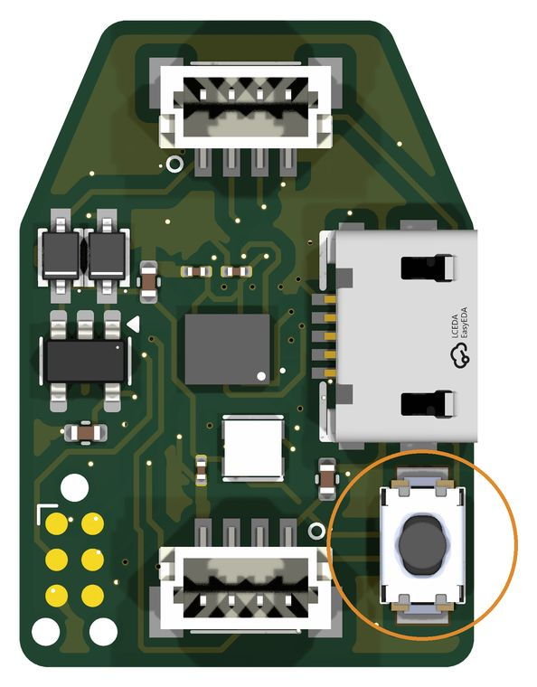
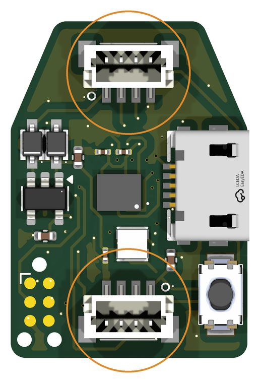

# Daisy-chain readout boards { #daisy-chain }

Multiple 30-pin readout boards can share one USB connection through a Teensy 4.0 controller. The boards communicate with the controller over I²C, while the host uses the same sensor-configuration and readout interfaces as for a board connected directly over USB.

<figure class="ot-fig" markdown="span">
  [{ loading=lazy }](../assets/diagrams/daisy_chain.svg)
  <figcaption>Only the Teensy is on USB; the boards share four bus wires (5&nbsp;V, SDA, SCL, GND). Pin assignments and pull-up requirements are given in <a href="#3-wire">Connect the I²C bus</a>.</figcaption>
</figure>

The controller supports up to 18 nodes on a 1 MHz bus. In a test with three 30-pin boards, 7,213 bus transactions completed without errors. With two boards streaming, the measured rate was approximately 240 frames/s per board. These measurements describe the tested configurations, rather than the throughput of a fully populated chain.

## 1. Flash every board for the bus

Plug each board in by its own USB cable, one at a time, and flash the bus
version of the firmware:

```sh
uv run opentac flash --bin firmware/prebuilt/NODE16_bus.bin
```

<figure class="ot-fig ot-fig--clear ot-fig--aside" markdown="span">
  { loading=lazy width="594" height="760" }
  <figcaption>BOOT0 (S4) on the 30-pin top board. Render of its KiCad file.</figcaption>
</figure>

A new board has no firmware yet: hold its BOOT0 button while plugging it in,
then run the same command. The bus firmware still answers `B` on USB, so the
same command reflashes it later.

In the Arduino IDE, add a file named `build_opt.h` next to
`opentac_readout.ino` containing this one line, then upload as in
[Flash the firmware](flash.md):

```
-DOT_BUS_NODE -DOT_BOARD_NODE16 -DI2C_TXRX_BUFFER_SIZE=160
```

The flags must reach every file the build compiles, not only the sketch, or
the I²C driver keeps a 32-byte buffer and cuts every frame short. `build_opt.h`
does that in the IDE; `firmware/build.sh` passes them as `build.extra_flags`.
Delete `build_opt.h` again before building a normal USB firmware.

## 2. Flash the Teensy

Load `firmware/prebuilt/bus_controller.hex` with the Teensy Loader. Or, in the
Arduino IDE with Teensyduino: copy `firmware/libraries/OpenTactileBus` into
your Arduino `libraries` folder, open `firmware/bus_controller/bus_controller.ino`,
choose Board **Teensy 4.0** and USB Type **Serial**, and click Upload.

## 3. Connect the I²C bus { #3-wire }

Each board has two 4-pin JST-SH bus connectors, wired the same way, so the
cable goes in on one and out on the other:

<figure class="ot-fig ot-fig--clear ot-fig--aside" markdown="span">
  { loading=lazy width="516" height="760" }
  <figcaption>The two bus connectors (CN1, CN2) on the 30-pin top board. Render of its KiCad file.</figcaption>
</figure>

| Pin | Signal | Teensy 4.0 |
|---|---|---|
| 1 | 5 V | VIN (USB power) |
| 2 | SDA | pin 18 |
| 3 | SCL | pin 19 |
| 4 | GND | GND |

- Fit one pair of pull-up resistors, SDA and SCL to 3.3 V, at the Teensy end
  only. The boards have none on the bus.
- The Teensy is 3.3 V and not 5 V tolerant: keep SDA and SCL at 3.3 V.
- A board takes 5 V from either its own USB or pin 1 (each through a diode),
  so you can unplug the boards' own USB cables once they are flashed.

## 4. Set up each sensor

```sh
uv run opentac info                                  # lists the boards (nodes) on the bus
uv run opentac setup palm.zip --node pick            # choose the board by its LED
uv run opentac setup thumb.zip --node 1              # or by node number
```

With `--node pick`, one board's LED lights red. Press Space until the red LED
is on the board that sensor is plugged into, then Enter. Each board remembers
its sensor; a board that restarts keeps its node number.

## 5. View and read multiple sensors { #5-view-and-read }

```sh
uv run opentac view                 # every board at once, one panel each
uv run opentac view --node 1        # one board
```

Each board's LED takes the colour of its panel's title.

```python
from opentac.device import Bus

with Bus() as bus:
    for s in bus:                         # one Sensor per board
        print(s.node, s.manifest.name)
    for node, frame in bus.frames():      # every board's frames, as they arrive
        print(node, frame.t_us, frame.taxels.max())
```

`frame.t_us` uses the Teensy's clock in microseconds, placing frames from all nodes on a common time base. This supports temporal alignment across sensors; it does not imply that their taxels are sampled simultaneously. Use `Sensor(node=2)` to access one board on the bus.

## Bus limitations { #known-limitation }

Only run the OpenTac bus controller firmware against these boards. A
controller that reads more bytes than a board sends makes the board hold SCL
low, and the bus remains blocked until the boards are power-cycled.

The bus firmware is for the 30-pin board only. A 60-pin board needs more
memory for its frame buffers than its firmware has left.
