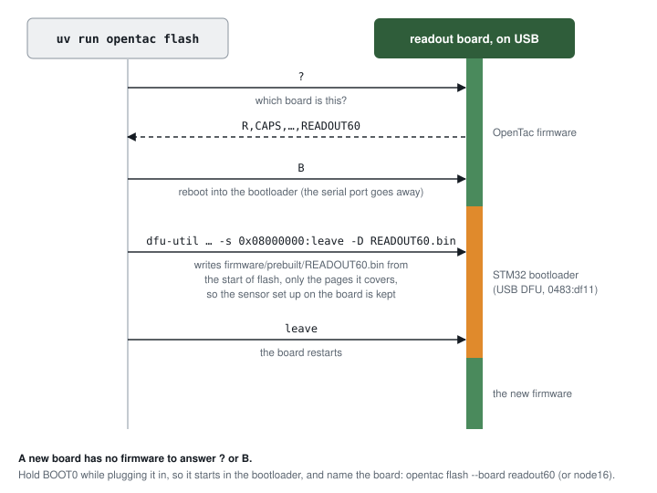
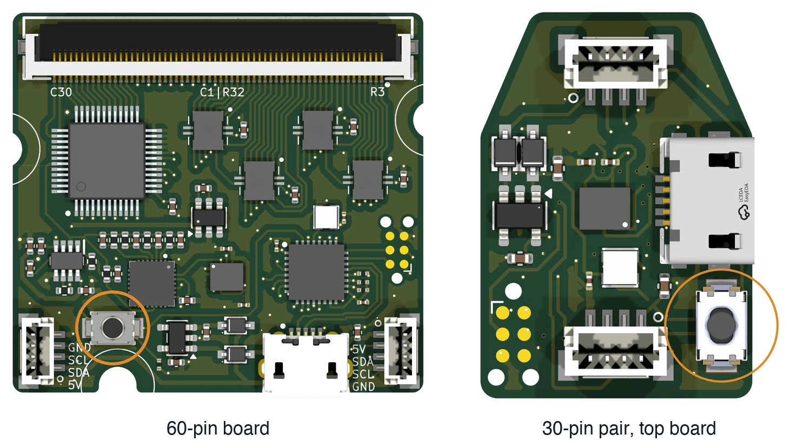

# Flash the firmware

Each readout-board design requires its corresponding firmware build. The table below identifies the prebuilt binaries supplied in the code repository.

| Board | Firmware | File |
|---|---|---|
| 60-pin board | `READOUT60` | `firmware/prebuilt/READOUT60.bin` |
| 30-pin pair | `NODE16` | `firmware/prebuilt/NODE16.bin` |
| 30-pin pair in a daisy chain | `NODE16` bus node | `firmware/prebuilt/NODE16_bus.bin` ([daisy chain](daisy-chain.md)) |

Firmware is written through the board's USB connection. A board already running OpenTac firmware can enter the STM32 device-firmware-upgrade (DFU) bootloader in response to the `B` command. A new or unresponsive board must enter the bootloader using BOOT0. Reflashing preserves the stored sensor configuration.

Use `opentac flash` to install a prebuilt binary. The Arduino IDE and `arduino-cli` workflows below are useful when compiling or modifying the firmware.

## 1. Prebuilt firmware with `opentac flash`

Install one flashing tool:

- **dfu-util**: `brew install dfu-util` (macOS) or `sudo apt install dfu-util` (Linux).
  On Linux, also do the one-time setup in [On Linux](#on-linux).
- or **STM32CubeProgrammer**, from st.com. Use this on Windows.

Plug the board in by USB, then:

```sh
uv run opentac flash
```

The command identifies the connected board, restarts it in bootloader mode, and writes the corresponding binary from `firmware/prebuilt/`:

<figure class="ot-fig" markdown="span" style="max-width: 36rem">
  [{ loading=lazy }](../assets/diagrams/flash_sequence.svg)
  <figcaption>Firmware-update sequence for the 60-pin board. The 30-pin pair follows the same sequence using <code>NODE16.bin</code>. With STM32CubeProgrammer instead of dfu-util, only the writing step differs.</figcaption>
</figure>

To see what it would do without changing anything:

```sh
uv run opentac flash --dry-run
```

**A new board** has no firmware, so it cannot restart itself into the
bootloader, and `opentac flash` reports that no board answered and none is
in the bootloader. Unplug it, hold the BOOT0 button while plugging it back in,
release it, and name the board:

<figure class="ot-fig" markdown="span">
  { loading=lazy width="1461" height="830" }
  <figcaption>The BOOT0 button (S4), circled. Renders of the boards' KiCad files, not to scale with each other.</figcaption>
</figure>

```sh
uv run opentac flash --board readout60     # the 60-pin board
uv run opentac flash --board node16        # the 30-pin pair
```

Do the same if the board's firmware does not answer, or if the board never
appears in the bootloader. A board in the bootloader cannot say which board it
is, so `--board` is needed there. `--board` also takes `60pin` and `30pin`. With `--board`,
`--dry-run` prints the command it would run even with no board attached.

dfu-util may print `Error during download get_status` after
`Submitting leave request`. This is harmless: the firmware is written and the
board has restarted.

The prebuilt files are also packed into the Python wheel, so `opentac flash`
works when OpenTac is installed with pip instead of run from this repository.

### On Linux

Serial-port access and USB bootloader access require separate permissions. Configure each once for the account that will run OpenTac.

The board's serial port (`/dev/ttyACM0`) belongs to the `dialout` group. If
`opentac` says it found the port but cannot open it (permission denied), add
yourself to the group, then log out and back in:

```sh
sudo usermod -aG dialout $USER
```

The bootloader (USB id `0483:df11`) needs a udev rule. If `opentac flash`
says a board is in the bootloader but this user may not open it, add the rule,
then unplug and replug the board:

```sh
echo 'SUBSYSTEMS=="usb", ATTRS{idVendor}=="0483", ATTRS{idProduct}=="df11", MODE="0666"' | sudo tee /etc/udev/rules.d/50-opentac-dfu.rules
sudo udevadm control --reload-rules && sudo udevadm trigger
```

## 2. Arduino IDE

Install the required tools and pinned dependencies:

1. Arduino IDE 2.
2. In *Settings*, add this to *Additional boards manager URLs*:
   `https://github.com/stm32duino/BoardManagerFiles/raw/main/package_stmicroelectronics_index.json`
3. *Boards Manager*: install **STM32 MCU based boards**, version **2.7.1**.
4. *Library Manager*: install **STM32duino LSM6DSV16BX** (1.0.0) and
   **Adafruit NeoPixel** (1.15.5).
5. **STM32CubeProgrammer** from st.com. The IDE uploads with it.

Configure and upload the firmware:

1. Open `firmware/opentac_readout/opentac_readout.ino`.
2. At the top of the file, delete the `//` in front of your board's line, for
   example `#define OT_BOARD_READOUT60`.
3. In the *Tools* menu set:
    - Board: **Generic STM32G4 series**
    - Board part number: **Generic G431KBUx**
    - U(S)ART support: **Enabled (generic 'Serial')**
    - USB support: **CDC (generic 'Serial' supersede U(S)ART)**
    - USB speed: **Low/Full Speed**
    - Upload method: **STM32CubeProgrammer (DFU)**
4. Open the *Serial Monitor*, set the line ending to **Newline**, type `B` and
   send it. The board's port disappears; that is expected.
5. Click *Upload*.

## 3. arduino-cli

Install the pinned STM32 core using arduino-cli 1.x:

```sh
arduino-cli config add board_manager.additional_urls https://github.com/stm32duino/BoardManagerFiles/raw/main/package_stmicroelectronics_index.json
arduino-cli core update-index
arduino-cli core install STMicroelectronics:stm32@2.7.1
```

Build every board's firmware into `firmware/build/`:

```sh
firmware/build.sh              # every target
firmware/build.sh readout60    # one: readout60, node16, node16_bus, bus_controller
```

`build.sh` installs the two Arduino libraries into `firmware/build/arduino/`
on its first run, so it does not touch your own sketchbook. Its output is
byte-for-byte the same as the files in `firmware/prebuilt/`
(`firmware/prebuilt/SHA256SUMS`).

To compile one board yourself, install the libraries once, then choose the
board with a compiler flag passed as `build.extra_flags`:

```sh
arduino-cli lib install "STM32duino LSM6DSV16BX@1.0.0" "Adafruit NeoPixel@1.15.5"
arduino-cli compile \
  --fqbn 'STMicroelectronics:stm32:GenG4:pnum=GENERIC_G431KBUX,usb=CDCgen,xusb=FS,xserial=generic' \
  --build-property 'build.extra_flags=-DOT_BOARD_READOUT60' \
  --output-dir firmware/build/manual firmware/opentac_readout
```

That writes `firmware/build/manual/opentac_readout.ino.bin`. Then flash a
binary, for example the one `build.sh` made:

```sh
uv run opentac flash --bin firmware/build/READOUT60.bin
```

or by hand, after sending `B` to the board:

```sh
dfu-util -a 0 -d 0483:df11 -s 0x08000000:leave -D firmware/build/READOUT60.bin
```

## Configure the sensor { #next }

After flashing, upload the sensor manifest and verify the live response using [Read a sensor](sensor.md).
