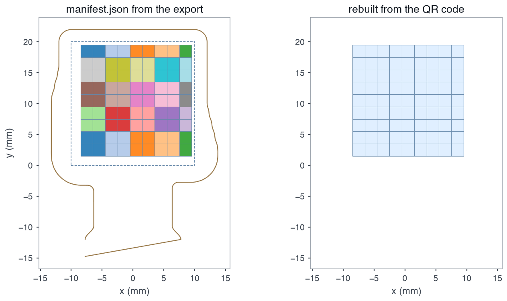

# Recover a manifest from the QR code

OpenTac-CAD includes a QR code on the back silkscreen when the board has sufficient space. It encodes the taxel grid, connector-pad assignments, active taxels, positions and footprint. This provides enough information to reconstruct a manifest for readout if the original design files are unavailable, subject to the omissions described below.

## Decode with a phone { #with-a-phone }

Scan the code with a phone camera and open its `opentac.github.io/q/...` link. The [QR decoder page](../qr.md) reconstructs the sensor in the browser and provides a **Download manifest.json** button. It also displays the taxel layout, electrode geometry, scan indices and connector-pad assignments, followed by the encoded fields and their bit allocations. Decoding is performed locally in the browser.

<figure class="ot-fig ot-fig--clear" markdown>
<div class="ot-shots" markdown>
<figure markdown="span">
  { loading=lazy width="601" height="900" }
  <figcaption>QR code on the back silkscreen.</figcaption>
</figure>
<figure markdown="span">
  { loading=lazy width="592" height="721" }
  <figcaption>Taxel geometry and wiring reconstructed from the code.</figcaption>
</figure>
</div>
<figcaption>The 9&nbsp;&times;&nbsp;9 patch example design: its back silkscreen as KiCad renders it from the export, and the decoder page on the link that code holds. The lower four rows are numbered 8, 7, 6, 5 from the top: scan order, not geometric order.</figcaption>
</figure>

Upload the recovered manifest to configure the readout board:

```sh
uv run opentac setup manifest.json
```

To see what a code holds without a sensor, open the code of the
[9 x 9 patch](../qr.md#YJ77YN9I2O-QN0AOBT.:VW3NG90){ data-design="strip-09x09" }
example design in the decoder. The decoder page links a few more.

## Decode from the command line { #with-the-command-line }

Any QR scanner app gives the code's text. Rebuild the manifest from it:

```sh
uv run opentac manifest from-qr 'PASTE-THE-TEXT-HERE' -o my_sensor.json
uv run opentac setup my_sensor.json
```

The text can be the whole link (`HTTPS://OPENTAC.GITHUB.IO/Q/...`, in any case,
with or without `https://`) or, on a small board, the bare code. Use single
quotes: the text can contain `$`, which a shell expands inside double quotes,
and `*`, which it expands when unquoted. A bare code that starts with `-` reads
as an option; put `HTTPS://OPENTAC.GITHUB.IO/Q/` in front of it.

In Python:

```python
from opentac import manifest

m = manifest.from_qr(text)      # the link or the bare code
m.save("my_sensor.json")
```

The decoder page and the command line write the same file, byte for byte.

## Codes on small boards { #small-boards }

The link adds 28 characters to the code, which makes the QR one version
larger (two on 1 of the 31 example designs), 1.4 mm more on each side per
version. A board without room for the link inside its outline gets the bare
code instead (27 characters for the 81-taxel example sensor, 36 to 39 for
sensors of about 100 taxels); a phone shows it as text rather than a link.
Paste that text into the [QR decoder page](../qr.md) or pass it to
`opentac manifest from-qr`. A board without room for either gets no code. All
31 [example designs](../design/examples.md) have room for the link.

<figure class="ot-fig" markdown="span" style="max-width: 22rem">
  { loading=lazy width="1090" height="595" }
  <figcaption>The 9&nbsp;&times;&nbsp;9 patch's code both ways, at one scale, quiet zone included, as the export builds them (unmirrored here).</figcaption>
</figure>

## Recovered fields and limitations { #what-comes-back-and-what-does-not }

A recovered manifest has the same rows, columns, pads and taxel mask as the
original. The QR stores the grid origin and pitch to 0.01 mm, so every taxel is
within 0.005 mm of its original position when the pitch is a whole number of
0.01 mm. A pitch with a third decimal moves the far taxels further: up to
0.12 mm on the example designs whose pitch was raised to fit the readout board.
This representation supports taxel readout and display, but omits the fields listed below.

<figure class="ot-fig" markdown="span" style="max-width: 34rem">
  [{ loading=lazy width="1263" height="750" }](../assets/diagrams/qr_recovered.png)
  <figcaption>The 9&nbsp;&times;&nbsp;9 patch's manifest, and the one <code>opentac manifest from-qr</code> rebuilds from its code: the same rows, columns and positions (here 0.000&nbsp;mm apart, at a 2&nbsp;mm pitch), without the outline, the board edge or the bump groups.</figcaption>
</figure>

The QR payload omits:

- `outline` and `edge_cuts`, the sensor's drawn shape and cut edge,
- `design`, the recipe OpenTac-CAD needs to rebuild or edit the board,
- `shear`, which taxels share a shear bump, so there are no shear arrows.

Scanner apps sometimes trim or lowercase the text; both still decode. The
text carries a checksum, so a truncated or mistyped text is almost always
refused rather than decoded into the wrong pads: 8,997 of 9,000 random
one-character changes were refused in a test. Scan the code rather than type
it.

The recovered file is not byte-for-byte the original, so the board stores it
under a different ID. If you find the original manifest later, run
`opentac setup` with it again.
