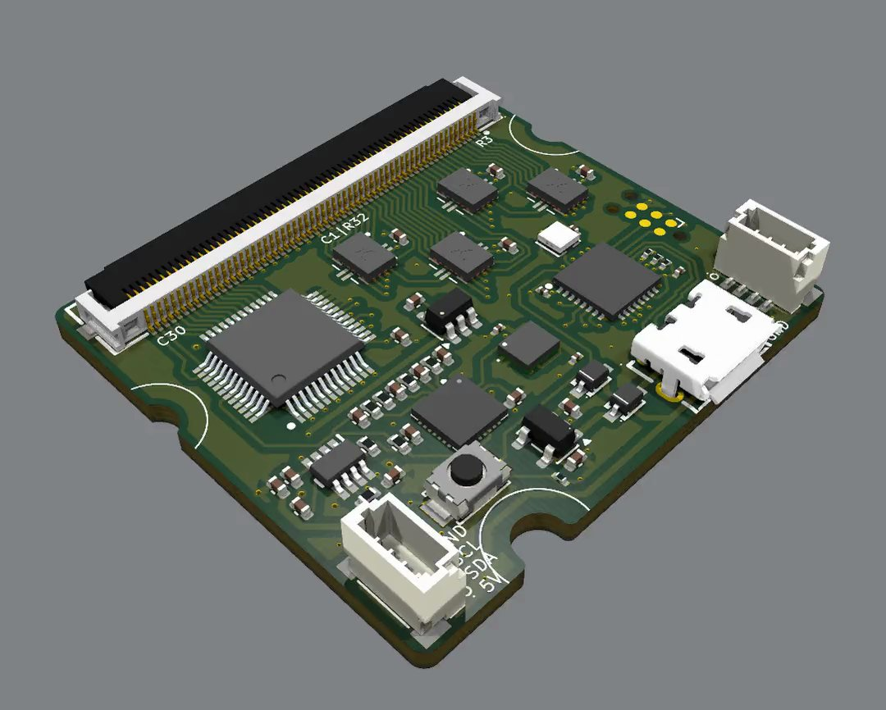
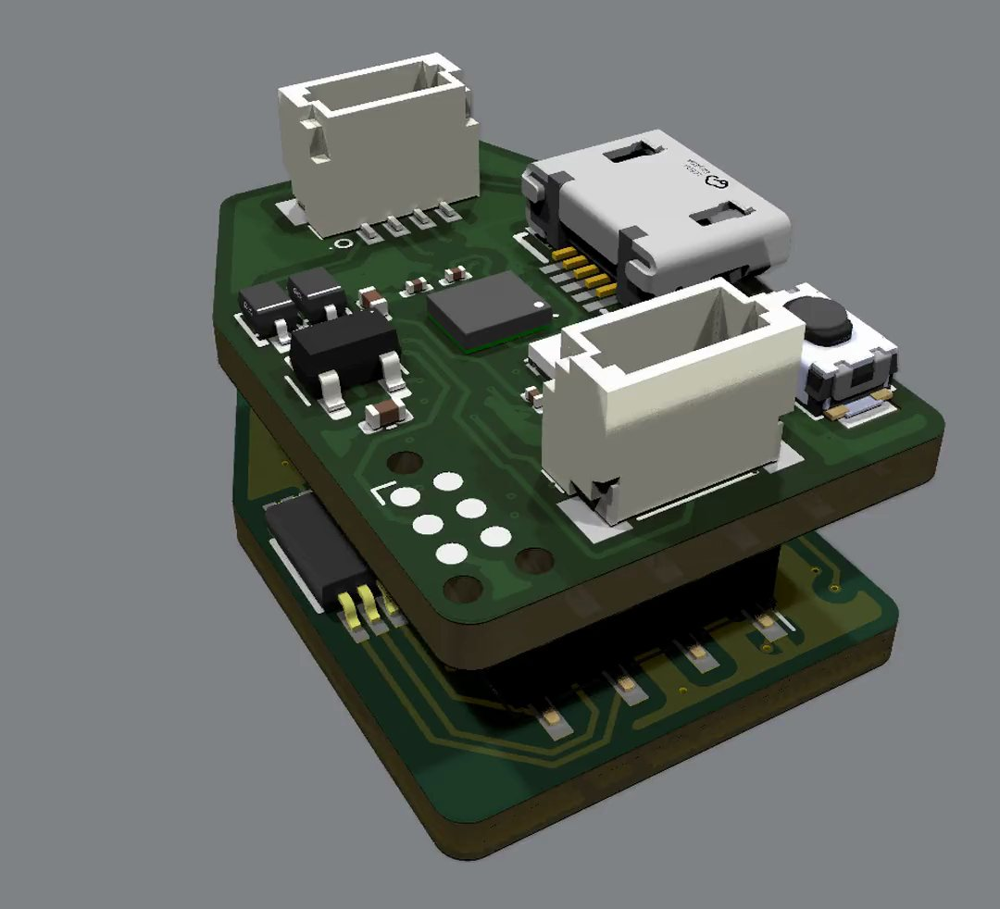
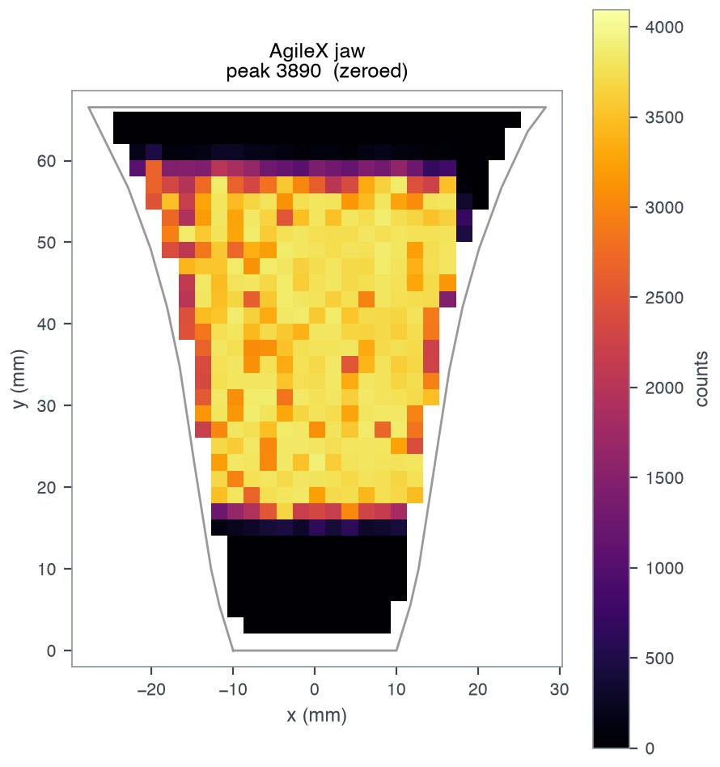
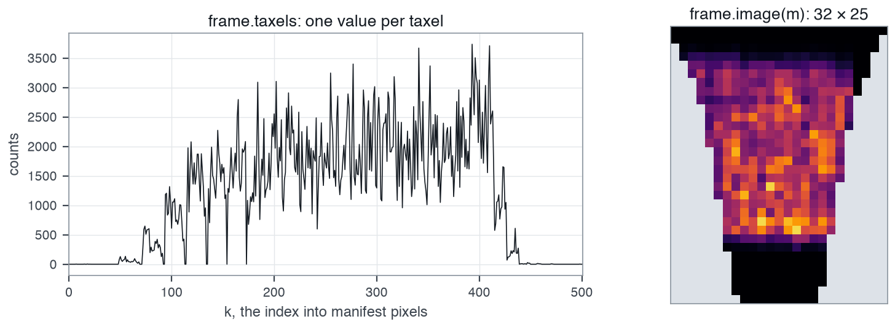
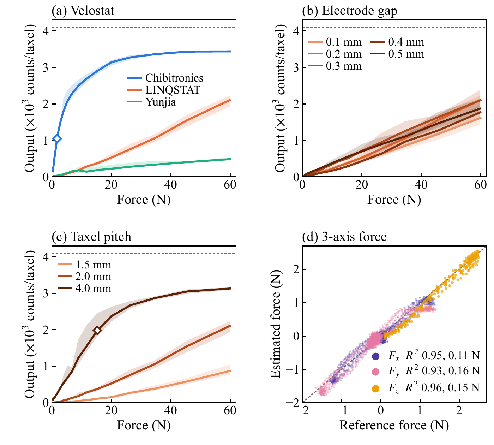

# Read a sensor

Readout requires a board running the OpenTac firmware ([Flash the firmware](flash.md)), a connected sensor, and the corresponding `manifest.json` from the OpenTac-CAD export. The manifest associates each measured value with its taxel position and connector wiring.

On Linux, your user must be in the `dialout` group to open the board's port
(`sudo usermod -aG dialout $USER`, then log out and back in; see
[On Linux](flash.md#on-linux)).

## Verify board compatibility { #which-board }

OpenTac-CAD's *readout board* setting picks the board a sensor is made for. A
sensor for the 30-pin board ends in a 30-position connector (up to 15 rows and
15 columns); a sensor for the 60-pin board ends in a 60-position one (up to 30
by 30). To check a design:

```sh
uv run opentac manifest check my_design.zip
```

<figure class="ot-fig ot-fig--clear" markdown>
<div class="ot-shots" markdown>
<figure markdown="span">
  { loading=lazy width="1080" height="866" }
  <figcaption>60-pin board: up to 30 rows and 30 columns.</figcaption>
</figure>
<figure markdown="span">
  { loading=lazy width="1080" height="982" }
  <figcaption>30-pin pair: up to 15 rows and 15 columns.</figcaption>
</figure>
</div>
<figcaption>The two readout boards (<a href="../../hardware/">Readout boards</a>).</figcaption>
</figure>

## Upload the sensor manifest { #set-up-once-per-sensor }

```sh
uv run opentac setup my_design.zip
```

`opentac setup` uploads the configuration needed to scan the sensor. The board stores this compact representation in flash with a CRC check; the computer retains the full manifest in `~/.opentac/manifests/`. The configuration survives power cycles and reflashing, so subsequent readout commands do not require the manifest path.

The board does not automatically identify the physical sensor connected to it. Run `opentac setup` whenever that sensor changes. A mismatched manifest can produce plausible values assigned to the wrong taxels.

Inspect the board and its stored sensor configuration:

```sh
uv run opentac info
```

## Live view

```sh
uv run opentac view
uv run opentac view --shear      # shear arrows, for a sensor with a bump sheet
```

Each taxel is drawn where it sits on the sensor. Click the window, then:

<figure class="ot-fig ot-fig--aside" markdown="span">
  { loading=lazy width="890" height="948" }
  <figcaption>One recorded frame as the viewer draws it: a square block pressed on a 502-taxel AgileX jaw skin, zeroed with <code>b</code>.</figcaption>
</figure>

| Key | Action |
|---|---|
| `b` | zero: subtract the current reading. Press it with nothing touching. |
| `c` | clear the zero |
| `a` | autoscale on/off |
| `s` | shear arrows on/off |
| `Enter` | start/stop a take (with `--save DIR`) |
| `q` | quit |

Only one program can use the board's port at a time. Close the viewer before
running another `opentac` command.

## Read frames in Python { #in-python }

```python
from opentac.device import Sensor

with Sensor() as s:              # finds the board on USB
    frame = s.read()             # the next frame
    print(frame.taxels)          # one value per taxel, in manifest `pixels` order
    print(s.manifest.xy)         # where each taxel is, in mm
    for frame in s.frames(limit=100):   # every frame, as fast as the board sends
        ...
```

`frame.taxels` contains 12-bit ADC readings, from 0 to 4095, in manifest `pixels` order. Readings increase with applied pressure until the response saturates.

<figure class="ot-fig" markdown="span">
  [{ loading=lazy width="1456" height="533" }](../assets/diagrams/frame_image.png)
  <figcaption>One recorded frame of the AgileX jaw skin two ways: <code>frame.taxels</code> in <code>pixels</code> order, and <code>frame.image(s.manifest)</code>, with grid cells that hold no taxel left empty (grey).</figcaption>
</figure>
`frame.t` is the computer's clock in seconds, `frame.imu` holds the IMU
readings when the IMU is on, and `frame.image(s.manifest)` lays the values out
as a 2-D array. `s.setup("my_design.zip")` does what `opentac setup` does.
`examples/read_sensor.py` is a complete script.

`Sensor()` starts each session with a full raster scan, `MUX_SETTLE_US` set to 8 and the IMU disabled. Enable inertial measurements with `Sensor(imu=True)` or `--imu`. In a test on one board, IMU reads disturbed the immediately following taxel measurements; check for this interaction when enabling both streams.

## Board settings

Settings last until the board restarts. List them with `opentac info`; change
them per session:

```sh
uv run opentac view --set MUX_SETTLE_US=10
```

```python
s["MUX_SETTLE_US"] = 10
```

## Gain (60-pin board)

The 60-pin board has a gain switch. Four switches each put a resistor across
the amplifier's 10 kΩ feedback resistor. The board starts with all switches
open: 10 kΩ, the highest gain. If a firm press saturates (taxels stuck near
4095), lower the gain:

| `GAIN_SW` | Feedback |
|---|---|
| 0 | 10 kΩ (default) |
| 1 | 3.2 kΩ |
| 2 | 990 Ω |
| 4 | 263 Ω |
| 8 | 68 Ω |

`GAIN_SW` is a bit mask: for example, 3 closes switches 1 and 2. In Python, `s.set_feedback(1000)` picks
the nearest setting and returns the feedback in ohms.

```sh
uv run opentac view --set GAIN_SW=2
```

## Record tactile data { #record }

```sh
uv run opentac record takes/ --seconds 10 --description "tape roll, edge-on"
uv run opentac view --save takes/           # Enter starts and stops a take
```

Each take is a folder holding `tactile.npz` (the counts, timestamps, IMU and
taxel positions), `manifest.json` and `take.json` (settings and notes).
`examples/record_take.py` records and reads one back:

<figure class="ot-fig" markdown="span">
  [{ loading=lazy width="1326" height="670" }](../assets/diagrams/record_take.jpg)
  <figcaption>Recorded response to a press: a square block pressed by hand on the 502-taxel AgileX jaw skin, about 121 frames/s. Counts above the zero, summed over the skin (top) and taxel by taxel at four moments (bottom).</figcaption>
</figure>

```python
from opentac.record import load_take
take = load_take("takes/20261015_120000_tape_roll_edge_on")
take["raw"]          # frames x taxels, int16; -1 where a taxel was not read
take["t_host"]       # seconds
```

## Convert readings to force { #newtons }

`opentac.calibrate` converts ADC counts to force using a supplied calibration file. The calibration is specific to the taxel geometry, piezoresistive material, mechanical stack and readout settings under which it was measured. Changing these conditions can invalidate the mapping to newtons.

<figure class="ot-fig" markdown="span" style="max-width: 24rem">
  [{ loading=lazy }](../assets/figures/calibration.png)
  <figcaption>Dependence of the force-to-counts response on sensor design. In the paper's load-cell tests at 1&nbsp;k&Omega; feedback resistance, the response varies with the film (a), electrode gap (b) and taxel pitch (c). See <a href="../../results/#material-and-spatial-response">Results</a>.</figcaption>
</figure>

```python
from opentac.calibrate import Calibration

force = Calibration("force_calibration.json").skin(s.manifest, velostat="v2")
newtons = force.taxels(frame, zero)     # N per taxel; zero = counts with nothing touching
total = force.total(frame, zero)
```
