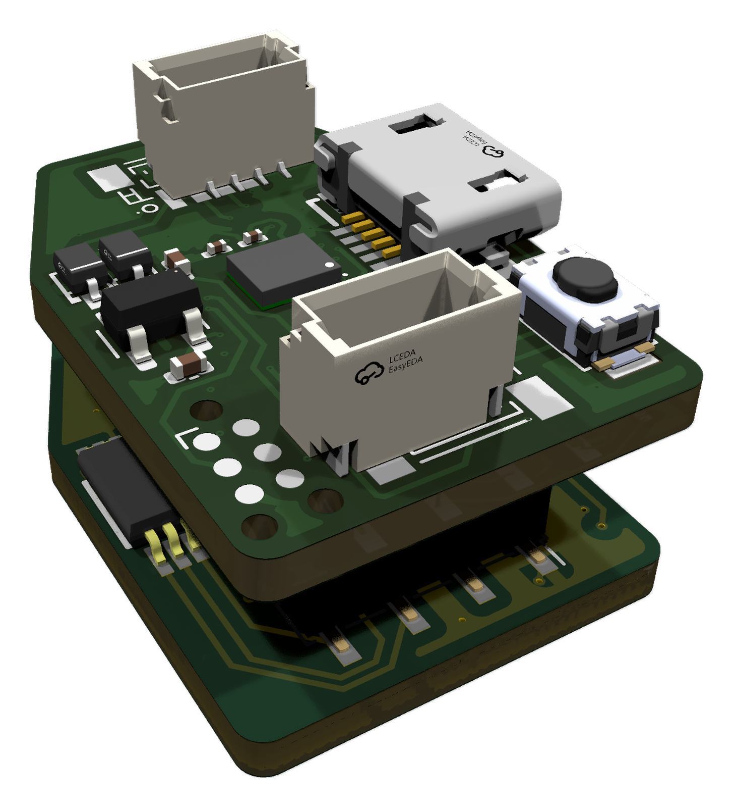

# 30-pin readout board pair

Reads one OpenTac sensor of up to **15 rows x 15 columns**. It is two small boards
stacked on 1.27 mm 7-pin header/socket pairs: the top board has the microcontroller,
the bottom board has the analog front end and the sensor connector.

| | Top board (`top/`) | Bottom board (`bottom/`) |
|---|---|---|
| Size | 16.0 x 22.8 mm, 4 layers | 16.0 x 22.7 mm, 2 layers |
| Main parts | STM32G431KBU6, LSM6DSV16BX IMU, micro-USB, two 4-pin JST SH I2C ports, RGB LED | ADG706 16-channel mux, two 74HC595, TLV9362 op-amp, LM2776 charge pump |
| Stacking | J1, J3: 1.27 mm 7-pin headers, underside | J2, J3: 1.27 mm 7-pin sockets, top side |
| Sensor connector | | Molex 505110-3091, 30-pin 0.5 mm FPC (LCSC C588008), underside. Pads 1-15 are columns, 16-30 are rows. |

Firmware target: `NODE16`.

## Files

Each folder has the same layout:

- the KiCad 10 project (`readout_30pin_top.*` or `readout_30pin_bottom.*`).
  Footprints, symbols and 3D models it uses are in [`hardware/libs`](../libs).
- `production/`: the JLCPCB fabrication files exported from this design on 2026-10-15: Gerber zip,
  JLCPCB BOM (`*_bom.csv`), pick-and-place positions (`*_positions.csv`), and the
  optional designator list and `netlist.ipc`.
- `bom.csv`: the same BOM with a manufacturer part number (MPN) column, for ordering parts elsewhere.

## Ordering from JLCPCB

Order the two boards separately.

1. Upload the Gerber zip as the PCB: `top/production/stm-i2c.zip` (4 layers) and
   `bottom/production/sensor_30.zip` (2 layers).
2. To have the parts fitted, turn on PCB Assembly and upload that board's
   `*_bom.csv` (BOM) and `*_positions.csv` (CPL). **Both boards have parts on both
   sides**, so choose two-sided assembly.
3. Check that each part shows as in stock before you pay. JLCPCB's stock changes daily.

**Known BOM problem on the bottom board.** In `bottom/production/sensor_30_bom.csv`,
three lines give LCSC parts in a different size from their 0402 pads: C9, C10, C12,
C14, C15 (C28233 is 0805), C34, C35 (C53067 is 0201), and R5-R7 (C17513 is 0805).
Pick 0402 parts of the same value before ordering assembly.
