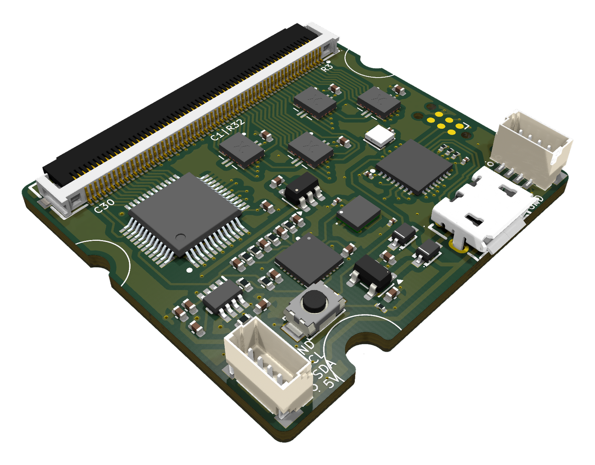

# 60-pin readout board

Reads one OpenTac sensor of up to **30 rows x 30 columns**. This is the
"I2C gain switch" version: the gain is set in firmware, with no jumpers.

| | |
|---|---|
| Size | 37.0 x 34.3 mm, 4 layers, 1.6 mm thick |
| Sensor connector | Molex 505110-6091, 60-pin 0.5 mm FPC (LCSC C493444). Pads 1-30 are rows, 31-60 are columns. |
| Microcontroller | STM32G431KBU6 |
| Gain | MAX14662 I2C switch (address 0x4C) puts 4.7k, 1.1k, 270 or 68 ohm in parallel with the 10k base resistor |
| Other | LSM6DSV16BX IMU (I2C 0x6A), micro-USB, two 4-pin JST SH I2C ports, RGB LED, Tag-Connect TC2030 for SWD |
| Firmware target | `READOUT60` |

## Files

- `readout_60pin.kicad_pro`, `.kicad_sch`, `.kicad_pcb`: the KiCad 10 project.
  Footprints, symbols and 3D models it uses are in [`../libs`](../libs).
- `production/`: the JLCPCB fabrication files for the version that was ordered (exported 2026-10-15).
  - `stm-i2c-60-switch.zip`: Gerbers and drill files
  - `stm-i2c-60-switch_bom.csv`: bill of materials, JLCPCB format (LCSC part numbers)
  - `stm-i2c-60-switch_positions.csv`: pick-and-place positions
  - `stm-i2c-60-switch_designators.csv`, `netlist.ipc`: optional extras (designator list, IPC-D-356 netlist for electrical test)
- `bom.csv`: the same BOM with a manufacturer part number (MPN) column, for ordering parts elsewhere.

The schematic also holds parts that are not on this PCB and not in the BOM:
U9 (digipot), JP1-JP4, R8, R9, C46-C49, C51, H1-H4 and TP9.

## Ordering from JLCPCB

1. Upload `production/stm-i2c-60-switch.zip` as the PCB. It is a 4-layer board.
2. To have the parts fitted, turn on PCB Assembly and upload
   `production/stm-i2c-60-switch_bom.csv` (BOM) and
   `production/stm-i2c-60-switch_positions.csv` (CPL). All parts are on the top side.
3. Check that each part shows as in stock before you pay. JLCPCB's stock changes daily.
